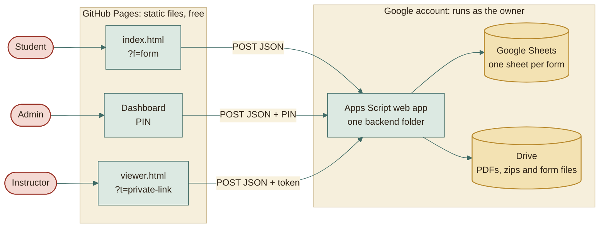

<div align="center">

# Forms Platform

**Team registration, task submission, time-slot booking and WhatsApp group sign-up for university courses, run from one dashboard, for free.**

[](https://github.com/moyeh04/forms-platform/actions/workflows/pages.yml)
[](https://hits.sh/github.com/moyeh04/forms-platform/)




</div>

## What it is for

A course with a few hundred students needs teams, project titles, task files and discussion
times. Done through chat groups and shared sheets, that means duplicate codes, half-filled
rows, files nobody can open, and an afternoon of copying. This platform replaces that with
one link per form.

| The problem | What the platform does |
|---|---|
| Teams are formed in chat and typed into a shared sheet by hand | Each form has its own link and its own Google Sheet. Student codes, names, team sizes, majors and sections are checked in the browser and again on the server, by the same rules file |
| A student needs to change something after sending | A 5-digit edit key, shown once and emailed, opens the registration to change or cancel it. It expires, and the admin can read, reset or extend it |
| Discussion times are agreed by message | A timetable of slots, one team per slot. A team can book with the key of its registration, so it only picks the time |
| Task files arrive as links of every kind | A task form takes one Drive link per team and locks at its deadline. **Download all** packs every file into zips with a `Teams.xlsx` list linked to each copy |
| Instructors ask for the list again and again | A private read-only link per instructor, with an optional access key, an end date and hidden columns, ready to print |
| Joining the course WhatsApp groups | A WhatsApp form matches pasted join requests to registrations by phone number |
| Servers cost money and need care | Nothing to rent: the pages are static on GitHub Pages and the backend runs inside the owner's Google account |

## Who uses it

| Person | Page | What they do |
|---|---|---|
| Student | `index.html?f=<form>` | Fills the form in English or Arabic (right to left), on a phone or a computer, and keeps a ticket with the edit key |
| Admin | The dashboard, behind a PIN | Creates and duplicates forms, sets the questions, lists and timetable, reads the responses, prints, exports, downloads all files |
| Instructor | `viewer.html?t=<link>` | Reads the teams or bookings of the forms shared with them, by day or all, and prints them |

## Tech stack

| Layer | Technology | Why |
|---|---|---|
| Pages | HTML, CSS and plain JavaScript, no framework and no build step | Small and fast on a phone; the files are served as they are written |
| Rules | `domain/rules/`, loaded by the browser, the backend and the tests | One copy of every check, so the page and the server can never disagree |
| Backend | Google Apps Script web app, bundled into one `Code.gs` by a Node script | Runs as the owner, free, with Sheets, Drive, Mail and a cache built in |
| Data | Google Sheets (a registry plus one spreadsheet per form) and Google Drive | The owner can open, sort and print the data without the platform |
| Excel | Office Open XML written by hand in `backend/platform/xlsx/` | Real `.xlsx` files with merged cells, tints and links, with no library |
| Hosting | GitHub Pages, deployed by GitHub Actions; the backend is pushed with `clasp` | A push to `master` tests and deploys both halves |
| Tests | `node:test`, jsdom and an in-memory copy of the Apps Script services; `actionlint` | The tests run the real backend and pages with no Google account |
| Look | IM Fell English, Amiri and Special Elite, a paper palette in light and dark | Readable in both languages, meeting WCAG 2.1 AA contrast |

## How it fits together



## Quick start

```
npm install          # once, installs the browser test library, Biome and the git hooks
npm run dev          # local preview on http://localhost:8080 (PIN 4321), in memory, no Google needed
npm run check        # Biome, line width, JSDoc, constants and structure checks
npm test             # rules, backend, form page, dashboard, instructor page, deployment
npm run build        # writes dist/Code.gs and dist/appsscript.json for clasp
npm run setup        # first deployment: creates the sheet, pushes the backend, creates the web app, configures GitHub
```

To put it online, follow [docs/operations/DEPLOY.md](docs/operations/DEPLOY.md). After that, a push to `master`
runs [`.github/workflows/pages.yml`](.github/workflows/pages.yml): the tests, then the Apps
Script deployment and the configured website.

## Project layout

| Path | Holds |
|---|---|
| `web/` | The website: the student form, the dashboard and the instructor page, with their scripts, styles and pictures |
| `domain/` | The validation rules and form metadata shared by the pages, the backend and the tests |
| `backend/` | The Apps Script modules, joined into `dist/Code.gs` by `npm run build` |
| `scripts/` | The bundler and the site build (`build/`), the local preview (`dev/`), the first-deployment setup (`deploy/`), and the checks (`checks/`) |
| `tests/` | The automated tests and the in-memory copy of Google's services |
| `docs/` | Architecture, data model, security, testing and deployment |

Every file is described in [docs/architecture/FILE-STRUCTURE.md](docs/architecture/FILE-STRUCTURE.md).

## Documentation

| Read | To learn |
|---|---|
| [REQUIREMENTS.md](docs/product/REQUIREMENTS.md) | Everything the platform was asked to do, and where each item stands |
| [docs/README.md](docs/README.md) | The index of the documentation and how to read its diagrams |
| [ARCHITECTURE.md](docs/architecture/ARCHITECTURE.md) | What runs where, how requests travel, every module |
| [WORKAROUNDS.md](docs/architecture/WORKAROUNDS.md) | The 24 solutions that make free hosting enough, and their trade-offs |
| [DEPLOY.md](docs/operations/DEPLOY.md) | Click-by-click setup and the first-run checklist |
| [COMMIT_CONVENTION.md](docs/process/COMMIT_CONVENTION.md) | How commits and branches are written |

Generated files (`dist/`, `_site/`, `node_modules/`) are not committed.
