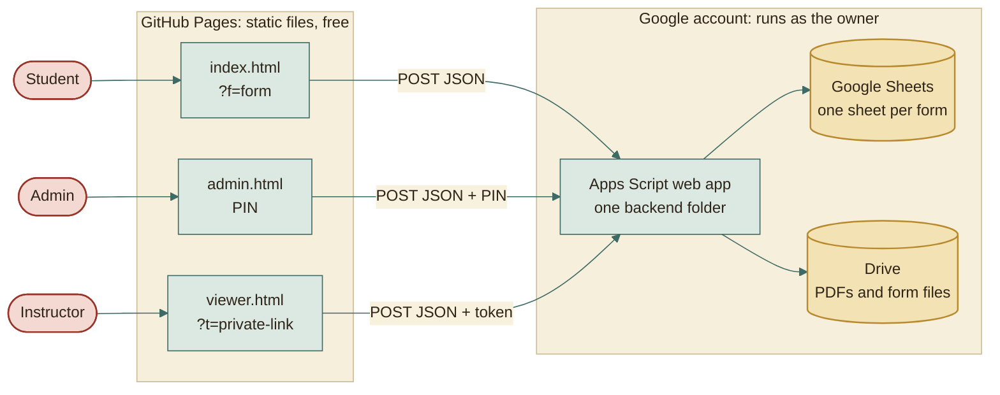

# Forms Platform

Many forms from one admin dashboard: team registration, task submission,
reservations, and WhatsApp group registration. Each form has its own link
and its own Google Sheet. No server to rent: the website is static
(GitHub Pages) and the backend is a Google Apps Script that stores
everything in Google Sheets.



**To put it online, follow [docs/DEPLOY.md](docs/DEPLOY.md).** One command,
`npm run setup`, creates the sheet, pushes the backend, creates the web app, and stores the three
GitHub repository Variables and the clasp credential Secret. The workflow
generates the published browser configuration.

## Requirements checklist

Status: **Done** means built and covered by automated tests. **Done, check live**
means built and tested against a faithful in-memory copy of Google, but the last
step needs the real Google services (see "What could not be tested here").

### Forms and admin
| Requirement | Status |
|---|---|
| Many forms from one admin dashboard, each with its own link (`?f=name`) and its own Google Sheet | Done |
| Four form types: team registration, task submission, reservation, WhatsApp registration | Done |
| Admin dashboard protected by a PIN (stored hashed, wrong guesses lock it for a while) | Done |
| Delete a form with one confirmation: its link stops working and its Google Sheet moves to the Drive trash (restorable for 30 days) | Done |
| Create, duplicate for a new term, open or close with dates, rename or hide questions, add a description under any question | Done |
| **Team members are mandatory: admin sets the minimum and maximum team size per form** | Done |
| **Students pick the total team size first; exactly that many member forms then appear** | Done |
| A note for chosen team sizes (for example "other students will be added to reach 5" on 3 and 4), written by the admin in English and Arabic | Done |
| Term picked from Fall, Spring, or Summer chips plus a year list, and a subject code (for example CMPn323) shown as a tag | Done |
| Title built from settings, e.g. "Database Team Project Registration Form" plus a term tag. No "Clean Code", no "Form Nº" | Done |
| A form can be limited to some specializations (for example Computers only): the Major question locks to them and the server refuses others | Done |
| A form can be limited to some sections, picked one by one or a whole year group (4C, 3L) at once, so one Sections list serves every year | Done |
| Editable lists behind dropdowns (levels, bylaws, majors, sections, groups): the lists at the side with their first choices, the picked list in the main part naming the forms that ask it, chips for plain values and rows for choices with English names, a save bar that says what changed and names a form limited to a removed choice, pasted lines and number runs to add many at once | Done |

### Student experience
| Requirement | Status |
|---|---|
| English by default with an Arabic switch (RTL), mobile first, light and dark themes | Done |
| Light paper palette meeting WCAG 2.1 AA contrast in both themes (checked by a test), **no logo on the page**, defined font sizes, bold labels, italic helper text | Done |
| A pirate ship over the current step of the route; it moves toward the X as the student goes on, and faces the other way in Arabic | Done |
| Branded tab icon: a form sheet whose red route ends in an X, the same trail students follow at the top of the form (SVG plus PNGs for phones) | Done |
| Arabic-only name fields: English letters and digits are removed while typing and on paste, with a hint saying why; at least four name parts; checked again on the server | Done |
| English-only project and task titles, Egyptian phone normalization, 7-digit codes | Done |
| Drive links must open and be shared with anyone who has the link | Done, check live |
| Project folders must be named `Team_Leader_Name_Project_Name_Subject_Name` (no spaces, underscores, ending with the subject name, for example `Software_Engineering`); students see the rule with an example built from their project title | Done, check live |
| Two-step review before sending | Done |
| Success ticket: reference, key with an arrow callout, expiry, "take a screenshot" note, Save as image, Save as PDF, Copy key | Done |
| Duplicate leader code says "use your key" | Done |

### Edit key
| Requirement | Status |
|---|---|
| 5 random digits, shown once and emailed, expiring after a per-form number of days (default 7) | Done |
| The key alone opens the registration; wrong guesses are throttled silently (10 per minute per form) | Done |
| Edit or cancel; cancelling frees the code and the slot | Done |
| A key opens a summary of the registration: Change opens one page, Done returns, and Save changes appears only after a change | Done |
| Remove one chosen team member (with Undo) or add one; the team size follows | Done |
| Admin can look up a student's key (Details, Show key) or reset a lost one | Done |

### Reservations
| Requirement | Status |
|---|---|
| Timetable: click dates on a month calendar to offer them, set the hours once (first slot, last slot, slot length, break), and read the result as one row of slots for each day; a click switches one slot off, a day can have its own hours or another name, a slot shows how many teams booked it, and a warning appears when a booking is left on a day or time that was removed; one team per slot (capacity adjustable) | Done |
| Teammates of a booking: asked or not, the fewest and the most (0 lets a leader book alone), the title and line students read, and which details are asked about each teammate | Done |
| Moving a student between teams (a switch per form): a leader who names a member of another team can ask for that member, the team registers without them, and the member moves when the leader of the other team approves with the edit key or the admin approves under Responses; emails to both leaders, a full team cannot receive, a leader cannot be asked for, and a team left under the minimum is reported | Done |
| One booking per leader code; taken slots crossed out for students | Done |
| Booking with a registration key: a reservation can take the 5-digit key of a team registration form, show the team to confirm, and ask only for the slot; the same key opens and cancels the booking | Done |
| Warning when a timetable change leaves existing bookings without a slot | Done |

### Sheets, dashboards, and printing
| Requirement | Status |
|---|---|
| Google Sheets: every team is a block with a heavy border and alternating tints, a star on the leader, one merged project or task cell | Done |
| Dashboard and instructor links show each team as a card: a teal or gold band, a header with the team number, project, and size, and the leader marked; readable in light and dark and stacked on phones | Done |
| Phone layout (up to 600px): member rows, bookings, WhatsApp registrations and private links stack as cards with each value under its column name; a phone number is a call link; toolbars use two equal columns and the day sheet controls stay in one labelled group | Done |
| Weekly bookings: bookings that use the keys of a registration form are listed inside its card in a list that folds to one line, and one button makes the next one as a copy of the last, one week later, as a draft | Done |
| New form page: choose what the form is for, name it, and see a live preview of the title, tags and pages students get, with what to set up next | Done |
| One form, four tabs (Responses, Questions, Timetable, Setup) with the status in the header; settings fold to one line that says what they are set to; the save bar appears only when something changed and leaving with unsaved changes asks first | Done |
| Questions listed under the page of the form that shows them, as rows that stack on a narrow screen | Done |
| Your own questions (short answer, long answer, one choice from a list) on any page; answers appear in Details and in the CSV | Done |
| Pages of the form: add a page with its title in both languages, rename, reorder, move any question to another page | Done |
| Bookings per slot (1 to 50) as its own control at the top of the timetable | Done |
| Print team list and print a day's reservations from a sheet menu and from the dashboard, with PDF export | Done, check live |
| WhatsApp split screen: pasted request numbers matched to registrations by phone, timetable preview, approve or reject, two review steps | Done |
| CSV download of any form | Done |

### Instructors and clients
| Requirement | Status |
|---|---|
| Private read-only links, no Google login | Done |
| Today, by day, or all; search; print | Done |
| Admin chooses hidden columns (removed on the server, never sent) and whether the link can review | Done |
| Links can be turned off, replaced, or deleted | Done |

### Excel export
| Requirement | Status |
|---|---|
| `scripts/download_tasks.py` downloads every task as a real `.pptx` and builds `Tasks.xlsx` with the same merged, tinted layout | Done |
| Relative links inside `Tasks.xlsx` so the whole folder can be moved | Done (desktop Excel only) |
| Links that cannot be downloaded are listed on a Failed sheet | Done |

## What could not be tested here

Be aware of these when you go live. They are checked on your first real run:

- **Real Google services.** Tests run against an in-memory copy of Sheets, Drive,
  Mail, and the cache. The real "does this Drive link open for anyone" check,
  the PDF export, the emails, and the 5-minute formatting timer only run on
  Google. Try each once after deploying (the guide has a checklist).
- **`admin.html` is a public page.** Anyone can open it, but it does nothing
  without the PIN, and wrong PINs lock it. Pick a PIN that is not guessable.
- **Excel links.** The relative links in `Tasks.xlsx` open in desktop Excel.
  Excel on the web and some phone apps cannot open local files.
- **Fonts** come from Google Fonts. Without internet the page falls back to
  system serif fonts and still works.
- **Image and PDF of the ticket** depend on the student's browser; the page
  tells them to take a screenshot as a fallback.

## Project layout

See [docs/MODULES.md](docs/MODULES.md). In short: `index.html`, `admin.html`,
`viewer.html` and `assets/` are the website; `backend/` is the Apps Script;
`shared/rules.js` holds the validation rules used by the browser, the backend,
and the tests alike, so they can never disagree; `scripts/` holds the bundler,
the first-deployment setup, and the Excel export; `tests/` holds the automated tests.

## Working on it

```
npm install          # once, installs the browser test library
npm test             # 244 tests: rules, backend, form page, dashboard, instructor page, deployment
npm run build        # writes dist/Code.gs and dist/appsscript.json for clasp
npm run setup        # first deployment: creates the sheet, pushes the backend, creates the web app, configures GitHub
npm run dev          # local preview on http://localhost:8080 (PIN 4321), in memory, no Google needed
python3 -m unittest discover -s tests -p "test_*.py"   # 20 tests for the Excel export
```

A push to `master` runs `.github/workflows/pages.yml`: the tests, then a GitHub
Actions deployment of Apps Script and the configured website. Set Pages Source to **GitHub Actions** and supply the required repository configuration. See [docs/DEPLOY.md](docs/DEPLOY.md#updating-later).

Commit style is described in [docs/COMMIT_CONVENTION.md](docs/COMMIT_CONVENTION.md).
Generated files (`dist/`, `node_modules/`) are not committed.

## Documentation

Start with [docs/README.md](docs/README.md). It links the architecture, the
23 workarounds that make free hosting enough, what builds `dist/`, what GitHub
and Google each do, the data model, security, and testing.
