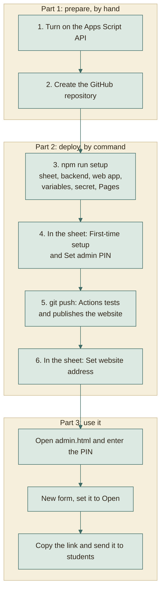

# Putting it online, step by step

You need a Google account, a free GitHub account, and about 15 minutes.
Nothing here needs a credit card.

On your computer you need three tools:

- **Node.js** 22 or newer, for the build and the Google command-line client (clasp)
- **git**
- **GitHub CLI** (`gh`), signed in once with `gh auth login`

One command, `npm run setup`, does the first deployment: it creates the Google
Sheet with its Apps Script project, pushes the backend into it, creates the web app, and writes the IDs, the
credential and the Pages setting into your GitHub repository. Nothing is pasted
into the Apps Script editor and nothing is typed into GitHub settings.


## The whole thing at a glance



Deployment identifiers live in GitHub repository Variables. Google credentials live in a repository Secret. The workflow generates the published browser configuration; keep the source placeholder unchanged.

---

## Part 1: Prepare (by hand, once)

### 1. Turn on the Apps Script API
Open [Google Apps Script user settings](https://script.google.com/home/usersettings)
and switch **Google Apps Script API** to **On**. Google offers this switch only
on that page, so no command can flip it, and without it Google refuses every
request the setup makes.

### 2. Create the GitHub repository
In the project folder:

```bash
gh repo create forms --public --source . --remote origin
```

Choose **public**: free GitHub Pages needs it. Do not push yet. If the
repository already exists, skip this step.

---

## Part 2: Deploy (by command)

### 3. Run the setup
In the project folder:

```bash
npm ci
```

```bash
npm run setup
```

The first time, a browser window opens for Google sign-in: choose the account
that will own the data and click **Allow**. The command then asks one question:

```
No sheet is linked to this repository yet.
  1) Create a new Forms Registry sheet (recommended)
  2) Use a sheet I already have
Choose 1 or 2 [1]:
```

Press **Enter** for a new sheet. After that the command:

1. creates a Google Sheet named **Forms Registry** with an Apps Script project attached to it;
2. builds `dist/Code.gs` and `dist/appsscript.json` and pushes them into that project;
3. creates the web app deployment (**Execute as: Me**, **Who has access: Anyone**, both taken from the manifest);
4. stores `APPS_SCRIPT_ID`, `APPS_SCRIPT_DEPLOYMENT_ID` and `API_URL` as repository Variables;
5. stores your clasp login as the repository Secret `CLASPRC_JSON`;
6. sets GitHub Pages to **Source: GitHub Actions**.

It prints the address of the new sheet and of the web app when it finishes. If a
step fails it stops with the reason; fix the cause and run it again. A second
run reuses the stored sheet and web app, so neither is created twice and the
address does not change.

**Already have a sheet?** Answer **2** and paste its **Script ID**, found in the
sheet under **Extensions > Apps Script > Project Settings** (gear icon). If you
do not have the ID at hand, press Enter: the command stops without creating
anything, and you run `npm run setup -- YOUR_SCRIPT_ID` later. The question is
not asked again once a sheet is linked.

### 4. First-time setup and admin PIN (in the sheet)
1. Open the **Forms Registry** sheet from the address the setup printed (it is also in your Google Drive). If it was already open, **reload the page** (F5). Wait about 5 seconds.
2. A new menu **Forms Platform** appears next to Help. Click it, then **1. First-time setup**.
3. Google asks for permission. Click **Continue**, choose your account, then:
   - If you see "Google hasn't verified this app", click **Advanced**, then **Go to Forms Registry (unsafe)**. This message appears because the script is yours and was never submitted to Google. It is safe: you are giving the script access to *your own* account.
   - Click **Allow**.
4. Click **Forms Platform > 1. First-time setup** again. A message says the setup finished. This creates the Forms, Lists, and Clients tabs and a Drive folder called **Forms Platform**.
5. Click **Forms Platform > 2. Set admin PIN...** Type a PIN with at least 4 characters and press OK. Pick something not easy to guess: the admin page is public, and the PIN is the only lock.

The web app answers only after this permission step, because it runs as you.

### 5. Publish the website
```bash
git push -u origin master
```

The run **Test and deploy site** starts on every push to `master`: it checks the
workflow, runs the tests, builds the configured site, updates the Apps Script
deployment, then publishes `index.html`, `admin.html`, `viewer.html`, `assets/`,
and `shared/`. Follow it and read the site address with:

```bash
gh run watch
```

```bash
gh api "repos/{owner}/{repo}/pages" --jq .html_url
```

The address looks like `https://YOUR-NAME.github.io/forms/`.

### 6. Tell the sheet your website address (for emails)
Back in the Forms Registry sheet: **Forms Platform > 3. Set website address...** and paste the address from step 5. Confirmation emails link to it.

---

## Part 3: Use it

1. Open `https://YOUR-NAME.github.io/forms/admin.html` and enter your PIN.
2. Click **New form**, choose a type, give it a title, pick the term (Fall, Spring, or Summer and the year), type the subject code, and click **Create form**.
3. On the settings page check:
   - **Who can register**: all specializations, or only some (for example Computers only).
   - **Team size**: minimum and maximum people per team (counting the leader), and an optional note for some sizes (for example "other students will be added to reach 5" for 3 and 4).
   - **Questions**: rename, hide, or add a description under any question.
   - **Emails**: whether students get a confirmation email.
   - **Limits and checks**: the Drive folder name rule `Team_Leader_Name_Project_Name_Subject_Name` (on by default for new team forms). Type the subject name, for example `Software Engineering`, so folders must end with `_Software_Engineering`.
   - **Timetable** for reservations: set the session hours, then add days by date.
   - **Status**: set to **Open** and click **Save settings**.
4. Click **Copy link** and send it to students. The link looks like `.../index.html?f=database-team-project-registration-form-fall-2027`.
5. Watch submissions under **Responses**. Each form's own Google Sheet is one click away (**Google Sheet**).
6. For instructors: **Clients > New private link**. Send them the link shown once. They need no account.

### First-run checklist (things only real Google can confirm)
Do these once with a test form:

- [ ] Register a team with a real Drive link shared to "Anyone with the link": accepted.
- [ ] Register another with a link set to private: refused with a clear message.
- [ ] Register with a folder named with spaces (for example `My Project`): refused, and the message shows the expected name such as `Ahmed_Mohamed_My_Project_Software_Engineering`.
- [ ] Check that the confirmation email arrived with the key.
- [ ] Open the form's Google Sheet: teams show as tinted blocks with heavy borders.
- [ ] In the dashboard click **Print team list**: a print tab and a PDF appear.
- [ ] Open an instructor link on a phone.

---

## Part 4: Excel list with the real files (on your computer)

1. Install Python 3 once. In the project folder run `pip install -r scripts/requirements.txt`.
2. Run (replace the name with your form's link name, the part after `?f=`):
   ```
   python scripts/download_tasks.py --slug database-tasks-fall-2027
   ```
3. Type your admin PIN when asked.
4. Open `Tasks_Export/database-tasks-fall-2027/Tasks.xlsx` in desktop Excel. Click a task name to open its downloaded `.pptx`. Keep `Tasks.xlsx` and the `files` folder together. Anything that could not be downloaded is on the **Failed** sheet with the reason (usually a link that is not shared with "Anyone with the link").

---

## Updating later

The configured pipeline handles both deployments after a push to `master`:
workflow validation and tests, backend bundle, site configuration generated from
`API_URL`, Apps Script update, then GitHub Pages publication. Pull requests run
checks only. Running the workflow from another branch cannot deploy.

**Required Pages setting:** repository **Settings > Pages > Build and deployment >
Source: GitHub Actions**. A branch deployment cannot inject repository variables
and serves the placeholder in `assets/js/config.js` directly.

### What the setup stored, and how to renew it

`npm run setup` wrote three Variables (`API_URL`, `APPS_SCRIPT_ID`,
`APPS_SCRIPT_DEPLOYMENT_ID`) and one Secret (`CLASPRC_JSON`). Variables are
readable configuration; secrets are credentials that GitHub masks in logs. The
web app URL becomes public in the published browser configuration regardless of
where it is stored. List them with:

```bash
gh variable list
```

The same values can be set by hand under **Settings > Secrets and variables >
Actions** if `gh` is not available. `CLASPRC_JSON` must hold the **entire
contents** of `~/.clasprc.json`, including the opening `{` and closing `}`.
Do not paste credentials into issues, chat, committed files, or log output.

The workflow validates configuration and rejects a missing or malformed URL,
missing IDs, malformed credential JSON, and a URL pointing to a different
deployment. It generates ignored `.clasp.json` for `dist/`, uses the same
`APPS_SCRIPT_DEPLOYMENT_ID` when deploying, and publishes Pages only after the
backend job succeeds. No personal URL or ID is stored as a fallback in source.
Credentials are removed from the runner after the deployment attempt.

A Gmail account works with the account owner's clasp login. Clasp uses the
refresh token to renew access tokens. If Google rejects the saved authorization,
sign in again and replace the **whole** secret:

```bash
npx --yes @google/clasp@3.4.1 login
```

```bash
gh secret set CLASPRC_JSON < ~/.clasprc.json
```

No service restart is required. Wait for **Test and deploy site** to succeed,
then hard-refresh the website. A branch-based **pages build and deployment** run
is not evidence that this configured workflow succeeded.

### Local preview and export

GitHub variables are available inside Actions; they do not configure a raw
local checkout. Use `npm run dev` for the in-memory preview (admin PIN `4321`).
To package a site locally, set `API_URL` in your shell and run
`npm run build:site`; serve `_site/`. Keep the source placeholder unchanged.
For the Excel exporter, supply the existing `--api` option or `FORMS_API_URL`
environment variable, since source `config.js` contains no deployment URL.

### Manual backend recovery

If clasp authentication fails, the tested `backend-dist` artifact remains
available. Copy its `Code.gs` into Apps Script, save, and update the **existing**
deployment through **Deploy > Manage deployments > pencil > New version >
Deploy**. This is a recovery path; routine updates use the configured workflow.

## If something goes wrong

| What you see | What to do |
|---|---|
| Website says it is not connected to the backend | Hard-refresh the page (**Ctrl+F5** on Windows/Linux, **Cmd+Shift+R** on Mac) to bypass browser caching of the placeholder `config.js`. Also verify Pages Source is **GitHub Actions** and `API_URL` is set under repository Variables. |
| Page says it could not reach the server | Run **First-time setup** in the sheet (step 4); the web app answers only after you allow the permissions. If it still fails, check under **Deploy > Manage deployments** that access is **Anyone**. |
| `npm run setup` stops at "Creating the Forms Registry sheet" | Turn on the Apps Script API (step 1), wait a minute, and run it again. If an empty **Forms Registry** sheet was left in Google Drive by the failed attempt, delete it. |
| `npm run setup` stops at "Pushing the backend" | Turn on the Apps Script API (step 1). If you passed a Script ID, check that it is the one from Project Settings. |
| `npm run setup` stops at a GitHub step | Run `gh auth login`, and check that the folder has an `origin` remote on GitHub (step 2). |
| "That PIN is not correct" | Wrong PIN, or too many tries: wait a few minutes. To reset, run **Forms Platform > 2. Set admin PIN...** again. |
| Backend update failed | Check the **Deploy Google Apps Script** job. Renew `CLASPRC_JSON` if authentication failed; verify both IDs and enable the Apps Script API. |
| The site did not change after a push | Open the **Actions** tab: a red run means a test failed and nothing was published. A green run means the browser cached the old file: press Ctrl+F5. |
| Actions says Pages is not enabled | Settings, Pages, Source: **GitHub Actions**. |
| The menu "Forms Platform" is missing | Reload the sheet and wait a few seconds. |

---

## Want to know why it works this way?

| Question | Read |
|---|---|
| How are configuration and hosting split? | [HOSTING.md](architecture/HOSTING.md) |
| What exactly is `dist/Code.gs`, and who builds it? | [BUILD-PIPELINE.md](architecture/BUILD-PIPELINE.md) |
| Why "Execute as Me" and "Anyone" is safe here | [WORKAROUNDS.md](architecture/WORKAROUNDS.md) and [SECURITY.md](reference/SECURITY.md) |
| What is stored where? | [DATA-MODEL.md](reference/DATA-MODEL.md) |
| The whole picture | [ARCHITECTURE.md](architecture/ARCHITECTURE.md) |
