# Architecture

This is the map of the whole platform: what runs where, how a request travels,
and why each piece exists. Other documents go deeper on one topic each; the
index is at the bottom.

## The idea in one paragraph

A student opens a web page. The page is a plain static file hosted for free on
GitHub Pages. When the student presses Send, the page posts a small piece of
JSON to a Google Apps Script web app. That script checks the answers with the
same rules the page used, writes a row into a Google Sheet, and answers with a
reference number and an edit key. There is no server to rent, no database to
run, no login for students, and no build step for the website. Everything an
admin changes (forms, questions, team sizes, time slots) is data stored in a
sheet, not code.

## Design principles

| Principle | What it means here |
|---|---|
| **No server, no bill** | GitHub Pages serves files; Apps Script runs the logic; Sheets and Drive store the data. All free for classroom scale. |
| **Visitors never log in** | The script runs as the owner. Students get an edit key; instructors get a private link; the admin gets a PIN. Each is its own small, hashed secret. |
| **One source of truth for rules** | `domain/rules/` is used by the browser, the backend, and the tests. They cannot disagree. |
| **Forms are data** | A form is a JSON definition in one cell. New questions and new form types need no code. |
| **Boring technology** | Plain JavaScript, no framework, no bundler for the website, one concatenation script for the backend. Easy to read, easy to fix later. |
| **Testable without Google** | An in-memory copy of Google's services runs the real backend code, so the tests cover it without touching a real account. |

## System context

Who talks to what. Three static pages share one backend.

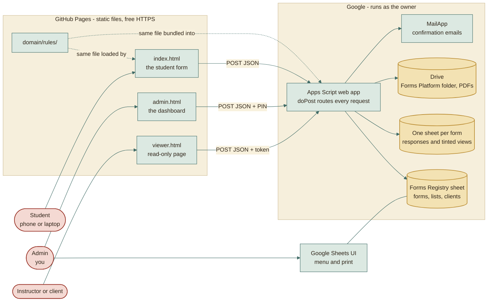

## What runs where

| Place | What runs there | Who pays | What it must never do |
|---|---|---|---|
| Visitor's browser | The page, live input filtering, draft saving, ticket image/PDF | Nobody | Be trusted. Every rule is checked again on the server. |
| GitHub Pages | Serves static files over HTTPS | Free | Run code or keep secrets. |
| Apps Script | All logic: validation, limits, keys, locking, emails, views | Free quotas | Hold state in memory. Every request starts fresh. |
| Google Sheets | The only database | Free | Be edited by hand in the Responses tab (the platform owns it). |
| Drive | Print PDFs, form sheets, student-shared files | Free | Be written by students. They only share links. |
| Admin laptop | Builds `dist/` and runs the first deployment | Nobody | Be required for students to use the forms. |

## Request lifecycle

Every action, from every page, takes the same path. This is the whole backend
entry point.

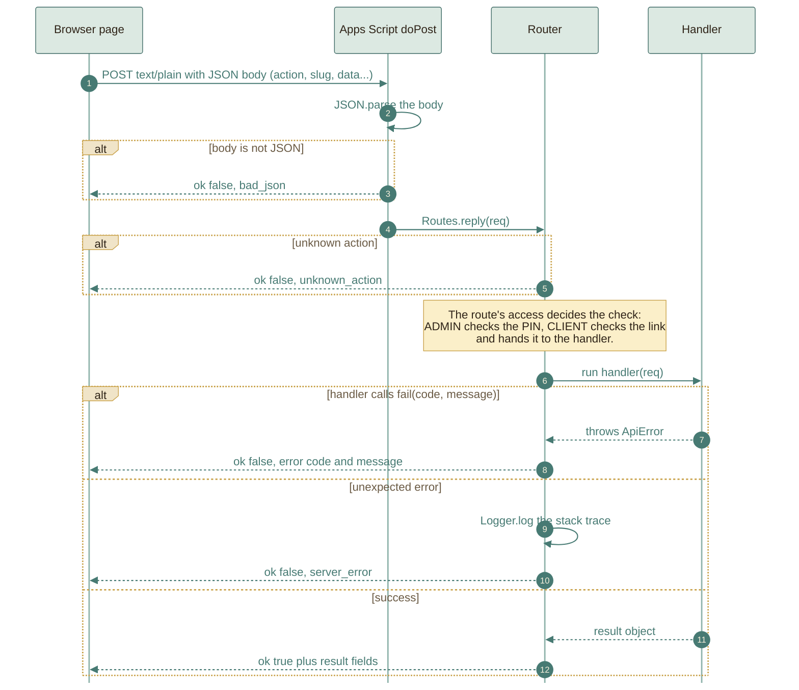

The response envelope is always `{ ok: true, ...fields }` or
`{ ok: false, error: { code, message, details } }`. The browser turns the
`code` into a friendly sentence in English or Arabic (`web/js/i18n/`).

## A student submits a registration

The most important flow. Validation happens twice on purpose: in the browser
for instant feedback, and on the server because the browser cannot be trusted.

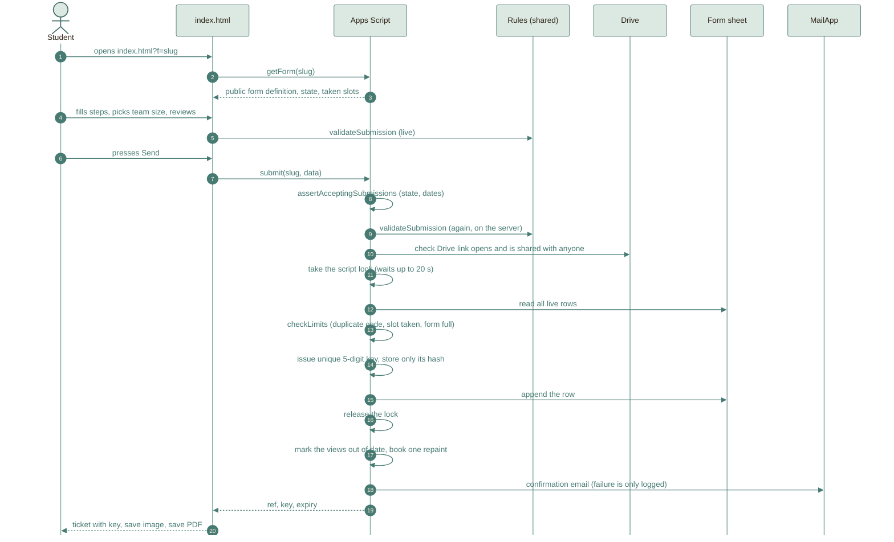

Two details worth knowing:

- The Drive check happens **before** the lock, because it is slow and does not
  touch the sheet. The lock is held only for the read-check-write sequence, so
  students are not queued behind network calls.
- The key is returned to the student **once**. The sheet stores a salted hash
  (used to find the row) and a *sealed* copy: each digit shifted by a pad derived
  from the private pepper, the form, and the registration. The sheet alone reveals
  no key, but the backend can unseal it for an admin with the PIN (**Details,
  Show key**), so a student who lost it can be helped without a reset.

## Editing or cancelling with a key

The key alone identifies the registration. That is a deliberate trade for
"no accounts", and the reason the key is salted per form, throttled, and
expiring. See [SECURITY.md](../backend/SECURITY.md).

A new registration is a path: one page after another, then a review. A
registration opened with a key is not. It opens on a summary of every answer
("Your registration"), each page is reached with **Change** and returns to the
summary with **Done**, and **Save changes** exists only while an answer differs
from the saved one (`hub()` and `changed()` in `web/js/form/form.view.js`). The route trail and
the Back button belong to the path, so they are not shown here.

A task is handed in by its deadline. Once a task form stops taking answers
(closed, or past its close date), its key still opens the task to read, but
**update** and **remove** refuse with `deadline_passed`, and the page says why
instead of offering Change or Cancel (`taskLocked_` in `submissions.controller.js`).
Opening the form again, or moving its close date, lifts the lock. Team
registrations are not locked this way.

A key works for the number of days set in **Setup, Edit key**, counted from
when it is given. The admin moves that date in `admin/keys/extend-keys.view.js`, backed by
`keys.controller.js`: **Extend** in a registration's details changes one key, and
**Extend keys** in Setup changes all keys, the expired ones, the ones ending in
three days, or teams picked from a list. A period is added to the later of
today and the key's own end, so an expired key works again for the whole
period; a date sets the same end for every key picked. The dialog says the new
end before anything is saved. Private links use the same picker for their end
date, with **No end date** as the default.

Team members are resized in place by `memberList` in `web/js/form/members.view.js`: each member
form has **Remove**, the list has **Add a team member**, and both move the team
size choice with them, inside the range of the form. Remove takes out the
member that was chosen and offers **Undo**, because its form may be filled in.

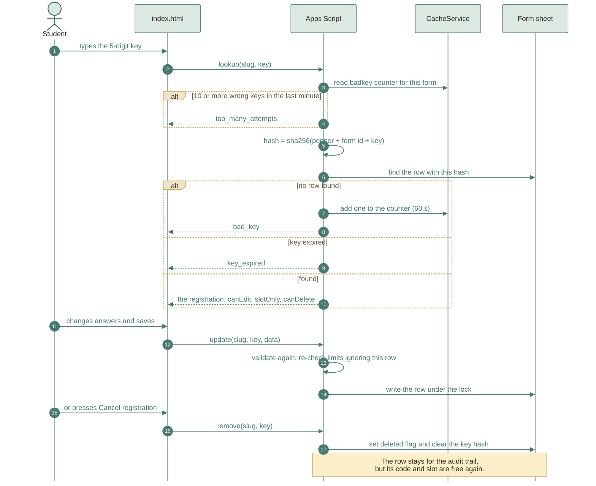

## Life of a form

A form has a stored status and optional dates. The state students actually see
is computed by `Rules.formState`, so the same function decides in the browser,
the backend, and the tests.

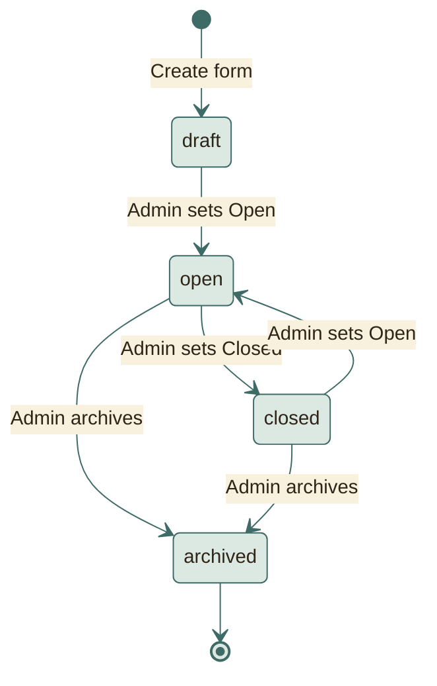

On top of the stored status, the optional dates are applied while it is
`open`:

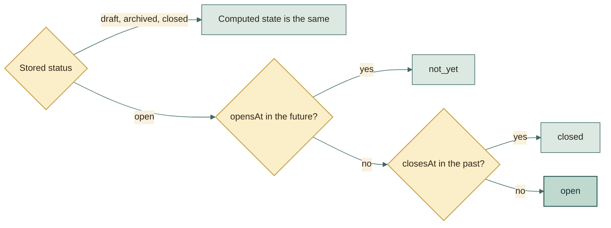

| Computed state | Students see |
|---|---|
| `draft` | "This form is not available yet." (its questions are not sent to the browser) |
| `not_yet` | "This form has not opened yet." |
| `open` | The form |
| `closed` | "This form is closed." (a message you can customise per form) |
| `archived` | Treated like closed for students; hidden from instructors |

## Team size: how "members are not optional" works

The admin sets a range. The student chooses a number. That number decides
exactly how many member forms exist, in the browser and on the server.

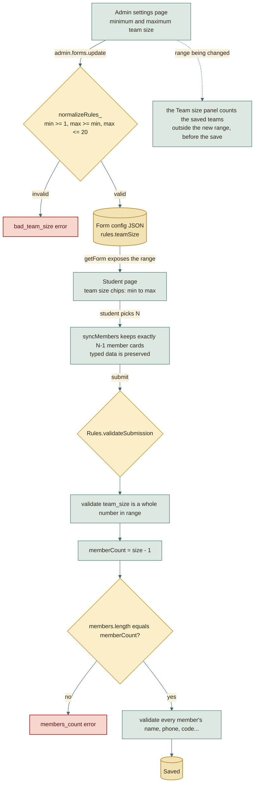

The admin can also attach a note to some sizes (`rules.teamSize.notice`). When a
student picks one of them, `Rules.teamSizeNotice` fills in `{n}` and `{max}` and
the page shows it under the size chips, on the review step, and on the ticket.
It is information only; it never blocks a submission.

If a form hides the team size question, the member limits fall back to the
range (`min - 1` to `max - 1`), so older form definitions keep working.

The teammates of a booking are the same kind of range, counted without the
leader: the `min` and `max` of the members question, from 0 (a leader books
alone) to 19, and its own `notice`. The admin sets both ranges with one
control, `A.sizeRange` in `admin/settings/range.view.js`: the lowest and the
highest, the numbers students will see, the saved answers outside a new range
(`teamSizes` or `teammateCounts` from `admin.forms.get`, both counted by
`countResponses_`), and the note with its preview, drawn by
`admin/settings/range-note.view.js`. `Rules.sizeNotice` fills in both notes, and the
backend cleans both with `normalizeSizeNotice_`. A booking shows the note under
the teammates when the leader has added one of its numbers.

### Warnings about small teams

A team can end up small, for example after a member moved to another team. A
form has two warnings for that, a critical one and a normal one, each with its
own switch and its own number: a team with fewer people than the number gets
the level, and a team under both gets the critical one. Nothing is fixed in the
code: `rules.sizeAlerts` holds the switches and the numbers, and a level that
was never set starts from the biggest team size (about half of it, and one
person under it).

| Responsibility | Owner |
|---|---|
| The levels, their starting numbers, the level of a team, and why a setting cannot be saved, the numbers a level can ask for | `Rules.sizeAlerts`, `Rules.sizeAlertLevels`, `Rules.sizeAlertOf`, `Rules.sizeAlertsProblem`, `Rules.sizeAlertBounds` in `domain/rules/team-size.js` |
| Checking and cleaning the setting on a save | `normalizeRules_` in `forms.rules.js`, with the same `Rules` functions (`bad_size_alerts`) |
| The control in the Small teams panel of Setup | `A.sizeAlerts` in `admin/settings/size-alerts.view.js`; it returns `{ node, refresh(), problem(), summary() }` like the range control |
| Whether an instructor sees them | `showSizeAlerts` of each link in `clients.repository.js`, set in the link dialog (`admin/people/client-dialog.view.js`) |
| The lines above the teams and the mark on a card | `App.sizeAlerts` in `size-alerts.js`, used by the dashboard and the instructor page |

The dashboard loads `domain/rules/` and asks it for the level of each team.
The instructor page does not, so `viewer.data` sends the levels that are on
and the level of each small team, worked out by the same functions, and sends
neither to a link whose `showSizeAlerts` is off. A team is counted by its people
(`Rules.membersOf`), so hiding a column from a link does not change the count.
The line about teams under the minimum size stays as it is: it says a team
breaks the range of the form, while these two levels are the admin's choice.

The warnings are set in Setup, not next to the team size in Questions: Questions
holds what students are asked, and the warnings only change what the admin and
instructors see (UI rule 20). The numbers are still bounded by the biggest team
size, so the panel is drawn again when the range changes in the other tab.
Whether an instructor sees them belongs to the person, not the form, so it is
a setting of their link, next to whether they may review.

## Reviews and WhatsApp matching

WhatsApp does not let a website read pending join requests. So the reviewer
pastes them and the platform matches by normalised phone number.

```mermaid
%%{init: {
  'theme': 'base',
  'themeVariables': {
    'fontFamily': 'ui-sans-serif, system-ui, -apple-system, Segoe UI, Roboto, sans-serif',
    'fontSize': '15px',
    'primaryColor': '#DCE9E2', 'primaryBorderColor': '#3F6B66', 'primaryTextColor': '#2F2418',
    'secondaryColor': '#F0E4C8', 'secondaryBorderColor': '#C9A24A', 'secondaryTextColor': '#2F2418',
    'tertiaryColor': '#F6EFDC', 'tertiaryBorderColor': '#CDBB94', 'tertiaryTextColor': '#2F2418',
    'lineColor': '#3F6B66', 'textColor': '#2F2418', 'mainBkg': '#DCE9E2', 'nodeBorder': '#3F6B66',
    'clusterBkg': '#F6EFDC', 'clusterBorder': '#CDBB94', 'titleColor': '#2F2418',
    'edgeLabelBackground': '#F8F1DD',
    'actorBkg': '#DCE9E2', 'actorBorder': '#3F6B66', 'actorTextColor': '#2F2418', 'actorLineColor': '#8FB3AB',
    'signalColor': '#477A73', 'signalTextColor': '#477A73',
    'labelBoxBkgColor': '#F0E4C8', 'labelBoxBorderColor': '#C9A24A', 'labelTextColor': '#2F2418', 'loopTextColor': '#6A5A44',
    'noteBkgColor': '#FBEFC9', 'noteBorderColor': '#C9A24A', 'noteTextColor': '#2F2418',
    'activationBkgColor': '#DCE9E2', 'activationBorderColor': '#3F6B66', 'sequenceNumberColor': '#F8F1DD',
    'transitionColor': '#3F6B66', 'stateLabelColor': '#2F2418', 'stateBkg': '#DCE9E2', 'altBackground': '#F6EFDC',
    'attributeBackgroundColorOdd': '#F8F1DD', 'attributeBackgroundColorEven': '#F0E4C8'
  },
  'flowchart': {'curve': 'basis', 'padding': 14, 'nodeSpacing': 40, 'rankSpacing': 46},
  'sequence': {'mirrorActors': false, 'messageMargin': 34, 'boxMargin': 8}
}}%%
flowchart LR
    paste["Reviewer pastes<br/>WhatsApp requests"] --> extract["Rules.extractPhones<br/>finds every phone in each line"]
    extract --> norm["normalizePhone<br/>+20 10 1234 5678 becomes 01012345678"]
    norm --> store[("Requests tab<br/>one row per phone, duplicates skipped")]
    store --> match["matching.list joins requests to registrations by phone"]
    reg[("Registrations")] --> match
    match --> st{"How many registrations<br/>share the phone?"}
    st -- "0" --> none["No match"]
    st -- "1" --> one["Matched"]
    st -- "2 or more" --> dup["Duplicate"]
    one --> screen["Split screen<br/>details and Drive preview"]
    screen --> dec["approve / reject / pending"]
    dec --> step["setReviewStep_ on the matched registration"]
    step --> rule{"Sequential steps?"}
    rule -- "approving step 2 before step 1" --> err["review_order: Finish step 1 first"]
    rule -- "ok" --> derive["status derived:<br/>any rejected = rejected<br/>all approved = approved<br/>some approved = in_review"]
    classDef cDb fill:#F3E2B3,stroke:#B8892D,stroke-width:1.5px,color:#2F2418
    classDef cActor fill:#F4D9D3,stroke:#9A3328,stroke-width:1.5px,color:#2F2418
    classDef cDec fill:#FBEFC9,stroke:#C9A24A,stroke-width:1.5px,color:#2F2418
    classDef cEnd fill:#2F2418,stroke:#2F2418,color:#F8F1DD
    classDef cErr fill:#F6D5CF,stroke:#A12B1F,stroke-width:1.5px,color:#5A140C
    classDef cOk fill:#BFD9CF,stroke:#2E5A55,stroke-width:1.5px,color:#17302D
    class store,reg cDb
    class st,rule cDec
    class dec,derive cErr
    class one cOk
```

## Backend modules

Small files under `backend/platform/` and `backend/features/<area>/<feature>/`
that the bundler joins with `domain/rules/`. They do not import each other;
they share one global scope (this is how Apps Script works), and each file
defines one namespace named after it (`clients.repository.js` defines
`ClientsRepository`) that holds its functions. `routes.js` joins each action to
its handler, and `entry-points.js` holds the functions Apps Script calls by
name. The diagram shows the features;
[FILE-STRUCTURE.md](FILE-STRUCTURE.md) lists every file.

```mermaid
%%{init: {
  'theme': 'base',
  'themeVariables': {
    'fontFamily': 'ui-sans-serif, system-ui, -apple-system, Segoe UI, Roboto, sans-serif',
    'fontSize': '15px',
    'primaryColor': '#DCE9E2', 'primaryBorderColor': '#3F6B66', 'primaryTextColor': '#2F2418',
    'secondaryColor': '#F0E4C8', 'secondaryBorderColor': '#C9A24A', 'secondaryTextColor': '#2F2418',
    'tertiaryColor': '#F6EFDC', 'tertiaryBorderColor': '#CDBB94', 'tertiaryTextColor': '#2F2418',
    'lineColor': '#3F6B66', 'textColor': '#2F2418', 'mainBkg': '#DCE9E2', 'nodeBorder': '#3F6B66',
    'clusterBkg': '#F6EFDC', 'clusterBorder': '#CDBB94', 'titleColor': '#2F2418',
    'edgeLabelBackground': '#F8F1DD',
    'actorBkg': '#DCE9E2', 'actorBorder': '#3F6B66', 'actorTextColor': '#2F2418', 'actorLineColor': '#8FB3AB',
    'signalColor': '#477A73', 'signalTextColor': '#477A73',
    'labelBoxBkgColor': '#F0E4C8', 'labelBoxBorderColor': '#C9A24A', 'labelTextColor': '#2F2418', 'loopTextColor': '#6A5A44',
    'noteBkgColor': '#FBEFC9', 'noteBorderColor': '#C9A24A', 'noteTextColor': '#2F2418',
    'activationBkgColor': '#DCE9E2', 'activationBorderColor': '#3F6B66', 'sequenceNumberColor': '#F8F1DD',
    'transitionColor': '#3F6B66', 'stateLabelColor': '#2F2418', 'stateBkg': '#DCE9E2', 'altBackground': '#F6EFDC',
    'attributeBackgroundColorOdd': '#F8F1DD', 'attributeBackgroundColorEven': '#F0E4C8'
  },
  'flowchart': {'curve': 'basis', 'padding': 14, 'nodeSpacing': 40, 'rankSpacing': 46},
  'sequence': {'mirrorActors': false, 'messageMargin': 34, 'boxMargin': 8}
}}%%
flowchart TD
    subgraph entry["Entry"]
        Main["main.js, routes.js<br/>doGet, doPost, the routes table"]
        Menu["outputs/menu<br/>onOpen sheet menu, print dialog"]
    end
    subgraph catalog["features/catalog"]
        Registry["registry<br/>registry sheet and folder, setup"]
        Forms["forms<br/>forms tab, rules, public form, questions"]
        Lists["lists<br/>shared lists"]
        Templates["templates<br/>four form types as data"]
    end
    subgraph intake["features/intake"]
        Submissions["submissions<br/>submit, lookup, update, remove"]
        Responses["responses<br/>rows, limits, review, Drive checks, emails"]
        Keys["keys<br/>edit keys and when they stop working"]
        Teams["teams<br/>numbered teams, shared"]
        Transfers["transfers<br/>moving a member between teams"]
        Reservations["reservations<br/>slots, booking with a registration key"]
        Matching["matching<br/>WhatsApp matching"]
    end
    subgraph access["features/access"]
        Auth["auth<br/>PIN, lockout, admin wrapper"]
        Clients["clients<br/>private links, access keys, end dates"]
        Viewer["viewer<br/>read-only data"]
    end
    subgraph outputs["features/outputs"]
        Views["sheet-views<br/>tinted sheet blocks"]
        Print["print<br/>print tabs and PDF"]
        Download["downloads<br/>files and folders in zips"]
    end
    Platform["platform/<br/>errors, sheet tables, lock, sheet style,<br/>crypto, properties, format, xlsx"]
    Rules["domain/rules/<br/>pure validation"]

    Main --> Platform
    Auth --> Platform
    Registry --> Platform
    Forms --> Registry
    Forms --> Lists
    Templates --> Forms
    Submissions --> Responses
    Submissions --> Keys
    Submissions --> Transfers
    Submissions --> Rules
    Responses --> Rules
    Responses --> Platform
    Reservations --> Rules
    Reservations --> Keys
    Views --> Responses
    Views --> Teams
    Print --> Views
    Print --> Teams
    Matching --> Responses
    Keys --> Responses
    Download --> Teams
    Download --> Platform
    Viewer --> Clients
    Viewer --> Responses
    Menu --> Print
    Forms --> Views
    classDef cDb fill:#F3E2B3,stroke:#B8892D,stroke-width:1.5px,color:#2F2418
    classDef cActor fill:#F4D9D3,stroke:#9A3328,stroke-width:1.5px,color:#2F2418
    classDef cDec fill:#FBEFC9,stroke:#C9A24A,stroke-width:1.5px,color:#2F2418
    classDef cEnd fill:#2F2418,stroke:#2F2418,color:#F8F1DD
    classDef cErr fill:#F6D5CF,stroke:#A12B1F,stroke-width:1.5px,color:#5A140C
    classDef cOk fill:#BFD9CF,stroke:#2E5A55,stroke-width:1.5px,color:#17302D
```

## Frontend modules

No framework. Each file is a small self-contained script that adds itself to a
single `App` object. Loading order is set by the script tags in each HTML file.

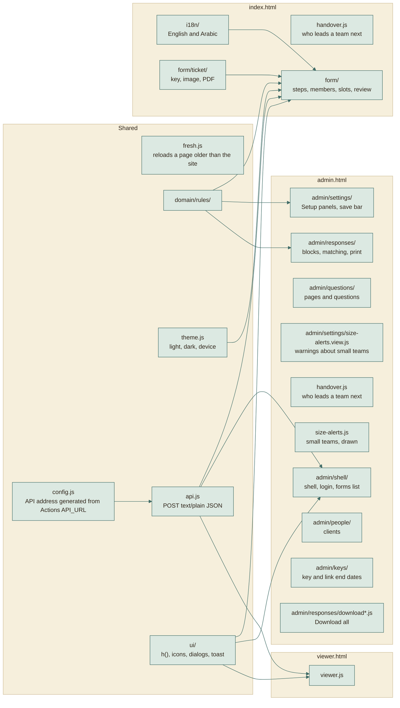

## How sheet views stay fast

Colouring a sheet is slow in Apps Script. A change only marks the form, and one
booked run repaints it a minute later, so a student never waits for formatting.

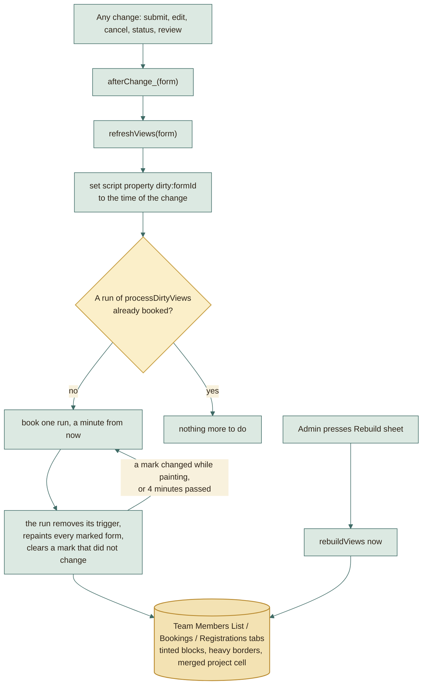

No timer runs while nothing changes: a run exists only between a change and its
repaint, and it removes itself. The repaint takes no script lock, because it only
reads the responses and writes its own tabs. A form whose repaint fails keeps its
mark, so its next change, or **Rebuild sheet**, paints it. A project that was set
up while a timer ran every five minutes loses that timer on the first run.

The same repaint looks after the data tabs. Responses, Transfers and Requests
get a dark header, a frozen first row, column widths and two row tints
(`SheetStyle.styleDataTab`, called by `SheetViewsLayout.styleFormTabs`); the
registry's Forms, Clients and Lists get them at **First-time setup** and from
**Rebuild all views** in the sheet menu (`RegistrySetup.styleRegistryTabs`). A tab
that has the look costs three reads and is left alone. Only the look is set, so
no value and no number format changes, and a tab that refuses a format is logged
and does not stop the repaint.

## Downloading everything a team form collected

**Download all tasks** (or **projects**) under Responses saves every team's task
file or project folder in zip parts, with a `Teams.xlsx` that lists the teams,
one tinted block per team, and links each task or project to its saved copy. It
is one feature for both team forms: `teamBlocks_` in `teams.service.js` gives the
numbered teams that the sheet view, the printed list and the download all read,
so they never disagree on the order or the numbers.

A team's number is given once, when it registers, and stored in the `number`
column of its row. A cancelled team keeps its number, so the teams after it are
not renumbered: after Team 2 cancels, the list reads 1, 3, 4, and a folder
`03 - ...` in last week's zip is still Team 3 this week. The dashboard and the
instructor page show the number the server sends and never count the cards.

**Why it runs inside Google, and not in a browser or a script on a laptop.**
Downloading Drive files through their public links (what a script, `curl`, or a
headless browser such as Playwright does) is anonymous traffic, and Google
limits it: "too many users have downloaded this file", a virus-scan page for big
files, and bot checks after a burst of requests. The download feature
(`backend/features/outputs/downloads/`) instead reads each
file as the owner: `DriveApp` for ordinary files, and the export address with the
owner's token for Google Slides, Docs and Sheets, which come as Office files.
That is not public-link traffic, so those limits do not apply. A headless
browser was considered and left out: it would have to run on the admin's own
computer (the dashboard is a static page), it means installing a whole browser,
and it breaks whenever Drive changes its pages.

What is left are Apps Script's own limits, and the design follows them:

| Limit | How the download stays inside it |
|---|---|
| Six minutes a request | The page asks for one team at a time. A big folder is fetched over several requests (40 files or 25 seconds each); a repeated request skips what is already saved. |
| About 50 MB a file | A file over 45 MB is not packed. It is listed with its Drive link. |
| About 50 MB a zip | The files are split into zip parts of up to 40 MB. `Teams.xlsx` is in part 1; unzipping every part into one folder makes all its links work. |
| "Slow down" answers from Google | Each read waits and tries again, up to three times, doubling the wait. |

The work happens in the owner's Drive, in `Forms Platform / Exports / Downloads`,
in a folder per download; starting a new download of the same form moves the
older one to the trash. Only the zips stay there. The page reads each zip in
3 MB pieces through the API (`admin.download.chunk`, a ranged Drive request, so
only the piece is read) and hands the whole file to the browser, so nothing is
ever shared by link. What could not be saved (no link, a Google Form, a file too
big, a link that does not open) is listed in the window and on the sheet "Not
downloaded" of `Teams.xlsx`, each with the reason and its Drive link.

`Teams.xlsx` is written by `backend/platform/xlsx/`, a small writer of the Excel file format.
Google Sheets cannot save a link to a file that sits next to the workbook, and
that is the whole point of the list. Each column is as wide as its longest value
(a file cannot ask Excel to autofit, so the width is measured when it is
written), names read right to left, and it prints one page wide.

```mermaid
%%{init: {
  'theme': 'base',
  'themeVariables': {
    'fontFamily': 'ui-sans-serif, system-ui, -apple-system, Segoe UI, Roboto, sans-serif',
    'fontSize': '15px',
    'primaryColor': '#DCE9E2', 'primaryBorderColor': '#3F6B66', 'primaryTextColor': '#2F2418',
    'secondaryColor': '#F0E4C8', 'secondaryBorderColor': '#C9A24A', 'secondaryTextColor': '#2F2418',
    'tertiaryColor': '#F6EFDC', 'tertiaryBorderColor': '#CDBB94', 'tertiaryTextColor': '#2F2418',
    'lineColor': '#3F6B66', 'textColor': '#2F2418', 'mainBkg': '#DCE9E2', 'nodeBorder': '#3F6B66',
    'clusterBkg': '#F6EFDC', 'clusterBorder': '#CDBB94', 'titleColor': '#2F2418',
    'edgeLabelBackground': '#F8F1DD',
    'actorBkg': '#DCE9E2', 'actorBorder': '#3F6B66', 'actorTextColor': '#2F2418', 'actorLineColor': '#8FB3AB',
    'signalColor': '#477A73', 'signalTextColor': '#477A73',
    'labelBoxBkgColor': '#F0E4C8', 'labelBoxBorderColor': '#C9A24A', 'labelTextColor': '#2F2418', 'loopTextColor': '#6A5A44',
    'noteBkgColor': '#FBEFC9', 'noteBorderColor': '#C9A24A', 'noteTextColor': '#2F2418',
    'activationBkgColor': '#DCE9E2', 'activationBorderColor': '#3F6B66', 'sequenceNumberColor': '#F8F1DD',
    'transitionColor': '#3F6B66', 'stateLabelColor': '#2F2418', 'stateBkg': '#DCE9E2', 'altBackground': '#F6EFDC',
    'attributeBackgroundColorOdd': '#F8F1DD', 'attributeBackgroundColorEven': '#F0E4C8'
  },
  'flowchart': {'curve': 'basis', 'padding': 14, 'nodeSpacing': 40, 'rankSpacing': 46},
  'sequence': {'mirrorActors': false, 'messageMargin': 34, 'boxMargin': 8}
}}%%
flowchart LR
    A["Download all"] --> B["admin.download.start<br/>a work folder, the numbered teams"]
    B --> C{"admin.download.team<br/>for each team"}
    C -- "a file" --> D["Tasks/03 - Task 3.pptx"]
    C -- "a folder" --> E["Projects/03 - Library System/...<br/>over as many requests as it needs"]
    C -- "cannot be saved" --> F["the reason and the Drive link"]
    D --> G["admin.download.finish<br/>Teams.xlsx, parts of 40 MB"]
    E --> G
    F --> G
    G --> H["admin.download.pack<br/>one zip per part"]
    H --> I["admin.download.chunk<br/>3 MB pieces to the page"]
    I --> J["the browser saves the zip"]
    classDef cDb fill:#F3E2B3,stroke:#B8892D,stroke-width:1.5px,color:#2F2418
    classDef cActor fill:#F4D9D3,stroke:#9A3328,stroke-width:1.5px,color:#2F2418
    classDef cDec fill:#FBEFC9,stroke:#C9A24A,stroke-width:1.5px,color:#2F2418
    classDef cEnd fill:#2F2418,stroke:#2F2418,color:#F8F1DD
    classDef cErr fill:#F6D5CF,stroke:#A12B1F,stroke-width:1.5px,color:#5A140C
    classDef cOk fill:#BFD9CF,stroke:#2E5A55,stroke-width:1.5px,color:#17302D
    class E cDec
    class C cDec
    class F cErr
```

## Scale and honest limits

The design is right for a class, a department, or a few hundred registrations
per form. It is not meant for tens of thousands.

| Limit | Why | What to do if you hit it |
|---|---|---|
| Every request re-reads the rows it needs | Sheets is the database; there is no index | Fine up to low thousands of rows per form. Beyond that, move the heavy reads to a cache or a real database. Not implemented. |
| One script lock for all writes | Guarantees no two students take one slot | Writes queue briefly. A 20 second wait fails with "busy, try again". |
| Apps Script daily quotas (mail, runtime, URL fetch) | Google applies quotas to free accounts and Workspace differently | Check Google's current quota page. Confirmation emails are the quota most likely to matter. |
| A 5-digit key has 100,000 values | Chosen so students can type it | Safe because it is salted per form, throttled to 10 wrong tries a minute, and expires. |
| Real Google behaviour is untested locally | Tests use a faithful copy, not Google | Run the first-run checklist in [DEPLOY.md](../operations/DEPLOY.md) once. |

## Colours and contrast

All colours are variables in `web/css/theme.css`, defined once for the light
theme and once for dark (used both when the device prefers dark and when the
toggle is on). The standard is **WCAG 2.1 AA in both themes**:

| What | Minimum | Tokens |
|---|---|---|
| Text, including small bold labels, tags, and pills | 4.5:1 | `ink`, `mute`, `accent`, `sea`, `err`, `gold` on `sheet`, `sheet-2`, `desk`, tints; `on-accent` and `on-sea` on their buttons |
| Outlines that show where a field or choice is | 3:1 | `field-line` on every background |
| Focus ring | 3:1 | `focus` |
| Decorative dividers and card borders | none | `line` |

`tests/web/css/theme.test.js` reads the tokens from `theme.css` and checks every
pair above, so a colour change that breaks the standard fails CI and is never
published. It also checks that the device dark theme and the dark toggle use
identical colours.

## Bookings under a registration form

A reservation that is booked with the keys of a form (`keyBooking.source`)
belongs to that form. Nothing else links them, so there is no new column and
no new record:

- The dashboard does not give such a reservation a card. It lists it inside the
  card of its form, newest first, with its status and its days. The list is
  folded to one line (the count and the newest booking) until it is opened,
  because a form can have a booking for every week of a term; which forms are
  open is kept in `sessionStorage` for the browser tab.
- `admin.bookings.next` (`key-booking.controller.js`) makes the next one. The first is a new
  reservation that books with the keys of the form. Each later one is a copy of
  the newest: the same questions, rules, hours and bookings per slot, its own
  empty sheet, status Draft, and every dated day seven days later
  (`nextWeekSlots_`). A day named after its date is named after the new date
  (`Rules.dayLabel`), "Week 11" in a typed name becomes "Week 12", and the last
  number in the title goes up ("Discussion - Week 3" to "Week 4").
- A team books once in each of them, because each is its own form.
- The key that finds a team that has booked shows the team its time and opens
  the booking on that time, to move it (`editScope_` in `submissions.controller.js`
  decides whether it may move). The ticket of such a booking draws the day and
  the time and does not show the key again, since the team already has it.

## The pages of one form

A form has one header and one tab bar, built by `A.formTabs` in `admin/shell/form-head.view.js` and
used by both the responses page and the settings page:

| Tab | Address | What it holds |
|---|---|---|
| Responses | `#/f/<slug>` | The answers (`admin/responses/`) |
| Questions | `#/f/<slug>/questions` | The questions under the page of the form that shows them, then team size and teammates |
| Timetable | `#/f/<slug>/timetable` | Reservations only: the calendar of days, the hours and bookings per slot, the slots of each day, booking with a key |
| Setup | `#/f/<slug>/settings` | Name and dates, who can register, edit key, emails, limits, review steps, delete |

Questions, Timetable and Setup are one view (`admin/settings/settings.page.js`)
over one form object, so a tab change only hides and shows sections and changes
the address with `A.setHash`; it never loads the form again and never loses an
edit. Each panel is drawn by its own part in `admin/settings/` (Setup) or
`admin/questions/` (the question list and the teammates of a booking); they
share one page object `s` with the form, the server's answer and the controls
that can refuse a save. `settings.model.js` builds the patch and finds the
first problem; `savebar.view.js` sends only what changed.
Status is in the header because it is the setting that changes most often.

Rules for this page, to keep when a setting is added:

- **A work area is a tab; a setting is a section.** A thing the admin builds
  (questions, a timetable) gets a tab and is always open (`panel.pin()`). A
  switch or a number goes in a section of Setup or under the work area it
  belongs to.
- **A section says what it is set to.** `panel(title, help, ...controls)`
  returns a folded section; give it a `summary` function that returns one short
  line ("On, 7 days, students can edit and cancel"). The line is painted again
  after each change. Open sections are remembered per form, so a save does not
  fold them.
- **One patch, one save bar.** `buildPatch()` is the only place that turns the
  form object into what `admin.forms.update` receives. The save bar compares
  it with the copy taken when the page opened and exists only while they
  differ (`A.unsaved`). The router asks before leaving a page with
  `A.unsaved`, and the browser asks before the window closes.
- **A refused save shows where.** `problem()` returns the first thing that
  stops a save and its section; the page opens that tab and that section.
- **Pages and questions are data.** `steps` is the list of pages (id, title in
  both languages, the ids of its questions in order) and `fields` is the list
  of questions. The Questions tab edits both: a page can be added, renamed,
  moved and, while it is empty, removed; a question can be moved to another
  page or up and down. A question the admin adds has `custom: true`, an id that
  starts with `q_`, and the type `text`, `textarea` or `select` with its own
  `options`. `normalizeQuestions_` in `forms.questions.js` cleans both lists on every
  save. The student form already draws any question of a page and skips a page
  with no questions, and an answer is stored under the id of its question in
  the `data` JSON, so no sheet column changes. Team size, team members and the
  booking slot stay on their page.
- **Limit a list with `allowPicker`.** A rule that keeps some values of a list
  (specializations, sections) uses the `allowPicker` chips, stores the values
  under the name of the list in `rules`, and adds that name to
  `LIMITED_LISTS_` in `forms.public.js`, which filters the options for the browser
  and for validation. An empty rule means every value.
- **No sideways scrolling.** Questions are rows of a grid that stack at 760px,
  not a table.
- **A work area that is large is its own file.** The timetable is
  `admin/settings/timetable.view.js`: `A.timetable(form, taken)` returns
  `{ node, summary(), problem(), slots() }`. Its state and rules are in
  `timetable.model.js` (`A.tt`), and the calendar, the hours and the rows
  of the days are drawn by `timetable-calendar.view.js`,
  `timetable-hours.view.js` and `timetable-day.view.js`. The settings view
  only places the node in a
  section and asks it for its part of the patch. The saved shape stays
  `slots.days` (`id`, `label`, `date`, `times`) with `slots.pattern` as the
  general hours. Which times of a day are switched off, and whether the day
  has times that no hours explain, is worked out from that when the page
  opens, so no field was added for the editor. The order on the page is the
  order of the decisions: the days on a calendar, the hours once, then one row
  of slots for each day as the result.

## Moving a member between teams

`rules.uniqueAcrossForm` refuses a team that names a member of another team.
With `rules.transfers` also on, `transfers.service.js` turns the refusal into a request.

1. `submit` and `update` call `takeOutTransfers_` inside the lock. It fails with
   `duplicate_member` and lists, under `transfer`, the members that can be asked
   for. The page shows them in a popup.
2. The page sends the same request again with their codes in `transfer`. The
   members are taken out of the answers, the team size answer follows, the team
   is saved, and `recordTransfers_` writes one `pending` row for each in the tab
   `Transfers`.
3. `lookup` returns `transfers`: `incoming` (requests for members of this team)
   and `outgoing` (requests this team made). The page asks about each incoming
   one when the registration opens.
4. `transfer.decide` (the key of the team that holds the member) and
   `admin.transfer.decide` both call `TransferDecision.decide`. The first answer
   counts. An approval removes the member from the team that holds the code,
   adds the stored member to the team that asked, and moves both team sizes.

The leader of a team can be asked for like any member, so that a team is not
stuck with a leader who wants to leave. The team must not be left without a
leader, so the approval carries `handover`: `{ leader, email }`, the code of the
member who leads next and that member's email. `TransferMembers.handOver` copies
the member's answers to the leader's questions of the same role or id, writes
the email (members are not asked for one), and takes the member out of the list.
What only a leader answers, like the major, stays. The team keeps its row, so
its reference, team number and edit key do not change; the page tells the leader
who left to give the key to the new leader.

The offer marks such a student with `leader: true`. A waiting request for a
leader carries `leader: true` and `heirs`, the members who can lead, both in
`lookup` and in `admin.submissions`. Whether a student leads is read from the
team as it is now, not stored with the request, so a request for a member who
became the leader meanwhile asks the same question.

The question is drawn once, by `App.handover` in `handover.js`: a chip for
each member and the email field, with each reason next to its answer. The
student page puts it in the request dialog and the dashboard in the dialog of
"Approve and move". The backend checks both answers again.

Rules of the move:

- A leader who is alone in a team is never offered: nobody would lead it. The
  refusal names that student and says why. An approval is refused if the
  leader became alone meanwhile (`transfer_leader`), names nobody or somebody
  outside the team (`transfer_heir`), or carries a refused email
  (`transfer_email`); a refused approval changes nothing.
- A team that is full cannot receive (`transfer_full`).
- A team left under the minimum size is allowed; the answer carries `underMin`
  and Responses lists every team under the minimum.
- An approval closes the other waiting requests for the same student. Removing
  a team closes its waiting requests.
- The popup names the other team by its reference only, and says when the
  student leads it, so a code typed at random does not show who else is in
  which team.
- With `rules.transferPhones` the two leaders of a request see each other's
  phone while it waits: `TransfersView.leaderContacts` adds `phone` to the
  request in `lookup` and in the answer of the `submit` or `update` that made
  it. The refusal that offers the request carries no number, so a phone is shown
  only to a team that registered and asked, and it goes away with the answer.
  With `rules.transferWhatsapp` the request also carries `whatsapp: true` and
  the page links the number with `Rules.whatsappLink`. The page draws the number
  in one place, `leaderContact` in `web/js/form/contacts.view.js`, always with a Copy button.
- Nothing of a member who moves is asked: the two leaders, or the admin,
  decide. A leader who is asked for answers for themselves.
- A leader learns about a request by opening the form with the key. Emails to
  the two leaders go out only with `rules.transferEmails`, which is off unless
  the admin ticks it. With it on, the new leader of a team that was handed
  over is told too; that email never holds the edit key.

## The Lists page

`admin/lists/` draws `#/lists` and `#/lists/<key>`: the lists at the side
(`.l-side`) and the choices of the picked one in the main part (`.l-main`).
`lists.page.js` builds one page object, `p`, that every part reads and
draws into: the lists and their names, the open list as it is edited, and
`paint`, `paintRows`, `changed` and `setRows`. The rules that draw nothing
are in the `*.model.js` files, so each editor only draws.

- **The kind picks the editor.** A list of `sections` is built from year group
  cards with a stepper for each kind; a count runs from 1 to 99, and a kind
  leaves a card with its own remove button while the card has another kind.
  **Add a year group** opens a draft card: a year (1 to 5, or a higher one a
  list uses), a department letter, and a count for each kind, every one at 0.
  Nothing is copied from another group; **Add 3C** appears once the group can
  be added, Enter in a count adds it, and the card goes in year and letter
  order. The letters and kinds offered are the ones the section lists use,
  with **+ New letter** and **+ New kind** for another: none is written in the
  code, and a typed one stays only if a group uses it. A value that the groups
  cannot give back exactly (a gap, a leading zero) is kept under Other
  sections. A list of `numbers` is two steppers. A `named`
  list is rows; a `plain` list is chips, with one link to the rows because
  chips cannot rename or reorder. Typing is needed only for names.
- **Lists are made, not only edited.** New list asks for a name, a kind and a
  copy to start from (`admin.lists.create`). An admin's own list can be renamed,
  and deleted while no form asks it; Delete is shown only then. A question
  that reads a list picks it in the Questions tab ("Choices from"), shown only
  when another list of the same kind may be picked (`A.listSwappable`).
- **The save bar is the one of the settings page.** It exists only while the
  picked list differs from its saved copy, sets `A.unsaved`, and says what a
  save would change ("1 added, 2 removed"). When a removed choice is in the
  `rules` of a form (`LIMITED_LISTS_`), the bar names that form.
- **A refused save stays on the page.** A choice that is in the list twice, a
  name without a value and an empty list are written under the choices and the
  row is marked. Nothing is reported with a toast.
- **One of two on a phone.** Below 940px the page shows the lists while the
  address is `#/lists`, and the picked list with a link back while the address
  names one. Both are in the page; the class `picked` on `.lists` chooses.

## Phone layout

At 600px and below, a table that lists people does not shrink and does not
scroll sideways. Each row becomes a card:

- The table head is hidden, so each cell carries its column name in a
  `data-label` attribute and CSS prints it before the value. A cell without
  `data-label` (the name, the row actions) is shown without a label.
- Team member rows (`.team-card .mini`) put Section and Code next to each
  other under the name, with the phone number on its own line as a `tel:` link.
- Bookings (`.block.single .mini`) and the list tables marked
  `.data-table.cards` (WhatsApp registrations, private links) put one value on
  each line.
- A toolbar is a grid of two equal columns. The search box and a `.tool-group`
  (controls that act together, such as the day, the option and the button of
  the day sheet) take the full width.

### Layout pieces

A new page is built from the layout classes at the top of `admin.css`, which
change shape from the width they are given, so the page has no media query of
its own:

| Class | What it does |
|---|---|
| `.l-split` with `.l-main` and `.l-side` | A main part and a narrower side. The side goes under the main part when both do not fit. |
| `.l-grid` | Equal columns, as many as fit. `--l-min` is the narrowest a column may be. |
| `.l-stack` | Children under each other with one gap (`--l-gap`). |

The new form page uses all three and nothing else for its layout. A media
query is for a thing that changes what it is on a phone (a table that becomes
cards), not for a thing that only needs fewer columns.

A new list table must set `data-label` on its cells and use one of these
classes; `tests/web/admin.test.js` and `tests/web/viewer.test.js` check the
labels of the current tables.

## Where to change what

| I want to... | Edit |
|---|---|
| Change a colour, font, or size | `web/css/theme.css` (variables only); `npm test` checks the contrast |
| Reword a message or translate | `web/js/i18n/en.js` and `ar.js` |
| Add a question to a form | Admin dashboard, or `template-fields.js` for new forms by default |
| Add a new form type | A new function in `templates.service.js`, a label in `web/js/admin/shell/admin.model.js` |
| Change a validation rule | its part in `domain/rules/` (browser, server, and tests all follow) |
| Add a backend action | A named function in the feature's `*.controller.js`, returned by its namespace; a row in `backend/routes.js` with its `Access`; a row in the section of that access in [API.md](../backend/API.md) |
| Change sheet colours | `PALETTE` in `sheet-style.js` |
| Change the downloaded Excel list | `DownloadsWorkbook.build` in `downloads.workbook.js` (the file format is in `backend/platform/xlsx/`) |
| Change the Drive folder name rule | `Rules.checkFolderName` in `domain/rules/drive-link.js` |
| Change the tab icon | `web/img/favicon.svg`, then regenerate the PNGs in `web/img/` |
| See a change in a real browser before deploying | `npm run dev` (`scripts/dev/dev-server.js`) |
| Change what CI runs or publishes | `.github/workflows/pages.yml` |

## Documents

| File | Read it for |
|---|---|
| [WORKAROUNDS.md](WORKAROUNDS.md) | The clever solutions to each hosting constraint, and why |
| [BUILD-PIPELINE.md](BUILD-PIPELINE.md) | What produces `dist/`, step by step |
| [HOSTING.md](HOSTING.md) | What GitHub does, what Google does, and how they fit |
| [DATA-MODEL.md](../backend/DATA-MODEL.md) | Every sheet, column, and stored property |
| [SECURITY.md](../backend/SECURITY.md) | The secrets, who holds them, and what a leak would mean |
| [TESTING.md](../process/TESTING.md) | How the tests run without Google |
| [DEPLOY.md](../operations/DEPLOY.md) | Click-by-click setup |
| [FILE-STRUCTURE.md](FILE-STRUCTURE.md) | Where every file lives and what it does |
