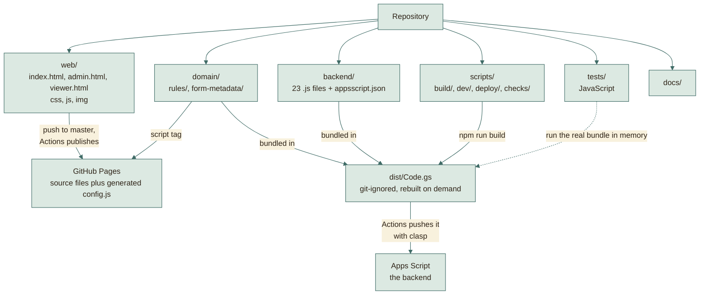
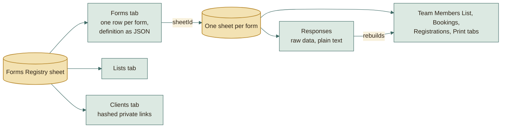

# File structure

## The repository at a glance

Each folder goes somewhere different. Only one of them needs a build step.

## Which scripts each page loads

The pages share a few small files. Each file adds itself to one `App` object.

```mermaid
%%{init: {
  'theme': 'base',
  'themeVariables': {
    'fontFamily': 'ui-sans-serif, system-ui, -apple-system, Segoe UI, Roboto, sans-serif',
    'fontSize': '15px',
    'primaryColor': '#DCE9E2', 'primaryBorderColor': '#3F6B66', 'primaryTextColor': '#2F2418',
    'secondaryColor': '#F0E4C8', 'secondaryBorderColor': '#C9A24A', 'secondaryTextColor': '#2F2418',
    'tertiaryColor': '#F6EFDC', 'tertiaryBorderColor': '#CDBB94', 'tertiaryTextColor': '#2F2418',
    'lineColor': '#3F6B66', 'textColor': '#2F2418', 'mainBkg': '#DCE9E2', 'nodeBorder': '#3F6B66',
    'clusterBkg': '#F6EFDC', 'clusterBorder': '#CDBB94', 'titleColor': '#2F2418',
    'edgeLabelBackground': '#F8F1DD',
    'actorBkg': '#DCE9E2', 'actorBorder': '#3F6B66', 'actorTextColor': '#2F2418', 'actorLineColor': '#8FB3AB',
    'signalColor': '#477A73', 'signalTextColor': '#477A73',
    'labelBoxBkgColor': '#F0E4C8', 'labelBoxBorderColor': '#C9A24A', 'labelTextColor': '#2F2418', 'loopTextColor': '#6A5A44',
    'noteBkgColor': '#FBEFC9', 'noteBorderColor': '#C9A24A', 'noteTextColor': '#2F2418',
    'activationBkgColor': '#DCE9E2', 'activationBorderColor': '#3F6B66', 'sequenceNumberColor': '#F8F1DD',
    'transitionColor': '#3F6B66', 'stateLabelColor': '#2F2418', 'stateBkg': '#DCE9E2', 'altBackground': '#F6EFDC',
    'attributeBackgroundColorOdd': '#F8F1DD', 'attributeBackgroundColorEven': '#F0E4C8'
  },
  'flowchart': {'curve': 'basis', 'padding': 14, 'nodeSpacing': 40, 'rankSpacing': 46},
  'sequence': {'mirrorActors': false, 'messageMargin': 34, 'boxMargin': 8}
}}%%
flowchart LR
    subgraph common["Loaded by all three pages"]
        cfg["config.js"]
        fr["fresh.js"]
        th["theme.js"]
        api["api.js"]
        ui["ui/: dom, icons, dialogs,<br/>clipboard, theme-button"]
    end
    subgraph index["index.html: the student form"]
        r1["domain/rules/"]
        i18n["i18n/: en, ar, i18n"]
        tk["form/ticket/"]
        h1["handover.js"]
        fm["form/: model, views, pages"]
    end
    subgraph admin["admin.html: the dashboard"]
        r2["domain/rules/"]
        a1["admin/shell/"]
        a2["admin/settings/"]
        a12["admin/questions/"]
        a5["admin/settings/timetable*.js"]
        a9["admin/settings/range.view.js"]
        a11["admin/settings/range-note.view.js"]
        a10["admin/settings/size-alerts.view.js"]
        a7["admin/keys/"]
        h2["handover.js"]
        s2["size-alerts.js"]
        a3["admin/responses/"]
        a4["admin/people/"]
        a6["admin/lists/"]
    end
    subgraph viewer["viewer.html: instructor page"]
        v1["viewer/"]
    end
    common --> index
    common --> admin
    common --> viewer
    classDef cDb fill:#F3E2B3,stroke:#B8892D,stroke-width:1.5px,color:#2F2418
    classDef cActor fill:#F4D9D3,stroke:#9A3328,stroke-width:1.5px,color:#2F2418
    classDef cDec fill:#FBEFC9,stroke:#C9A24A,stroke-width:1.5px,color:#2F2418
    classDef cEnd fill:#2F2418,stroke:#2F2418,color:#F8F1DD
    classDef cErr fill:#F6D5CF,stroke:#A12B1F,stroke-width:1.5px,color:#5A140C
    classDef cOk fill:#BFD9CF,stroke:#2E5A55,stroke-width:1.5px,color:#17302D
```

The instructor page loads the rules in the same order as the dashboard: it
checks no answers, but it reads the length of an access key from them.

## Website (static files, no build step)

The site is published at the paths it has always had: the pages at the root,
`web/js`, `web/css` and `web/img` under `assets/`, and `domain/` as
`shared/`. `scripts/build/site-map.js` holds that mapping.

| File | What it is |
|---|---|
| `web/index.html` | The page students use. Shows any form from its saved definition (`?f=name`). |
| `web/admin.html` | The admin dashboard (PIN). |
| `web/viewer.html` | The read-only instructor and client page (`?t=private-token`). |
| `web/css/theme.css` | Every colour of the stylesheets, the fonts and the type scale, as named variables. Change the look here; the contrast standard is in its header and enforced by `tests/web/css/theme.test.js`. |
| `web/css/app/page.css` | The page, its top bar and icon buttons, and the sheet. Every page loads the `app/` files in the order of these rows, so the cascade is the one the single file had. |
| `web/css/app/route.css` | The route of the steps: the sea, the islands, the treasure island and the ship. |
| `web/css/app/fields.css` | The title of a step, the fields, the chips of small lists and the team members. |
| `web/css/app/slots.css` | The booking slots, and the torn ticket of a full slot. |
| `web/css/app/buttons.css` | The buttons, and the lists of the review summary and of a ticket. |
| `web/css/app/ticket.css` | The ticket, and the clock and calendar that show the time of a booking. |
| `web/css/app/dialogs.css` | Dialogs, toasts and the strip that says a newer site is published. |
| `web/css/app/print.css` | Print: only the ticket, on plain paper. |
| `web/css/app/notes.css` | Lists inside summaries, the note of a chosen team size and the requests to move a member. |
| `web/css/admin/layout.css` | The dashboard layout classes, the tabs of a form and the settings sections. The dashboard and the instructor page load the `admin/` files in the order of these rows, so the cascade is the one the single file had. |
| `web/css/admin/questions.css` | The Questions tab: a row per question under its page. |
| `web/css/admin/forms-list.css` | The header of a form and the forms list grouped by status. |
| `web/css/admin/bookings.css` | The bookings of a registration form inside its card. |
| `web/css/admin/new-form.css` | New form: the steps and the preview at the side. |
| `web/css/admin/fields.css` | The fields editor: descriptions, size preview, chips and steppers. |
| `web/css/admin/timetable.css` | The timetable editor and the save bar. |
| `web/css/admin/responses-alerts.css` | What waits for the admin above Responses, and the warnings about small teams. |
| `web/css/admin/teammates.css` | The teammates settings of a booking. |
| `web/css/admin/sections.css` | A section list: a card for each year group. |
| `web/css/admin/lists.css` | The Lists page: kind cards, chips, choice rows and the index. |
| `web/css/admin/responses.css` | Responses blocks and the team cards (a coloured band per team, header strip, leader tag). |
| `web/css/admin/matching.css` | WhatsApp matching. |
| `web/css/admin/phone.css` | The phone layout of team members, the page header and bookings. |
| `web/css/admin/phone-tables.css` | The phone layout of wide tables: one card per row. |
| `web/css/admin/keys.css` | Client links, the until picker of keys and links, and Download all. |
| `web/img/` | The tab icon (`favicon.svg`), PNG sizes for phones and older browsers, and `site.webmanifest`. The pirate and the parrot of the ticket picture (`pirate.webp`, `parrot.webp`), with clear backgrounds; `web/js/form/ticket/` draws the clock and the calendar around them. The pictures of the route: the ship (`ship.svg`), an island (`island.svg`), the treasure chest (`treasure.svg`), the waves (`sea.svg`), the sky by day and by night (`sky-day.svg`, `sky-night.svg`) the sun and moon (`sun.svg`, `moon.svg`) and the red flag of an explored island (`crew-flag.svg`). The arrow of a select (`select-arrow.svg`). They have their own colours; the sea and sky behind them take theirs from the theme. |
| `web/js/config.js` | Source placeholder; `scripts/build/build-site.js` generates its published copy from the Actions `API_URL` variable, with the version of the site. |
| `web/js/app/fresh.js` | Keeps an open page on the published version: compares the version in `config.js` with `version.json`, reloads an older page when nothing would be lost, and offers **Reload** otherwise. |
| `web/js/app/api.js` | Sends requests to the backend as plain-text JSON (avoids browser CORS checks). |
| `web/js/form/form.model.js` | The state of the student page and the helpers that read and write an answer; creates `App.formPage`, which the other parts add their functions to. Loaded first of the form parts. |
| `web/js/form/steps.model.js` | The steps of a form and the step a question is on. |
| `web/js/form/drafts.model.js` | Keeps a half-filled form in the tab's session storage, so a reload does not wipe it. |
| `web/js/form/chrome.view.js` | The top bar and the head of the form. |
| `web/js/form/route.view.js` | The route trail drawn as a sea of islands, the sheet and the banner. |
| `web/js/form/fields.view.js` | A question with its label, description, control and error, and the folder naming rule. |
| `web/js/form/text-input.view.js` | The text box of each field type and the filter of what it allows. |
| `web/js/form/select.view.js` | Chips and dropdowns. |
| `web/js/form/team-size.view.js` | The team size chips and the note of a size. |
| `web/js/form/members.view.js` | The member cards and the list that follows the team size. |
| `web/js/form/slots.view.js` | The days and times of a reservation. |
| `web/js/form/review.view.js` | The review step and the ticket summary. |
| `web/js/form/form.view.js` | The page of an open or closed form; with a key it opens on the summary. |
| `web/js/form/team-key.page.js` | The first step of a key booking: the key and the team it opens. |
| `web/js/form/navigation.page.js` | Moving between steps and showing their errors. |
| `web/js/form/submit.page.js` | Sending the registration and showing its ticket. |
| `web/js/form/submit-errors.page.js` | What the page does with each error the server gives back when a registration is sent. |
| `web/js/form/key-entry.page.js` | Opening a registration with its key. |
| `web/js/form/edit.page.js` | A registration opened with its key: read only, Close, cancel, start again. |
| `web/js/form/success.view.js` | The page with the ticket after sending. |
| `web/js/form/contacts.view.js` | The names and contacts of other teams in a request to move a member. |
| `web/js/form/transfer.view.js` | The dialog of a request to move a member. |
| `web/js/form/transfer.page.js` | The requests to move a member when a registration opens. |
| `web/js/form/form.page.js` | Loads the form, draws the page for its state, and starts the page. Loaded last. |
| `web/js/form/ticket/time.model.js` | The clock hands and the slice of the dial for the time of a booking. Loaded first of the ticket parts; creates `App.ticket`. |
| `web/js/form/ticket/shapes.view.js` | The colours of the ticket picture and its small SVG shapes: a shadow, a brass knob. |
| `web/js/form/ticket/calendar.view.js` | The desk calendar of the ticket picture. |
| `web/js/form/ticket/clock-hands.view.js` | The hands of the ticket's clock, and the slot as a shaded slice of the dial with an arrow along it. |
| `web/js/form/ticket/clock.view.js` | The ship's clock of the ticket picture: the wooden ring, the rim, the face and its numbers, the knobs. |
| `web/js/form/ticket/when.view.js` | The time of a booking as a picture: the clock, the calendar, the pirate and the parrot, with the day and time as text over them. |
| `web/js/form/ticket/save-image.page.js` | Saves the ticket as an image, with its torn edges. |
| `web/js/form/ticket/ticket.view.js` | The success ticket: the reference, the picture, the key, and the buttons that save or print it. Loaded last. |
| `web/js/i18n/en.js`, `ar.js` | The English and Arabic text of the student page, by key, in `App.strings`. |
| `web/js/i18n/i18n.js` | `App.i18n`: the page language and its direction, the text of a key, `{en, ar}` labels, error sentences and dates. Loaded after `en.js` and `ar.js`. |
| `web/js/teams/handover.view.js` | The question asked before the leader of a team moves to another team: who leads next, and their email. Used by the student page and the dashboard. |
| `web/js/app/theme.js` | Light, dark, or follow the device; the choice is remembered on this device only. |
| `web/js/ui/dom.js` | `App.ui.h` builds an element with its attributes and children; `clear` empties one. Loaded first of the `ui/` parts, since the others draw with it. |
| `web/js/ui/icons.js` | The inline SVG icons and the icons a form may show. |
| `web/js/ui/dialogs.js` | The toast and the confirmation dialog. |
| `web/js/ui/clipboard.js` | Copies text, with a fallback for browsers without the clipboard API. |
| `web/js/ui/theme-button.js` | The light and dark switch every page has. |
| `web/js/admin/shell/admin.model.js` | The kinds of form, the statuses and their labels, the tabs of a form, the icon sizes, and the links of a form and an instructor page. Loaded first of the dashboard parts; creates `App.admin`. |
| `web/js/admin/shell/calls.page.js` | Calls to the backend, and what the admin is told when one fails. |
| `web/js/admin/shell/widgets.view.js` | The small controls every screen is built from: badge, field, checkbox, text, number, dropdown. |
| `web/js/admin/shell/dialogs.view.js` | A dialog with its own buttons, and the dialog that shows a link or a key once. |
| `web/js/admin/shell/metadata.view.js` | The editors of what a form shows beside its title: a term with a subject code, or a batch year. |
| `web/js/admin/shell/form-head.view.js` | The header and the tab bar of a form: its status, its link and the More menu. |
| `web/js/admin/shell/form-actions.page.js` | Deleting a form, and copying it for a new term. |
| `web/js/admin/shell/forms.model.js` | Which forms give keys, which can start bookings, and which form a booking belongs to. |
| `web/js/admin/shell/series.view.js` | The bookings under a registration form and the button that makes the next one. |
| `web/js/admin/shell/forms-list.view.js` | The forms list, grouped by status. |
| `web/js/admin/shell/create.view.js` | The page that makes a new form. |
| `web/js/admin/shell/login.view.js` | The PIN screen. |
| `web/js/admin/shell/router.page.js` | Reads the address, draws the bar and the page it names, and guards unsaved changes. Loaded last of the shell parts. |
| `web/js/admin/settings/settings.page.js` | The settings page of a form: loads it, places the panels in the Questions, Timetable and Setup tabs, and keeps the open sections. |
| `web/js/admin/settings/panel.view.js` | A settings section folded to one line: its name and what it is set to now. |
| `web/js/admin/settings/allow-picker.view.js` | The chips that limit a form to some values of a list, grouped by section year. |
| `web/js/admin/settings/general.view.js` | The Name and dates panel: title, subject and term, link name, opening and closing, language, icon. |
| `web/js/admin/settings/who.view.js` | The Who can register panel: the specializations and sections a form is limited to. |
| `web/js/admin/settings/key-booking.view.js` | The Booking with a key panel of a reservation. |
| `web/js/admin/settings/team-size.view.js` | The Team size panel and the Small teams panel. |
| `web/js/admin/settings/edit-key.view.js` | The Edit key panel: whether students get a key, for how long, and what it lets them do. |
| `web/js/admin/settings/limits.view.js` | The Limits and checks panel: most submissions, Drive check, one team per student with transfer requests, folder names. |
| `web/js/admin/settings/emails.view.js` | The Emails panel: the confirmation to students and the note to the admin. |
| `web/js/admin/settings/review.view.js` | The Review steps panel, and matching to pasted WhatsApp requests. |
| `web/js/admin/settings/settings.model.js` | What the settings page saves, and the first thing that stops a save with its panel. |
| `web/js/admin/settings/savebar.view.js` | The save bar: shown while something changed, sends only what changed, shows why a save was refused. |
| `web/js/admin/questions/questions.model.js` | The questions and pages of a form as the Questions tab changes them: kinds, moves, adding and removing, choices, what stops a save. |
| `web/js/admin/questions/page-head.view.js` | The heading of a page in the Questions list, and the picker of the list a choice question reads. |
| `web/js/admin/questions/question-tools.view.js` | The folded tools of a question: its page, its order, and for an added question its kind, choices and Remove. |
| `web/js/admin/questions/question-row.view.js` | A question in the list: Show, Required, its labels, kind and description, and the rows of the questions about each member. |
| `web/js/admin/questions/questions.view.js` | The Questions panel: each page and its questions, the questions on no page, and Add a page. |
| `web/js/admin/questions/teammates.view.js` | The Teammates panel of a booking: whether they are asked, how many, the words students read, and what is asked about each. |
| `web/js/admin/settings/timetable.model.js` | The state of the timetable and its rules: the slots a day offers, the bookings counted, what stops a save, the saved shape. |
| `web/js/admin/settings/timetable-calendar.view.js` | The month calendar where dates are added and removed. |
| `web/js/admin/settings/timetable-hours.view.js` | The general hours and the bookings per slot. |
| `web/js/admin/settings/timetable-day.view.js` | One day of the result: its name, its slots, its own hours. |
| `web/js/admin/settings/timetable.view.js` | The timetable of a reservation form: the result and the layout of the parts. |
| `web/js/admin/settings/range.view.js` | The range control of the team size and the teammates: the bounds, the numbers students see and the saved answers left outside. |
| `web/js/admin/settings/range-note.view.js` | The note of the range control: the numbers that show it, its text and its preview. |
| `web/js/admin/settings/size-alerts.view.js` | The two warnings about small teams. |
| `web/js/admin/keys/until.model.js` | The dates keys and links work until: how a date is written, the end of a picked day, and where a key ends once given more time. |
| `web/js/admin/keys/until-picker.view.js` | The line that says until when a key or a link works, and the one picker for how long, shared by Clients, a registration and Extend keys. |
| `web/js/admin/keys/key-teams.view.js` | The keys the Extend keys dialog acts on: the groups to pick from, and the teams to choose with their search. |
| `web/js/admin/keys/extend-keys.view.js` | The Extend keys dialog. |
| `web/js/admin/keys/keys-summary.view.js` | The keys line of a form's Setup, with the Extend keys button. |
| `web/js/admin/responses/responses.model.js` | The rules of Responses that draw nothing: the search, the teams under the minimum size, bookings by day, the order of WhatsApp registrations and the CSV rows. |
| `web/js/admin/responses/row-controls.view.js` | What every list of responses shares: Arabic names, labelled cells, the status and review selects and the Details button. |
| `web/js/admin/responses/details-key.view.js` | The edit key rows of the Details dialog: the key shown on request and the date it works until. |
| `web/js/admin/responses/details.view.js` | The Details dialog of a submission: every answer, the review steps, Reset key and Delete. |
| `web/js/admin/responses/teams.view.js` | Teams and tasks, each team in its own block with its members. |
| `web/js/admin/responses/bookings.view.js` | Reservations, each day in its own block with its bookings in timetable order. |
| `web/js/admin/responses/registrations.view.js` | WhatsApp registrations in one table, with a column for each review step. |
| `web/js/admin/responses/transfers.view.js` | The students another team asked for, with Reject and Approve and move, and the new leader when a leader moves. |
| `web/js/admin/responses/matching.view.js` | WhatsApp matching: its shared state, loading, filtering and deciding. |
| `web/js/admin/responses/matching-list.view.js` | The left side of matching: the pasted requests, the filters and the list. |
| `web/js/admin/responses/matching-detail.view.js` | The right side of matching: the registrations of a phone number, the note and the decision buttons. |
| `web/js/admin/responses/print.view.js` | The print tabs made in the Google Sheet, and the CSV file. |
| `web/js/admin/responses/toolbar.view.js` | The toolbar of Responses: search, status filter, Refresh, Download CSV and the print and download buttons of each form type. |
| `web/js/admin/responses/responses.page.js` | The Responses page: its stats, what needs the admin, the matching tabs and the list. |
| `web/js/admin/responses/download.model.js` | The steps of Download all: start the job, save the teams, pack the parts and save each part from its pieces. |
| `web/js/admin/responses/download-result.view.js` | The end of Download all: the parts to save, the items not downloaded and the Drive folder. |
| `web/js/admin/responses/download.view.js` | The Download all dialog: what it saves, its progress, and Start again when it stops. |
| `web/js/admin/people/access.view.js` | The dialog that shows a private link and its access key apart. |
| `web/js/admin/people/link-end.view.js` | How long a private link works: the picker of its end and the dialog that moves it. |
| `web/js/admin/people/client-row.view.js` | A private link in the Clients table, with its key and its actions. |
| `web/js/admin/people/client-dialog.view.js` | The dialog that makes a private link or edits one. |
| `web/js/admin/people/people.page.js` | The Clients page: its head and the table of links. |
| `web/js/admin/lists/lists.model.js` | The lists that came with the platform, the kinds a list can be, and how a saved list turns into rows and back. Also the kind, name and swap rule the Questions tab reads. |
| `web/js/admin/lists/list-edit.model.js` | The open list as it is edited: loading it, whether it differs from its saved copy, what stops a save and what a save would change. |
| `web/js/admin/lists/sections.model.js` | A section list as year groups, kinds and counts: reading and writing the values, where a new group goes, and the kinds, letters and years in use. |
| `web/js/admin/lists/stepper.view.js` | A number with − and + buttons around its field. |
| `web/js/admin/lists/new-kind.view.js` | The "+ New kind" chip that turns into a field. |
| `web/js/admin/lists/section-extras.view.js` | The sections kept as written because they follow no pattern. |
| `web/js/admin/lists/sections.view.js` | The editor of a section list: a card for each year group with a stepper for each kind. |
| `web/js/admin/lists/group-draft.model.js` | The rules of a new year group: its name, its sections and what stops it being added. |
| `web/js/admin/lists/group-draft-pick.view.js` | The year and department letter chips of a new year group. |
| `web/js/admin/lists/group-draft.view.js` | The card of a new year group: its counts, its footer and Add. |
| `web/js/admin/lists/numbers.view.js` | The editor of a number list: a run from one number to another. |
| `web/js/admin/lists/choices.view.js` | The editor of named and short choices, as rows or chips. |
| `web/js/admin/lists/choice-add.view.js` | Adding choices one at a time or many at once from pasted lines. |
| `web/js/admin/lists/list-index.view.js` | The index of the Lists page: New list and a card for each list. |
| `web/js/admin/lists/list-savebar.view.js` | The save bar of the open list and what follows the rows as they are typed. |
| `web/js/admin/lists/create-pane.view.js` | The New list pane: name, kind and what it starts with. |
| `web/js/admin/lists/list-head.view.js` | The head of the open list: name, Rename, Delete, what it is for and the forms that ask it. |
| `web/js/admin/lists/lists.page.js` | The Lists page: its page object, opening a list, and drawing the pane and the editor of each kind. |
| `web/js/teams/size-alerts.view.js` | The warnings about small teams as they are drawn: a line for each level and a mark on the card of a small team. Used by the dashboard and the instructor page. |
| `web/js/viewer/viewer.model.js` | The state of the instructor page and its calls: the link and form in the address, the access key kept for the tab, loading the open form and matching the search. Loaded first of the instructor page parts; creates `App.viewer`. |
| `web/js/viewer/login.view.js` | The screens before a link opens: the access key it asks for, and why a link cannot be opened. |
| `web/js/viewer/toolbar.view.js` | The toolbar: the form picker, the views of a booking form, the search, Refresh and Print. |
| `web/js/viewer/cells.view.js` | The cells of the instructor page tables, each column drawn the way its values read best. |
| `web/js/viewer/bookings.view.js` | The bookings of a booking form, a block for each day. |
| `web/js/viewer/teams.view.js` | The teams of a team or task form, after the warnings about small teams; only the columns the link shows. |
| `web/js/viewer/registrations.view.js` | The registrations of a WhatsApp form and the review of each step, which a link with review rights can change. |
| `web/js/viewer/viewer.page.js` | The instructor page: opening the link, asking for its key, and drawing the open form by its kind. |
| `domain/enums.js` | The words the pages and the backend share, as frozen enums of stored values: `FormType`, `FormStatus`, `ReviewStatus` and `ListKind`. Loaded before the other domain files. |
| `domain/form-metadata/index.js` | What each form type shows beside its title (term, subject code, batch year) and how it is read, saved and copied. Used by the pages and the backend. It picks the part of the form type; the pages and the bundle load the parts before it. |
| `domain/form-metadata/read.js` | How the metadata reads what it is given: text, own keys, a field of a form that may be missing, a term as its season and academic year (a season belongs to the academic year that starts in its year), and academic years from years and terms. |
| `domain/form-metadata/subject.js` | The metadata of a form with a term and a subject code: team registrations, task submissions and reservations. |
| `domain/form-metadata/batch.js` | The metadata of a WhatsApp registration: the batch year, also read from the term an older form kept it in, as any term is read. |
| `domain/rules/index.js` | The loader of the validation and normalization rules: it gathers the parts below into the one global `Rules`. Used by the browser, the backend, and the tests, so all three always agree. The pages and the bundle load the parts before it. |
| `domain/rules/text.js` | Arabic digits read as Latin ones, empty values, Arabic names, English-only titles and email addresses. |
| `domain/rules/phone.js` | Egyptian mobile numbers: the canonical form, the WhatsApp chat of a number, and the numbers inside pasted text. |
| `domain/rules/codes.js` | Student codes: digits only, of the length the field asks; the digits of a registration key and whether a text is one, and the digits of the access key of a private link. |
| `domain/rules/drive-link.js` | Google Drive and Docs links, and the Drive folder name rule (Team_Leader_Name_Project_Name_Subject_Name). |
| `domain/rules/slots.js` | Reservation slots: the times of a day, the key and the room left in a slot, the names of dated days, and the check of a chosen slot. |
| `domain/rules/form.js` | Reading a form and its responses: a field by its role, the people on a submission, how many people a form holds, and whether it is open. |
| `domain/rules/team-size.js` | Team size: the sizes a form allows, the notes a student sees for a size, and the warnings about small teams. |
| `domain/rules/progress.js` | The milestones of a form: copied from a milestones list into `form.progress`, cleaned on a save, and compared with the list. |
| `domain/rules/progress-marks.js` | The marks of a team on each milestone: a change and why it is refused, counts, and what a team or a link may see. |
| `domain/rules/submission.js` | A whole submission: each field checked by its type, the member forms of a team, and nobody named twice. |

## Backend (`backend/`, becomes one `Code.gs`)

Apps Script runs every file in one global scope, so the folders give the
structure. `platform/<concern>/` holds code no feature owns, named by what it
does. `features/<area>/<feature>/` holds one feature, with the business area
above it. Each file defines one namespace named after it, in PascalCase
(`forms.repository.js` defines `FormsRepository`), and returns only the
functions other files use; the rest stay private to the file. Inside a feature
the file name says the role:

| Role | What it holds |
|---|---|
| `*.repository.js` | reading and writing the feature's tab |
| `*.rules.js` | business rules |
| `*.access.js` | who may act |
| `*.service.js` | the feature's work: loads data, applies the rules, saves |
| `*.controller.js` | the API actions of the feature, one named function each, listed in `routes.js` |

### Platform: code no feature owns

| File | What it does |
|---|---|
| `backend/platform/http/api-error.js` | The error every handler throws and the JSON reply the web app sends. |
| `backend/platform/http/router.js` | Finds the handler of each request in the routes table, runs the admin or link check its access asks for, and turns what it returns or throws into the reply. |
| `backend/platform/sheets/table.js` | Reading and writing the rows of a sheet tab by its header names. |
| `backend/platform/sheets/lock.js` | The script lock every write runs under, safe to nest. |
| `backend/platform/sheets/cell.js` | Yes/no values as the sheets store them: `readFlag` and `writeFlag`, the only code that reads or writes the stored `'1'` and `'0'`. |
| `backend/platform/sheets/sheet-style.js` | The palette every painted tab shares, and the look of a data tab: row colours, widths and a frozen header. |
| `backend/platform/security/crypto.js` | Ids, random digits, SHA-256 and the sealing of short digit strings. |
| `backend/platform/security/properties.js` | Script properties, including the secret pepper of every hash. |
| `backend/platform/format/text.js` | Turning text into link names and into safe HTML. |
| `backend/platform/format/time.js` | The current time and date as ISO text, and instants some days away. |
| `backend/platform/format/json.js` | Copying values and reading JSON text safely. |
| `backend/platform/config/constants.js` | The name of the app, the registry tab names, and the names of the script properties and cache keys. |
| `backend/platform/config/access.js` | Who may call an action: the admin, a private link, the holder of a registration key, or anyone. |
| `backend/platform/xlsx/xml.js` | The XML pieces of an Excel file: elements, namespaces, links between parts, escaped text, column letters and colours. |
| `backend/platform/xlsx/style-sheet.js` | The style sheet of an Excel file: fonts, fills, the grid border and one cell format for each style. |
| `backend/platform/xlsx/worksheet.js` | One sheet of an Excel file: its cells, column widths fitted to the text, merged ranges, links, frozen header and print setup. |
| `backend/platform/xlsx/workbook.js` | The Excel file itself: the list of parts, the workbook, its links, and the zip. |

### Catalog: what the admin sets up

| File | What it does |
|---|---|
| `backend/features/catalog/registry/registry.repository.js` | The registry spreadsheet and the Drive folder that holds every form. |
| `backend/features/catalog/registry/registry.setup.js` | Creating the registry tabs and folder the first time, and the look of the registry tabs. |
| `backend/features/catalog/forms/forms.repository.js` | The Forms tab: reading, finding and saving form rows. |
| `backend/features/catalog/forms/forms.service.js` | Creating, reading, copying and deleting forms with their sheets, and the form the admin editor opens. |
| `backend/features/catalog/forms/forms.patch.js` | Changing a form: the settings a patch may change, how each is cleaned, and refusing a change made on an old copy. |
| `backend/features/catalog/forms/forms.rules.js` | The submission rules and the small-team notice of a form, cleaned to what is allowed. |
| `backend/features/catalog/forms/forms.public.js` | What the public may read of a form, with its list options filled in. |
| `backend/features/catalog/forms/forms.questions.js` | The questions and pages an admin adds to a form. |
| `backend/features/catalog/forms/forms.controller.js` | The form actions: the public form definition and the admin form actions. |
| `backend/features/catalog/lists/lists.repository.js` | The Lists tab: the values of each list and what kind of list it is. |
| `backend/features/catalog/lists/lists.rules.js` | The lists a new registry starts with, and how list values are cleaned. |
| `backend/features/catalog/lists/lists.service.js` | The lists of the registry: read, fill, make, rename and delete them, with the checks on keys and names. |
| `backend/features/catalog/lists/lists.controller.js` | The list actions of the admin: read, fill, make, rename and delete lists. |
| `backend/features/catalog/templates/template-fields.js` | The fields every form template is built from: people, study, team size and members. |
| `backend/features/catalog/templates/templates.service.js` | The starting definition of each form type. |

### Intake: what students send and what happens to it

| File | What it does |
|---|---|
| `backend/features/intake/responses/responses.repository.js` | The Responses tab of a form: reading and saving submissions. |
| `backend/features/intake/responses/responses.review.js` | The review steps of a submission and its review status. |
| `backend/features/intake/responses/responses.rules.js` | Whether a form takes submissions, and the limits on how many and how big. |
| `backend/features/intake/responses/drive-links.js` | Checking the Drive links a submission names: shared, and named as the form asks. |
| `backend/features/intake/responses/responses.notify.js` | What follows a saved submission: the emails and the repaint of the sheet views. |
| `backend/features/intake/keys/keys.service.js` | Edit keys: issuing, sealing, expiring and finding a submission by its key, and listing and extending the keys of a form. |
| `backend/features/intake/keys/keys.controller.js` | The key actions of the admin: list keys and extend their end dates. |
| `backend/features/intake/submissions/submissions.controller.js` | The student actions: submit, look up, update and cancel a submission. |
| `backend/features/intake/submissions/admin-submissions.controller.js` | The admin actions on submissions: list, edit, delete and reset or show a key. |
| `backend/features/intake/submissions/submissions.service.js` | Submissions: checking the answers, saving a new one, changing and cancelling one, and what the student sees of it. |
| `backend/features/intake/submissions/admin-submissions.service.js` | The admin side of submissions: the list, changes to review, status and answers, and resetting or showing a key. |
| `backend/features/intake/teams/team-numbers.js` | The number of each team, given once and kept. |
| `backend/features/intake/teams/teams.service.js` | Which forms gather teams, and the teams as blocks of members. |
| `backend/features/intake/transfers/transfers.repository.js` | The Transfers tab of a form: reading and saving move requests. |
| `backend/features/intake/transfers/transfers.service.js` | Asking for a member of another team: taking the member out, recording, cancelling and closing requests. |
| `backend/features/intake/transfers/transfers.decision.js` | The answer to a request: a rejection, or an approval that moves the member and closes the other requests. |
| `backend/features/intake/transfers/transfers.members.js` | The members of a team as a transfer moves them: the member code, the team size and the hand-over of the lead. |
| `backend/features/intake/transfers/transfers.view.js` | What the leaders and the dashboard see of the requests, with who can lead next and the other leader's phone. |
| `backend/features/intake/transfers/transfers.mail.js` | The emails of a transfer request and of its answer. |
| `backend/features/intake/transfers/transfers.controller.js` | The transfer actions of the team leader and of the admin. |
| `backend/features/intake/reservations/slots.rules.js` | The slots of a reservation form: cleaned, labelled and counted. |
| `backend/features/intake/reservations/key-booking.service.js` | Booking a slot with the key of a registration. |
| `backend/features/intake/reservations/key-booking.series.js` | The weekly series of bookings of a registration form: the bookings so far, and the title and timetable of the next one. |
| `backend/features/intake/reservations/key-booking.controller.js` | The booking actions: the team behind a key, and the next week of bookings. |
| `backend/features/intake/matching/matching.repository.js` | The WhatsApp requests tab of a form. |
| `backend/features/intake/matching/matching.service.js` | WhatsApp matching: reads a form with matching on, imports pasted numbers, matches requests to submissions by phone, records decisions and deletes requests. |
| `backend/features/intake/matching/matching.controller.js` | The WhatsApp matching actions of the admin: import, list, decide and remove. Each checks the request and asks MatchingService. |

### Access: who may see what

| File | What it does |
|---|---|
| `backend/features/access/auth/auth.service.js` | The admin PIN: setting it, checking it, and locking out wrong guesses. |
| `backend/features/access/auth/auth.controller.js` | The admin login action. |
| `backend/features/access/clients/clients.repository.js` | The Clients tab: the private links of instructors and clients. |
| `backend/features/access/clients/clients.service.js` | A link token, its access key and its end date, and what the admin sees of a link. |
| `backend/features/access/clients/clients.access.js` | Who may use a link: its token, its key, its end date and the lock-out after wrong keys. |
| `backend/features/access/clients/clients.links.js` | The admin's work on private links: list, make, change, renew, key, show and remove them. |
| `backend/features/access/clients/clients.controller.js` | The link actions of the admin: list, make, change, renew, key, show and remove. |
| `backend/features/access/viewer/viewer.rules.js` | What a private link may see: the forms, the kind of view and the columns. |
| `backend/features/access/viewer/viewer.service.js` | The rows a private link reads: bookings, teams and WhatsApp registrations. |
| `backend/features/access/viewer/viewer.controller.js` | The actions of the instructor page: who the link is, its data and its reviews. |

### Outputs: what the platform produces in Sheets and Drive

| File | What it does |
|---|---|
| `backend/features/outputs/sheet-views/sheet-views.layout.js` | The look of the sheet views: headers, frames, merged labels and links; and the look of a form's data tabs. |
| `backend/features/outputs/sheet-views/sheet-views.builder.js` | Which view each type of form gets, and the order by creation the views share. |
| `backend/features/outputs/sheet-views/sheet-views.team-list.js` | The Team Members List view: each team a tinted block with its task merged down the side. |
| `backend/features/outputs/sheet-views/sheet-views.bookings.js` | The Bookings view: every booking in timetable order, each day a block with its label merged down the side. |
| `backend/features/outputs/sheet-views/sheet-views.registrations.js` | The Registrations view: everyone by group and section, with the timetable link and the review. |
| `backend/features/outputs/sheet-views/sheet-views.scheduler.js` | When the sheet views are rebuilt. A change only marks the form's views as out of date and books one run a minute later. The run repaints every marked form and removes itself, so students never wait for formatting and nothing runs while nothing changes. |
| `backend/features/outputs/sheet-views/sheet-views.controller.js` | The admin action that rebuilds the sheet views. |
| `backend/features/outputs/downloads/downloads.jobs.js` | A Download all job: its folder, its saved state between requests, and where a team goes in the zip. |
| `backend/features/outputs/downloads/downloads.files.js` | The files of a job: their bytes, read or exported to Office, their names in the zip, and retries while Google is busy. |
| `backend/features/outputs/downloads/downloads.team.js` | Saving one team's file or folder, as far as one request may. |
| `backend/features/outputs/downloads/downloads.service.js` | Starting a job, splitting the saved files into zip parts, packing a part and reading a zip in pieces. |
| `backend/features/outputs/downloads/downloads.workbook.js` | The Excel workbook a Download all job puts beside the files. |
| `backend/features/outputs/downloads/downloads.controller.js` | The Download all actions: start, one team, finish, pack and send in chunks. |
| `backend/features/outputs/print/print.service.js` | The print actions behind one door, and the PDF export of a print tab to Drive. |
| `backend/features/outputs/print/print.layout.js` | The layout every print tab shares: its name, title and header rows, widths, frame and empty note. |
| `backend/features/outputs/print/print.reservations.js` | The print tab of one day of reservations, in timetable order with a signature column. |
| `backend/features/outputs/print/print.team-list.js` | The print tab of everyone, team by team, with the team number and task merged. |
| `backend/features/outputs/print/print.controller.js` | The print actions of the admin. |
| `backend/features/outputs/menu/menu.service.js` | The Forms Platform menu of the registry sheet and what each item does. |
| `backend/features/outputs/menu/print-dialog.js` | The dialog the print menu items open in the sheet. |

### The web app

| File | What it does |
|---|---|
| `backend/routes.js` | Every action: who may call it and the handler that answers it. A row without a valid access stops the script while it loads. |
| `backend/entry-points.js` | The functions Apps Script calls by name (the sheet menu, its print dialog, setup, the PIN commands and the view trigger), each handing the call to its namespace. |
| `backend/main.js` | The web app: every request arrives here, is read as JSON, and goes to the router. |

`npm run build` joins `domain/enums.js`, the parts of `domain/rules/` and
`domain/form-metadata/` and every backend file into `dist/Code.gs`: `platform/` first, then `features/`, then
`routes.js`, `entry-points.js` and `main.js`.

## Tools and tests

| Path | What it is |
|---|---|
| `scripts/build/bundle-backend.js` | The bundler. |
| `scripts/build/site-map.js` | Where each published path of the site comes from: the pages from `web/`, `assets/js`, `assets/css` and `assets/img` from `web/js`, `web/css` and `web/img`, and `shared/` from `domain/`. The site packager, the preview server, the page tests and the structure check read it. |
| `scripts/checks/run-checks.js`, `.githooks/pre-commit`, `.githooks/pre-push` | Runs every check, on the staged files before each commit (`--staged`) or on the whole tree before each push and in CI (`--all`, `npm run check`), and the git hooks that call it. `npm install` points git at `.githooks`. [CHECKS.md](../standards/CHECKS.md) lists the checks. |
| `scripts/checks/config.json`, `exceptions.json` | What each check covers and its limits, and the paths allowed to break a structure rule, each with its reason. |
| `scripts/checks/lib/` | `files.js` (which files a run looks at), `parse.js` (acorn with comments), `jsdoc.js` (reads a JSDoc comment into its summary and tags), `exceptions.js`, `report.js`. |
| `scripts/checks/code/check-biome.js` | Runs Biome on the files of a run and turns what it reports into findings. |
| `scripts/checks/code/check-lines.js` | No line wider than 80 columns, or 120 in CSS, URLs not counted. |
| `scripts/checks/code/check-jsdoc.js` | Every named function has a Google-style JSDoc comment whose tags match its parameters and return, with no metadata tags. |
| `scripts/checks/code/check-comments.js` | Every shell script, git hook and CI workflow says in a comment what it does and when it runs, and every workflow job says why it runs. |
| `scripts/checks/code/check-numbers.js` | Every number that initialises something, which Biome skips, is held by a CONSTANT_CASE name. |
| `scripts/checks/code/check-colours.js` | Every colour of the stylesheets is a named custom property of `web/css/theme.css`. |
| `scripts/checks/code/check-enums.js` | The values of a shared enum are written as its members where they are compared with the property the enum names. |
| `scripts/checks/code/check-layers.js` | Backend code reads only the layers it may: the platform reads no feature, and a controller reads no repository. |
| `scripts/checks/code/check-flags.js` | Yes/no values are compared and written as `'1'`/`'0'` only in `backend/platform/sheets/cell.js`. |
| `scripts/checks/tree/check-structure.js` | The structure rules above. |
| `scripts/checks/tree/check-docs.js` | [API.md](../backend/API.md) names exactly the actions the backend has, [TESTING.md](../process/TESTING.md) gives the real number of tests, and no Markdown link points at a file that is gone. |
| `scripts/deploy/prepare-clasp.js` | Checks the deployment variables of the workflow and writes the clasp configuration git ignores. |
| `scripts/deploy/backend-changed.js` | Tells the workflow whether a push changed a backend file, so a push of pages or documents alone does not deploy the backend. |
| `scripts/deploy/setup-deployment.js` | First deployment from your computer (`npm run setup`): creates the sheet and its script, pushes the bundle, creates the web app, and stores the IDs, the credential and the Pages setting in GitHub. |
| `scripts/deploy/clasp-output.js` | Reads the Script ID and the deployment ID from what clasp prints, for the first deployment. |
| `scripts/dev/setup-git.sh` | Run by `npm install`: points git at `.githooks/` and at `.git-blame-ignore-revs`, the layout-only commits `git blame` skips. |
| `scripts/dev/dev-server.js` | `npm run dev`: serves the site and answers its API calls from the in-memory Google, with sample forms, so pages can be opened in a real browser. |
| `scripts/dev/sample-world.js` | The admin PIN and the sample forms and registrations of the preview, made through the API as a person would. |
| `tests/harness/appsscript-mock.js` | An in-memory Sheets, Drive, Mail, Cache, and clock, so the real backend code runs in tests. |
| `tests/harness/dom.js` | Opens the real pages in jsdom wired to that backend. |
| `tests/harness/admin-page.js` | What the dashboard tests share: a world with an admin PIN that makes open forms, the dashboard opened in it, and the answers of a team. |
| `tests/harness/form-page.js` | What the student page tests share: a world with one open form, the form opened in it, and its first two steps filled in. |
| `tests/<source path>/` | The tests, at the path of the code they check: `tests/backend/features/intake/transfers/transfers.test.js` checks that feature, `tests/web/admin.lists.test.js` the Lists part of the admin page. A test of the whole system, such as `tests/golden.test.js`, sits at the root of `tests/`. [TESTING.md](../process/TESTING.md) lists them. |

## Structure rules

`scripts/checks/tree/check-structure.js` checks these on the whole tree; the
paths and limits are under `structure` in `scripts/checks/config.json`.

| Rule | What it means |
|---|---|
| Root allow-list | The root holds `README.md`, `package.json`, `package-lock.json`, `biome.json`, `.gitignore`, `.git-blame-ignore-revs`, `.githooks/`, `.github/`, `backend/`, `web/`, `domain/`, `scripts/`, `tests/` and `docs/`. Pages, notes and requirements live in their folders. |
| No catch-all names | No file or folder is named `utils`, `helpers`, `common`, `misc`, `manager`, `stuff` or `shared`. Code is named by what it does, so a reader finds it by its subject. |
| One subject per folder | A folder holds the files of one subject, so its name says what is inside. No number decides when a folder is too full; the reviewer splits a folder when it holds two subjects. No published JavaScript standard sets a file count, so none is checked. |
| Pages and assets | Every script and stylesheet a page loads exists, and every file under `web/js/` and `web/css/` is loaded by a page. |
| Every file named here | Each source file has a row on this page, by its path or its name. A pattern such as `admin*.js` does not count. |
| Layers | Code under `backend/platform/` reads no feature, and a `*.controller.js` reads no `*.repository.js`: it asks the service, which reads the repository. `scripts/checks/code/check-layers.js` checks it. |
| Tests mirror the source | Node's test runner sets no layout, so `tests/` mirrors the source: the tests of `scripts/checks/lib/exceptions.js` are in `tests/scripts/checks/lib/exceptions.test.js`. Only `tests/harness/` and `tests/fixtures/` exist in tests alone, and a test of the whole system sits at the root of `tests/`. `scripts/checks/tree/check-structure.js` checks that every other folder under `tests/` is a source folder. |

## Data model in one paragraph

The **Forms Registry** sheet has one row per form (its whole definition as JSON),
the shared lists, and the instructor links (only a hash of each link's secret is
stored). Each form owns a **separate spreadsheet** with a Responses tab (the raw
data), and the tinted views built from it. A form definition is plain data:
questions, steps, rules (including the team size range), slots, review steps. The
engine never hard-codes a question, which is why new forms need no code.

## Going deeper

| Question | Read |
|---|---|
| How does a request travel, and what runs where? | [ARCHITECTURE.md](ARCHITECTURE.md) |
| Why was it built this way? | [WORKAROUNDS.md](WORKAROUNDS.md) |
| What produces `dist/`? | [BUILD-PIPELINE.md](BUILD-PIPELINE.md) |
| What do GitHub and Google each do? | [HOSTING.md](HOSTING.md) |
| Every sheet and column | [DATA-MODEL.md](../backend/DATA-MODEL.md) |
| Secrets and weak spots | [SECURITY.md](../backend/SECURITY.md) |
| How the tests work | [TESTING.md](../process/TESTING.md) |
| Click-by-click setup | [DEPLOY.md](../operations/DEPLOY.md) |
