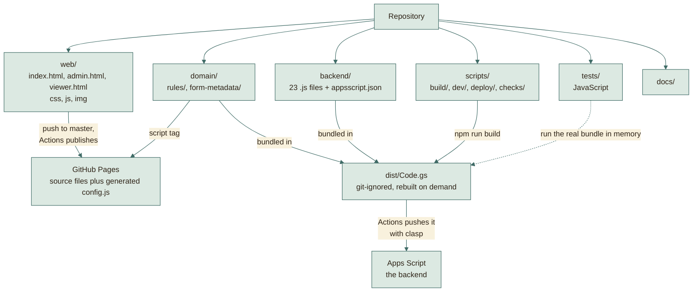
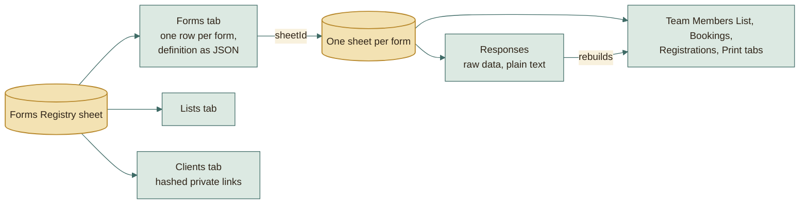

# File structure

## The repository at a glance

Each folder goes somewhere different. Only one of them needs a build step.

## Which scripts each page loads

The pages share a few small files. Each file adds itself to one `App` object.

```mermaid
%%{init: {
  'theme': 'base',
  'themeVariables': {
    'fontFamily': 'ui-sans-serif, system-ui, -apple-system, Segoe UI, Roboto, sans-serif',
    'fontSize': '15px',
    'primaryColor': '#DCE9E2', 'primaryBorderColor': '#3F6B66', 'primaryTextColor': '#2F2418',
    'secondaryColor': '#F0E4C8', 'secondaryBorderColor': '#C9A24A', 'secondaryTextColor': '#2F2418',
    'tertiaryColor': '#F6EFDC', 'tertiaryBorderColor': '#CDBB94', 'tertiaryTextColor': '#2F2418',
    'lineColor': '#3F6B66', 'textColor': '#2F2418', 'mainBkg': '#DCE9E2', 'nodeBorder': '#3F6B66',
    'clusterBkg': '#F6EFDC', 'clusterBorder': '#CDBB94', 'titleColor': '#2F2418',
    'edgeLabelBackground': '#F8F1DD',
    'actorBkg': '#DCE9E2', 'actorBorder': '#3F6B66', 'actorTextColor': '#2F2418', 'actorLineColor': '#8FB3AB',
    'signalColor': '#477A73', 'signalTextColor': '#477A73',
    'labelBoxBkgColor': '#F0E4C8', 'labelBoxBorderColor': '#C9A24A', 'labelTextColor': '#2F2418', 'loopTextColor': '#6A5A44',
    'noteBkgColor': '#FBEFC9', 'noteBorderColor': '#C9A24A', 'noteTextColor': '#2F2418',
    'activationBkgColor': '#DCE9E2', 'activationBorderColor': '#3F6B66', 'sequenceNumberColor': '#F8F1DD',
    'transitionColor': '#3F6B66', 'stateLabelColor': '#2F2418', 'stateBkg': '#DCE9E2', 'altBackground': '#F6EFDC',
    'attributeBackgroundColorOdd': '#F8F1DD', 'attributeBackgroundColorEven': '#F0E4C8'
  },
  'flowchart': {'curve': 'basis', 'padding': 14, 'nodeSpacing': 40, 'rankSpacing': 46},
  'sequence': {'mirrorActors': false, 'messageMargin': 34, 'boxMargin': 8}
}}%%
flowchart LR
    subgraph common["Loaded by all three pages"]
        cfg["config.js"]
        fr["fresh.js"]
        th["theme.js"]
        api["api.js"]
        ui["ui/: dom, icons, dialogs,<br/>clipboard, theme-button"]
    end
    subgraph index["index.html: the student form"]
        r1["domain/rules/"]
        i18n["i18n/: en, ar, i18n"]
        tk["ticket.js"]
        h1["handover.js"]
        fm["form.js"]
    end
    subgraph admin["admin.html: the dashboard"]
        r2["domain/rules/"]
        a1["admin.js"]
        a2["admin-settings.js"]
        a5["admin-timetable.js"]
        a9["admin-range.js"]
        a10["admin-size-alerts.js"]
        a7["admin-keys.js"]
        a8["admin-download.js"]
        h2["handover.js"]
        s2["size-alerts.js"]
        a3["admin-data.js"]
        a4["admin-people.js"]
        a6["admin-lists.js"]
    end
    subgraph viewer["viewer.html: instructor page"]
        v1["viewer.js"]
    end
    common --> index
    common --> admin
    common --> viewer
    classDef cDb fill:#F3E2B3,stroke:#B8892D,stroke-width:1.5px,color:#2F2418
    classDef cActor fill:#F4D9D3,stroke:#9A3328,stroke-width:1.5px,color:#2F2418
    classDef cDec fill:#FBEFC9,stroke:#C9A24A,stroke-width:1.5px,color:#2F2418
    classDef cEnd fill:#2F2418,stroke:#2F2418,color:#F8F1DD
    classDef cErr fill:#F6D5CF,stroke:#A12B1F,stroke-width:1.5px,color:#5A140C
    classDef cOk fill:#BFD9CF,stroke:#2E5A55,stroke-width:1.5px,color:#17302D
```

The instructor page does not load the rules: it only reads data, so it needs
no validation.

## Website (static files, no build step)

The site is published at the paths it has always had: the pages at the root,
`web/js`, `web/css` and `web/img` under `assets/`, and `domain/` as
`shared/`. `scripts/build/site-map.js` holds that mapping.

| File | What it is |
|---|---|
| `web/index.html` | The page students use. Shows any form from its saved definition (`?f=name`). |
| `web/admin.html` | The admin dashboard (PIN). |
| `web/viewer.html` | The read-only instructor and client page (`?t=private-token`). |
| `web/css/theme.css` | Colors, fonts, and the type scale as variables. Change the look here; the contrast standard is in its header and enforced by `tests/web/css/theme.test.js`. |
| `web/css/app.css` | Components of the student page. |
| `web/css/admin.css` | Dashboard and instructor layout, including the team cards (a coloured band per team, header strip, leader tag). |
| `web/img/` | The tab icon (`favicon.svg`), PNG sizes for phones and older browsers, and `site.webmanifest`. The pirate and the parrot of the ticket picture (`pirate.webp`, `parrot.webp`), with clear backgrounds; `ticket.js` draws the clock and the calendar around them. The pictures of the route: the ship (`ship.svg`), an island (`island.svg`), the treasure chest (`treasure.svg`), the waves (`sea.svg`), the sky by day and by night (`sky-day.svg`, `sky-night.svg`) and the sun and moon (`sun.svg`, `moon.svg`). They have their own colours; the sea and sky behind them take theirs from the theme. |
| `web/js/config.js` | Source placeholder; `scripts/build/build-site.js` generates its published copy from the Actions `API_URL` variable, with the version of the site. |
| `web/js/app/fresh.js` | Keeps an open page on the published version: compares the version in `config.js` with `version.json`, reloads an older page when nothing would be lost, and offers **Reload** otherwise. |
| `web/js/app/api.js` | Sends requests to the backend as plain-text JSON (avoids browser CORS checks). |
| `web/js/form.js`, `ticket.js` | The student page and the success ticket. |
| `web/js/i18n/en.js`, `ar.js` | The English and Arabic text of the student page, by key, in `App.strings`. |
| `web/js/i18n/i18n.js` | `App.i18n`: the page language and its direction, the text of a key, `{en, ar}` labels, error sentences and dates. Loaded after `en.js` and `ar.js`. |
| `web/js/teams/handover.view.js` | The question asked before the leader of a team moves to another team: who leads next, and their email. Used by the student page and the dashboard. |
| `web/js/app/theme.js` | Light, dark, or follow the device; the choice is remembered on this device only. |
| `web/js/ui/dom.js` | `App.ui.h` builds an element with its attributes and children; `clear` empties one. Loaded first of the `ui/` parts, since the others draw with it. |
| `web/js/ui/icons.js` | The inline SVG icons and the icons a form may show. |
| `web/js/ui/dialogs.js` | The toast and the confirmation dialog. |
| `web/js/ui/clipboard.js` | Copies text, with a fallback for browsers without the clipboard API. |
| `web/js/ui/theme-button.js` | The light and dark switch every page has. |
| `web/js/admin.js` | Dashboard core: login with the PIN, navigation, the widgets the dashboard modules share, and the forms list. |
| `web/js/admin-settings.js` | Form settings: everything an admin can change without touching code. |
| `web/js/admin-timetable.js` | The timetable of a reservation form: dates on a calendar, the hours, and the slots of each day. |
| `web/js/admin-range.js` | The range control of the team size and the teammates. |
| `web/js/admin-size-alerts.js` | The two warnings about small teams. |
| `web/js/admin-keys.js` | Key and link end dates. |
| `web/js/admin-data.js` | Responses, each team, day or registration in its own block as in the sheet, and WhatsApp matching. |
| `web/js/admin-download.js` | Download all. |
| `web/js/admin-people.js` | Instructor and client links. |
| `web/js/admin-lists.js` | The lists behind dropdown questions, each edited the way its kind needs. |
| `web/js/teams/size-alerts.view.js` | The warnings about small teams as they are drawn: a line for each level and a mark on the card of a small team. Used by the dashboard and the instructor page. |
| `web/js/viewer.js` | The instructor page. |
| `domain/enums.js` | The words the pages and the backend share, as frozen enums of stored values: `FormType`, `FormStatus`, `ReviewStatus` and `ListKind`. Loaded before the other domain files. |
| `domain/form-metadata/index.js` | What each form type shows beside its title (term, subject code, batch year) and how it is read, saved and copied. Used by the pages and the backend. It picks the part of the form type; the pages and the bundle load the parts before it. |
| `domain/form-metadata/read.js` | How the metadata reads what it is given: text, own keys, a field of a form that may be missing, and academic years from years and terms. |
| `domain/form-metadata/subject.js` | The metadata of a form with a term and a subject code: team registrations, task submissions and reservations. |
| `domain/form-metadata/batch.js` | The metadata of a WhatsApp registration: the batch year, also read from the term an older form kept it in. |
| `domain/rules/index.js` | The loader of the validation and normalization rules: it gathers the parts below into the one global `Rules`. Used by the browser, the backend, and the tests, so all three always agree. The pages and the bundle load the parts before it. |
| `domain/rules/text.js` | Arabic digits read as Latin ones, empty values, Arabic names, English-only titles and email addresses. |
| `domain/rules/phone.js` | Egyptian mobile numbers: the canonical form, the WhatsApp chat of a number, and the numbers inside pasted text. |
| `domain/rules/codes.js` | Student codes: digits only, of the length the field asks. |
| `domain/rules/drive-link.js` | Google Drive and Docs links, and the Drive folder name rule (Team_Leader_Name_Project_Name_Subject_Name). |
| `domain/rules/slots.js` | Reservation slots: the times of a day, the key and the room left in a slot, the names of dated days, and the check of a chosen slot. |
| `domain/rules/form.js` | Reading a form and its responses: a field by its role, the people on a submission, how many people a form holds, and whether it is open. |
| `domain/rules/team-size.js` | Team size: the sizes a form allows, the notes a student sees for a size, and the warnings about small teams. |
| `domain/rules/submission.js` | A whole submission: each field checked by its type, the member forms of a team, and nobody named twice. |

## Backend (`backend/`, becomes one `Code.gs`)

Apps Script runs every file in one global scope, so the folders give the
structure. `platform/<concern>/` holds code no feature owns, named by what it
does. `features/<area>/<feature>/` holds one feature, with the business area
above it. Each file defines one namespace named after it, in PascalCase
(`forms.repository.js` defines `FormsRepository`), and returns only the
functions other files use; the rest stay private to the file. Inside a feature
the file name says the role:

| Role | What it holds |
|---|---|
| `*.repository.js` | reading and writing the feature's tab |
| `*.rules.js` | business rules |
| `*.access.js` | who may act |
| `*.service.js` | the feature's work: loads data, applies the rules, saves |
| `*.controller.js` | the API actions of the feature, one named function each, listed in `routes.js` |

### Platform: code no feature owns

| File | What it does |
|---|---|
| `backend/platform/http/api-error.js` | The error every handler throws and the JSON reply the web app sends. |
| `backend/platform/http/router.js` | Finds the handler of each request in the routes table, runs the admin or link check its access asks for, and turns what it returns or throws into the reply. |
| `backend/platform/sheets/table.js` | Reading and writing the rows of a sheet tab by its header names. |
| `backend/platform/sheets/lock.js` | The script lock every write runs under, safe to nest. |
| `backend/platform/sheets/cell.js` | Yes/no values as the sheets store them: `readFlag` and `writeFlag`, the only code that reads or writes the stored `'1'` and `'0'`. |
| `backend/platform/sheets/sheet-style.js` | The palette every painted tab shares, and the look of a data tab: row colours, widths and a frozen header. |
| `backend/platform/security/crypto.js` | Ids, random digits, SHA-256 and the sealing of short digit strings. |
| `backend/platform/security/properties.js` | Script properties, including the secret pepper of every hash. |
| `backend/platform/format/text.js` | Turning text into link names and into safe HTML. |
| `backend/platform/format/time.js` | The current time and date as ISO text, and instants some days away. |
| `backend/platform/format/json.js` | Copying values and reading JSON text safely. |
| `backend/platform/config/constants.js` | The name of the app, the registry tab names, and the names of the script properties and cache keys. |
| `backend/platform/config/access.js` | Who may call an action: the admin, a private link, the holder of a registration key, or anyone. |
| `backend/platform/xlsx/xml.js` | The XML pieces of an Excel file: elements, namespaces, links between parts, escaped text, column letters and colours. |
| `backend/platform/xlsx/style-sheet.js` | The style sheet of an Excel file: fonts, fills, the grid border and one cell format for each style. |
| `backend/platform/xlsx/worksheet.js` | One sheet of an Excel file: its cells, column widths fitted to the text, merged ranges, links, frozen header and print setup. |
| `backend/platform/xlsx/workbook.js` | The Excel file itself: the list of parts, the workbook, its links, and the zip. |

### Catalog: what the admin sets up

| File | What it does |
|---|---|
| `backend/features/catalog/registry/registry.repository.js` | The registry spreadsheet and the Drive folder that holds every form. |
| `backend/features/catalog/registry/registry.setup.js` | Creating the registry tabs and folder the first time, and the look of the registry tabs. |
| `backend/features/catalog/forms/forms.repository.js` | The Forms tab: reading, finding and saving form rows. |
| `backend/features/catalog/forms/forms.service.js` | Creating, reading, copying and deleting forms with their sheets, and the form the admin editor opens. |
| `backend/features/catalog/forms/forms.patch.js` | Changing a form: the settings a patch may change, how each is cleaned, and refusing a change made on an old copy. |
| `backend/features/catalog/forms/forms.rules.js` | The submission rules and the small-team notice of a form, cleaned to what is allowed. |
| `backend/features/catalog/forms/forms.public.js` | What the public may read of a form, with its list options filled in. |
| `backend/features/catalog/forms/forms.questions.js` | The questions and pages an admin adds to a form. |
| `backend/features/catalog/forms/forms.controller.js` | The form actions: the public form definition and the admin form actions. |
| `backend/features/catalog/lists/lists.repository.js` | The Lists tab: the values of each list and what kind of list it is. |
| `backend/features/catalog/lists/lists.rules.js` | The lists a new registry starts with, and how list values are cleaned. |
| `backend/features/catalog/lists/lists.service.js` | The lists of the registry: read, fill, make, rename and delete them, with the checks on keys and names. |
| `backend/features/catalog/lists/lists.controller.js` | The list actions of the admin: read, fill, make, rename and delete lists. |
| `backend/features/catalog/templates/template-fields.js` | The fields every form template is built from: people, study, team size and members. |
| `backend/features/catalog/templates/templates.service.js` | The starting definition of each form type. |

### Intake: what students send and what happens to it

| File | What it does |
|---|---|
| `backend/features/intake/responses/responses.repository.js` | The Responses tab of a form: reading and saving submissions. |
| `backend/features/intake/responses/responses.review.js` | The review steps of a submission and its review status. |
| `backend/features/intake/responses/responses.rules.js` | Whether a form takes submissions, and the limits on how many and how big. |
| `backend/features/intake/responses/drive-links.js` | Checking the Drive links a submission names: shared, and named as the form asks. |
| `backend/features/intake/responses/responses.notify.js` | What follows a saved submission: the emails and the repaint of the sheet views. |
| `backend/features/intake/keys/keys.service.js` | Edit keys: issuing, sealing, expiring and finding a submission by its key, and listing and extending the keys of a form. |
| `backend/features/intake/keys/keys.controller.js` | The key actions of the admin: list keys and extend their end dates. |
| `backend/features/intake/submissions/submissions.controller.js` | The student actions: submit, look up, update and cancel a submission. |
| `backend/features/intake/submissions/admin-submissions.controller.js` | The admin actions on submissions: list, edit, delete and reset or show a key. |
| `backend/features/intake/submissions/submissions.service.js` | Submissions: checking the answers, saving a new one, changing and cancelling one, and what the student sees of it. |
| `backend/features/intake/submissions/admin-submissions.service.js` | The admin side of submissions: the list, changes to review, status and answers, and resetting or showing a key. |
| `backend/features/intake/teams/team-numbers.js` | The number of each team, given once and kept. |
| `backend/features/intake/teams/teams.service.js` | Which forms gather teams, and the teams as blocks of members. |
| `backend/features/intake/transfers/transfers.repository.js` | The Transfers tab of a form: reading and saving move requests. |
| `backend/features/intake/transfers/transfers.service.js` | Asking for a member of another team: taking the member out, recording, cancelling and closing requests. |
| `backend/features/intake/transfers/transfers.decision.js` | The answer to a request: a rejection, or an approval that moves the member and closes the other requests. |
| `backend/features/intake/transfers/transfers.members.js` | The members of a team as a transfer moves them: the member code, the team size and the hand-over of the lead. |
| `backend/features/intake/transfers/transfers.view.js` | What the leaders and the dashboard see of the requests, with who can lead next and the other leader's phone. |
| `backend/features/intake/transfers/transfers.mail.js` | The emails of a transfer request and of its answer. |
| `backend/features/intake/transfers/transfers.controller.js` | The transfer actions of the team leader and of the admin. |
| `backend/features/intake/reservations/slots.rules.js` | The slots of a reservation form: cleaned, labelled and counted. |
| `backend/features/intake/reservations/key-booking.service.js` | Booking a slot with the key of a registration. |
| `backend/features/intake/reservations/key-booking.series.js` | The weekly series of bookings of a registration form: the bookings so far, and the title and timetable of the next one. |
| `backend/features/intake/reservations/key-booking.controller.js` | The booking actions: the team behind a key, and the next week of bookings. |
| `backend/features/intake/matching/matching.repository.js` | The WhatsApp requests tab of a form. |
| `backend/features/intake/matching/matching.service.js` | WhatsApp matching: reads a form with matching on, imports pasted numbers, matches requests to submissions by phone, records decisions and deletes requests. |
| `backend/features/intake/matching/matching.controller.js` | The WhatsApp matching actions of the admin: import, list, decide and remove. Each checks the request and asks MatchingService. |

### Access: who may see what

| File | What it does |
|---|---|
| `backend/features/access/auth/auth.service.js` | The admin PIN: setting it, checking it, and locking out wrong guesses. |
| `backend/features/access/auth/auth.controller.js` | The admin login action. |
| `backend/features/access/clients/clients.repository.js` | The Clients tab: the private links of instructors and clients. |
| `backend/features/access/clients/clients.service.js` | A link token, its access key and its end date, and what the admin sees of a link. |
| `backend/features/access/clients/clients.access.js` | Who may use a link: its token, its key, its end date and the lock-out after wrong keys. |
| `backend/features/access/clients/clients.links.js` | The admin's work on private links: list, make, change, renew, key, show and remove them. |
| `backend/features/access/clients/clients.controller.js` | The link actions of the admin: list, make, change, renew, key, show and remove. |
| `backend/features/access/viewer/viewer.rules.js` | What a private link may see: the forms, the kind of view and the columns. |
| `backend/features/access/viewer/viewer.service.js` | The rows a private link reads: bookings, teams and WhatsApp registrations. |
| `backend/features/access/viewer/viewer.controller.js` | The actions of the instructor page: who the link is, its data and its reviews. |

### Outputs: what the platform produces in Sheets and Drive

| File | What it does |
|---|---|
| `backend/features/outputs/sheet-views/sheet-views.layout.js` | The look of the sheet views: headers, frames, merged labels and links; and the look of a form's data tabs. |
| `backend/features/outputs/sheet-views/sheet-views.builder.js` | Which view each type of form gets, and the order by creation the views share. |
| `backend/features/outputs/sheet-views/sheet-views.team-list.js` | The Team Members List view: each team a tinted block with its task merged down the side. |
| `backend/features/outputs/sheet-views/sheet-views.bookings.js` | The Bookings view: every booking in timetable order, each day a block with its label merged down the side. |
| `backend/features/outputs/sheet-views/sheet-views.registrations.js` | The Registrations view: everyone by group and section, with the timetable link and the review. |
| `backend/features/outputs/sheet-views/sheet-views.scheduler.js` | When the sheet views are rebuilt. A change only marks the form's views as out of date and books one run a minute later. The run repaints every marked form and removes itself, so students never wait for formatting and nothing runs while nothing changes. |
| `backend/features/outputs/sheet-views/sheet-views.controller.js` | The admin action that rebuilds the sheet views. |
| `backend/features/outputs/downloads/downloads.jobs.js` | A Download all job: its folder, its saved state between requests, and where a team goes in the zip. |
| `backend/features/outputs/downloads/downloads.files.js` | The files of a job: their bytes, read or exported to Office, their names in the zip, and retries while Google is busy. |
| `backend/features/outputs/downloads/downloads.team.js` | Saving one team's file or folder, as far as one request may. |
| `backend/features/outputs/downloads/downloads.service.js` | Starting a job, splitting the saved files into zip parts, packing a part and reading a zip in pieces. |
| `backend/features/outputs/downloads/downloads.workbook.js` | The Excel workbook a Download all job puts beside the files. |
| `backend/features/outputs/downloads/downloads.controller.js` | The Download all actions: start, one team, finish, pack and send in chunks. |
| `backend/features/outputs/print/print.service.js` | The print actions behind one door, and the PDF export of a print tab to Drive. |
| `backend/features/outputs/print/print.layout.js` | The layout every print tab shares: its name, title and header rows, widths, frame and empty note. |
| `backend/features/outputs/print/print.reservations.js` | The print tab of one day of reservations, in timetable order with a signature column. |
| `backend/features/outputs/print/print.team-list.js` | The print tab of everyone, team by team, with the team number and task merged. |
| `backend/features/outputs/print/print.controller.js` | The print actions of the admin. |
| `backend/features/outputs/menu/menu.service.js` | The Forms Platform menu of the registry sheet and what each item does. |
| `backend/features/outputs/menu/print-dialog.js` | The dialog the print menu items open in the sheet. |

### The web app

| File | What it does |
|---|---|
| `backend/routes.js` | Every action: who may call it and the handler that answers it. A row without a valid access stops the script while it loads. |
| `backend/entry-points.js` | The functions Apps Script calls by name (the sheet menu, its print dialog, setup, the PIN commands and the view trigger), each handing the call to its namespace. |
| `backend/main.js` | The web app: every request arrives here, is read as JSON, and goes to the router. |

`npm run build` joins `domain/enums.js`, the parts of `domain/rules/` and
`domain/form-metadata/` and every backend file into `dist/Code.gs`: `platform/` first, then `features/`, then
`routes.js`, `entry-points.js` and `main.js`.

## Tools and tests

| Path | What it is |
|---|---|
| `scripts/build/bundle-backend.js` | The bundler. |
| `scripts/build/site-map.js` | Where each published path of the site comes from: the pages from `web/`, `assets/js`, `assets/css` and `assets/img` from `web/js`, `web/css` and `web/img`, and `shared/` from `domain/`. The site packager, the preview server, the page tests and the structure check read it. |
| `scripts/checks/run-checks.js`, `.githooks/pre-commit`, `.githooks/pre-push` | Runs every check, on the staged files before each commit (`--staged`) or on the whole tree before each push and in CI (`--all`, `npm run check`), and the git hooks that call it. `npm install` points git at `.githooks`. [CHECKS.md](../standards/CHECKS.md) lists the checks. |
| `scripts/checks/config.json`, `baseline.json`, `exceptions.json` | What each check covers and its limits; the findings old files may still have, which may only go down; and the paths allowed to break a structure rule, each with its reason. |
| `scripts/checks/lib/` | `files.js` (which files a run looks at), `parse.js` (acorn with comments), `jsdoc.js` (reads a JSDoc comment into its summary and tags), `baseline.js`, `exceptions.js`, `report.js`. |
| `scripts/checks/code/check-biome.js` | Runs Biome on the files of a run and turns what it reports into findings. |
| `scripts/checks/code/check-lines.js` | No line wider than 80 columns, URLs not counted. |
| `scripts/checks/code/check-jsdoc.js` | Every named function has a Google-style JSDoc comment whose tags match its parameters and return, with no metadata tags. |
| `scripts/checks/code/check-comments.js` | Every shell script, git hook and CI workflow says in a comment what it does and when it runs, and every workflow job says why it runs. |
| `scripts/checks/code/check-numbers.js` | Every number that initialises something, which Biome skips, is held by a CONSTANT_CASE name. |
| `scripts/checks/code/check-enums.js` | The values of a shared enum are written as its members where they are compared with the property the enum names. |
| `scripts/checks/code/check-layers.js` | Backend code reads only the layers it may: the platform reads no feature, and a controller reads no repository. |
| `scripts/checks/code/check-flags.js` | Yes/no values are compared and written as `'1'`/`'0'` only in `backend/platform/sheets/cell.js`. |
| `scripts/checks/tree/check-structure.js` | The structure rules above. |
| `scripts/checks/tree/check-docs.js` | [API.md](../backend/API.md) names exactly the actions the backend has, [TESTING.md](../process/TESTING.md) gives the real number of tests, and no Markdown link points at a file that is gone. |
| `scripts/deploy/prepare-clasp.js` | Checks the deployment variables of the workflow and writes the clasp configuration git ignores. |
| `scripts/deploy/backend-changed.js` | Tells the workflow whether a push changed a backend file, so a push of pages or documents alone does not deploy the backend. |
| `scripts/deploy/setup-deployment.js` | First deployment from your computer (`npm run setup`): creates the sheet and its script, pushes the bundle, creates the web app, and stores the IDs, the credential and the Pages setting in GitHub. |
| `scripts/dev/setup-git.sh` | Run by `npm install`: points git at `.githooks/` and at `.git-blame-ignore-revs`, the layout-only commits `git blame` skips. |
| `scripts/dev/dev-server.js` | `npm run dev`: serves the site and answers its API calls from the in-memory Google, with sample forms, so pages can be opened in a real browser. |
| `tests/harness/appsscript-mock.js` | An in-memory Sheets, Drive, Mail, Cache, and clock, so the real backend code runs in tests. |
| `tests/harness/dom.js` | Opens the real pages in jsdom wired to that backend. |
| `tests/<source path>/` | The tests, at the path of the code they check: `tests/backend/features/intake/transfers/transfers.test.js` checks that feature, `tests/web/admin.test.js` the admin page. A test of the whole system, such as `tests/golden.test.js`, sits at the root of `tests/`. [TESTING.md](../process/TESTING.md) lists them. |

## Structure rules

`scripts/checks/tree/check-structure.js` checks these on the whole tree; the
paths and limits are under `structure` in `scripts/checks/config.json`.

| Rule | What it means |
|---|---|
| Root allow-list | The root holds `README.md`, `package.json`, `package-lock.json`, `biome.json`, `.gitignore`, `.git-blame-ignore-revs`, `.githooks/`, `.github/`, `backend/`, `web/`, `domain/`, `scripts/`, `tests/` and `docs/`. Pages, notes and requirements live in their folders. |
| No catch-all names | No file or folder is named `utils`, `helpers`, `common`, `misc`, `manager`, `stuff` or `shared`. Code is named by what it does, so a reader finds it by its subject. |
| One subject per folder | A folder holds the files of one subject, so its name says what is inside. No number decides when a folder is too full; the reviewer splits a folder when it holds two subjects. No published JavaScript standard sets a file count, so none is checked. |
| Pages and assets | Every script and stylesheet a page loads exists, and every file under `web/js/` and `web/css/` is loaded by a page. |
| Every file named here | Each source file has a row on this page, by its path or its name. A pattern such as `admin*.js` does not count. |
| Layers | Code under `backend/platform/` reads no feature, and a `*.controller.js` reads no `*.repository.js`: it asks the service, which reads the repository. `scripts/checks/code/check-layers.js` checks it. |
| Tests mirror the source | Node's test runner sets no layout, so `tests/` mirrors the source: the tests of `scripts/checks/lib/baseline.js` are in `tests/scripts/checks/lib/baseline.test.js`. Only `tests/harness/` and `tests/fixtures/` exist in tests alone, and a test of the whole system sits at the root of `tests/`. `scripts/checks/tree/check-structure.js` checks that every other folder under `tests/` is a source folder. |

## Data model in one paragraph

The **Forms Registry** sheet has one row per form (its whole definition as JSON),
the shared lists, and the instructor links (only a hash of each link's secret is
stored). Each form owns a **separate spreadsheet** with a Responses tab (the raw
data), and the tinted views built from it. A form definition is plain data:
questions, steps, rules (including the team size range), slots, review steps. The
engine never hard-codes a question, which is why new forms need no code.

## Going deeper

| Question | Read |
|---|---|
| How does a request travel, and what runs where? | [ARCHITECTURE.md](ARCHITECTURE.md) |
| Why was it built this way? | [WORKAROUNDS.md](WORKAROUNDS.md) |
| What produces `dist/`? | [BUILD-PIPELINE.md](BUILD-PIPELINE.md) |
| What do GitHub and Google each do? | [HOSTING.md](HOSTING.md) |
| Every sheet and column | [DATA-MODEL.md](../backend/DATA-MODEL.md) |
| Secrets and weak spots | [SECURITY.md](../backend/SECURITY.md) |
| How the tests work | [TESTING.md](../process/TESTING.md) |
| Click-by-click setup | [DEPLOY.md](../operations/DEPLOY.md) |
