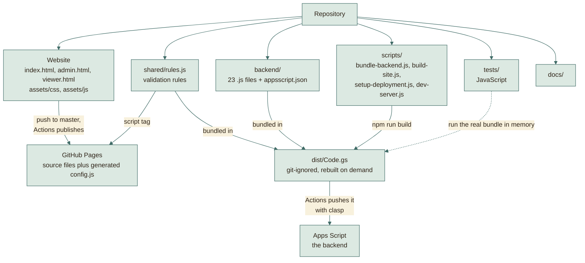
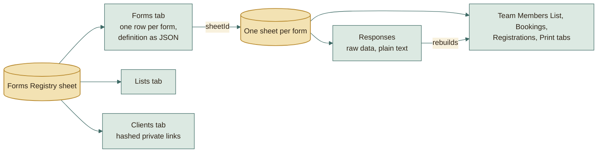

# File structure

## The repository at a glance

Each folder goes somewhere different. Only one of them needs a build step.

## Which scripts each page loads

The pages share a few small files. Each file adds itself to one `App` object.

```mermaid
%%{init: {
  'theme': 'base',
  'themeVariables': {
    'fontFamily': 'ui-sans-serif, system-ui, -apple-system, Segoe UI, Roboto, sans-serif',
    'fontSize': '15px',
    'primaryColor': '#DCE9E2', 'primaryBorderColor': '#3F6B66', 'primaryTextColor': '#2F2418',
    'secondaryColor': '#F0E4C8', 'secondaryBorderColor': '#C9A24A', 'secondaryTextColor': '#2F2418',
    'tertiaryColor': '#F6EFDC', 'tertiaryBorderColor': '#CDBB94', 'tertiaryTextColor': '#2F2418',
    'lineColor': '#3F6B66', 'textColor': '#2F2418', 'mainBkg': '#DCE9E2', 'nodeBorder': '#3F6B66',
    'clusterBkg': '#F6EFDC', 'clusterBorder': '#CDBB94', 'titleColor': '#2F2418',
    'edgeLabelBackground': '#F8F1DD',
    'actorBkg': '#DCE9E2', 'actorBorder': '#3F6B66', 'actorTextColor': '#2F2418', 'actorLineColor': '#8FB3AB',
    'signalColor': '#477A73', 'signalTextColor': '#477A73',
    'labelBoxBkgColor': '#F0E4C8', 'labelBoxBorderColor': '#C9A24A', 'labelTextColor': '#2F2418', 'loopTextColor': '#6A5A44',
    'noteBkgColor': '#FBEFC9', 'noteBorderColor': '#C9A24A', 'noteTextColor': '#2F2418',
    'activationBkgColor': '#DCE9E2', 'activationBorderColor': '#3F6B66', 'sequenceNumberColor': '#F8F1DD',
    'transitionColor': '#3F6B66', 'stateLabelColor': '#2F2418', 'stateBkg': '#DCE9E2', 'altBackground': '#F6EFDC',
    'attributeBackgroundColorOdd': '#F8F1DD', 'attributeBackgroundColorEven': '#F0E4C8'
  },
  'flowchart': {'curve': 'basis', 'padding': 14, 'nodeSpacing': 40, 'rankSpacing': 46},
  'sequence': {'mirrorActors': false, 'messageMargin': 34, 'boxMargin': 8}
}}%%
flowchart LR
    subgraph common["Loaded by all three pages"]
        cfg["config.js"]
        fr["fresh.js"]
        th["theme.js"]
        api["api.js"]
        ui["ui.js"]
    end
    subgraph index["index.html: the student form"]
        r1["shared/rules.js"]
        i18n["i18n.js"]
        tk["ticket.js"]
        h1["handover.js"]
        fm["form.js"]
    end
    subgraph admin["admin.html: the dashboard"]
        r2["shared/rules.js"]
        a1["admin.js"]
        a2["admin-settings.js"]
        a5["admin-timetable.js"]
        a9["admin-range.js"]
        a10["admin-size-alerts.js"]
        a7["admin-keys.js"]
        a8["admin-download.js"]
        h2["handover.js"]
        s2["size-alerts.js"]
        a3["admin-data.js"]
        a4["admin-people.js"]
        a6["admin-lists.js"]
    end
    subgraph viewer["viewer.html: instructor page"]
        v1["viewer.js"]
    end
    common --> index
    common --> admin
    common --> viewer
    classDef cDb fill:#F3E2B3,stroke:#B8892D,stroke-width:1.5px,color:#2F2418
    classDef cActor fill:#F4D9D3,stroke:#9A3328,stroke-width:1.5px,color:#2F2418
    classDef cDec fill:#FBEFC9,stroke:#C9A24A,stroke-width:1.5px,color:#2F2418
    classDef cEnd fill:#2F2418,stroke:#2F2418,color:#F8F1DD
    classDef cErr fill:#F6D5CF,stroke:#A12B1F,stroke-width:1.5px,color:#5A140C
    classDef cOk fill:#BFD9CF,stroke:#2E5A55,stroke-width:1.5px,color:#17302D
```

The instructor page does not load `rules.js`: it only reads data, so it needs
no validation.

## Website (static files, no build step)

| File | What it is |
|---|---|
| `index.html` | The page students use. Shows any form from its saved definition (`?f=name`). |
| `admin.html` | The admin dashboard (PIN). |
| `viewer.html` | The read-only instructor and client page (`?t=private-token`). |
| `assets/css/theme.css` | Colors, fonts, and the type scale as variables. Change the look here; the contrast standard is in its header and enforced by `tests/contrast.test.js`. |
| `assets/css/app.css` | Components of the student page. |
| `assets/css/admin.css` | Dashboard and instructor layout, including the team cards (a coloured band per team, header strip, leader tag). |
| `assets/img/` | The tab icon (`favicon.svg`), PNG sizes for phones and older browsers, and `site.webmanifest`. The pirate and the parrot of the ticket picture (`pirate.webp`, `parrot.webp`), with clear backgrounds; `ticket.js` draws the clock and the calendar around them. The pictures of the route: the ship (`ship.svg`), an island (`island.svg`), the treasure chest (`treasure.svg`), the waves (`sea.svg`), the sky by day and by night (`sky-day.svg`, `sky-night.svg`) and the sun and moon (`sun.svg`, `moon.svg`). They have their own colours; the sea and sky behind them take theirs from the theme. |
| `assets/js/config.js` | Source placeholder; `scripts/build-site.js` generates its published copy from the Actions `API_URL` variable, with the version of the site. |
| `assets/js/fresh.js` | Keeps an open page on the published version: compares the version in `config.js` with `version.json`, reloads an older page when nothing would be lost, and offers **Reload** otherwise. |
| `assets/js/api.js` | Sends requests to the backend as plain-text JSON (avoids browser CORS checks). |
| `assets/js/form.js`, `ticket.js`, `i18n.js` | The student page, the success ticket, English and Arabic text. |
| `assets/js/handover.js` | The question asked before the leader of a team moves to another team: who leads next, and their email. Used by the student page and the dashboard. |
| `assets/js/theme.js` | Light, dark, or follow the device; the choice is remembered on this device only. |
| `assets/js/ui.js` | DOM building, inline icons, dialogs and the clipboard, used by every page. |
| `assets/js/admin.js` | Dashboard core: login with the PIN, navigation, the widgets the dashboard modules share, and the forms list. |
| `assets/js/admin-settings.js` | Form settings: everything an admin can change without touching code. |
| `assets/js/admin-timetable.js` | The timetable of a reservation form: dates on a calendar, the hours, and the slots of each day. |
| `assets/js/admin-range.js` | The range control of the team size and the teammates. |
| `assets/js/admin-size-alerts.js` | The two warnings about small teams. |
| `assets/js/admin-keys.js` | Key and link end dates. |
| `assets/js/admin-data.js` | Responses, each team, day or registration in its own block as in the sheet, and WhatsApp matching. |
| `assets/js/admin-download.js` | Download all. |
| `assets/js/admin-people.js` | Instructor and client links. |
| `assets/js/admin-lists.js` | The lists behind dropdown questions, each edited the way its kind needs. |
| `assets/js/size-alerts.js` | The warnings about small teams as they are drawn: a line for each level and a mark on the card of a small team. Used by the dashboard and the instructor page. |
| `assets/js/viewer.js` | The instructor page. |
| `shared/form-metadata.js` | What each form type shows beside its title (term, subject code, batch year) and how it is read, saved and copied. Used by the pages and the backend. |
| `shared/rules.js` | Validation and normalization rules (Arabic names, phones, codes, Drive links, team size, slots). Used by the browser, the backend, and the tests, so all three always agree. |

## Backend (`backend/`, becomes one `Code.gs`)

| File | What it does |
|---|---|
| `Code.js` | Entry point. Routes each request to its handler. |
| `Config.js` | Constants and small helpers. |
| `Auth.js` | Admin PIN (salted hash, lockout). |
| `Registry.js` | The registry sheet: setup, reading and writing forms and lists, and creating, updating, duplicating and deleting a form under the lock. |
| `Templates.js` | The four form types and the default lists, all as data. |
| `FormsApi.js` | The API of forms and lists: the public form definition, the admin's form actions, and making, renaming, filling and deleting lists. |
| `Responses.js` | Reading and writing rows, edit keys, limits, Drive checks, emails. |
| `Submissions.js` | Student submit, lookup, update, cancel; admin edits and key reset. |
| `Slots.js` | Reservation timetable checks and availability. |
| `Questions.js` | Questions and pages an admin adds: allowed types, ids, labels and choices, and pages that list each existing question once. |
| `KeyBooking.js` | Booking a reservation with a registration key from another form: the setting, the team preview, the copied answers, and the next booking of a series. |
| `TeamList.js` | The teams of a team or task form with their members and their numbers, which a team keeps for good. Read by the sheet view, the printed list, the dashboard, the instructor page and the download. |
| `Download.js` | Download all: each team's task file or project folder read as the owner, `Teams.xlsx`, zip parts, and the pieces the page saves. |
| `Xlsx.js` | A small writer of Excel files: styles, merged cells, links to files next to the workbook, widths that fit the content. |
| `KeyExpiry.js` | When registration edit keys stop working, and moving that date for one, some, or all registrations of a form. |
| `Transfers.js` | Moving a member between two teams of a form: the rule, the requests tab, asking on submit and update, the answer of the leader or the admin, the move, and the emails. |
| `Views.js` | Tinted block views inside each form's Google Sheet, and the booked run that repaints them a minute after a change. |
| `SheetStyle.js` | How the data tabs look: the registry's Forms, Clients and Lists, and each form's Responses, Transfers and Requests get the dark header, a frozen first row, column widths and two row tints. It writes no value and no number format. |
| `Print.js` | Print tabs and PDF export. |
| `Menu.js` | The "Forms Platform" menu in the registry sheet: setup, the admin PIN, printing, rebuilding the views, and unlocking the admin page after wrong PINs. |
| `Matching.js` | WhatsApp request matching. |
| `Clients.js`, `Viewer.js` | Private instructor links, their access keys and end dates, and what they can see. |

`npm run build` joins `shared/rules.js`, `shared/form-metadata.js` and every backend file into `dist/Code.gs`.

## Tools and tests

| Path | What it is |
|---|---|
| `scripts/bundle-backend.js` | The bundler. |
| `scripts/checks/run-checks.js`, `.githooks/pre-commit`, `.githooks/pre-push` | Runs every check, on the staged files before each commit (`--staged`) or on the whole tree before each push and in CI (`--all`, `npm run check`), and the git hooks that call it. `npm install` points git at `.githooks`. [CHECKS.md](../standards/CHECKS.md) lists the checks. |
| `scripts/checks/config.json`, `baseline.json`, `exceptions.json` | What each check covers and its limits; the findings old files may still have, which may only go down; and the paths allowed to break a structure rule, each with its reason. |
| `scripts/checks/lib/` | `files.js` (which files a run looks at), `parse.js` (acorn with comments), `jsdoc.js` (reads a JSDoc comment into its summary and tags), `baseline.js`, `exceptions.js`, `report.js`. |
| `scripts/checks/check-biome.js` | Runs Biome on the files of a run and turns what it reports into findings. |
| `scripts/checks/check-lines.js` | No line wider than 80 columns, URLs not counted. |
| `scripts/checks/check-jsdoc.js` | Every named function has a Google-style JSDoc comment whose tags match its parameters and return, with no metadata tags. |
| `scripts/checks/check-numbers.js` | Every number that initialises something, which Biome skips, is held by a CONSTANT_CASE name. |
| `scripts/checks/check-flags.js` | Yes/no values are compared and written as `'1'`/`'0'` only in a row codec. |
| `scripts/checks/check-structure.js` | The structure rules above. |
| `scripts/checks/check-docs.js` | [API.md](../backend/API.md) names exactly the actions the backend has, [TESTING.md](../process/TESTING.md) gives the real number of tests, and no Markdown link points at a file that is gone. |
| `scripts/prepare-clasp.js` | Checks the deployment variables of the workflow and writes the clasp configuration git ignores. |
| `scripts/backend-changed.js` | Tells the workflow whether a push changed a backend file, so a push of pages or documents alone does not deploy the backend. |
| `scripts/setup-deployment.js` | First deployment from your computer (`npm run setup`): creates the sheet and its script, pushes the bundle, creates the web app, and stores the IDs, the credential and the Pages setting in GitHub. |
| `scripts/dev-server.js` | `npm run dev`: serves the site and answers its API calls from the in-memory Google, with sample forms, so pages can be opened in a real browser. |
| `tests/harness/appsscript-mock.js` | An in-memory Sheets, Drive, Mail, Cache, and clock, so the real backend code runs in tests. |
| `tests/harness/dom.js` | Opens the real pages in jsdom wired to that backend. |
| `tests/*.test.js`, `tests/scripts/` | The tests, one file per area, and the tests of the scripts under the same path; [TESTING.md](../process/TESTING.md) lists them. |

## Structure rules

`scripts/checks/check-structure.js` checks these on the whole tree; the
paths and limits are under `structure` in `scripts/checks/config.json`.

| Rule | What it means |
|---|---|
| Root allow-list | The root holds `README.md`, `package.json`, `package-lock.json`, `biome.json`, `.gitignore`, `.git-blame-ignore-revs`, `.githooks/`, `.github/`, `backend/`, `web/`, `domain/`, `scripts/`, `tests/` and `docs/`. Pages, notes and requirements live in their folders. |
| No catch-all names | No file or folder is named `utils`, `helpers`, `common`, `misc`, `manager`, `stuff` or `shared`. Code is named by what it does, so a reader finds it by its subject. |
| Folder cap | At most 8 code files in one folder. A ninth means the folder holds more than one subject; sort its files into sub-folders by subject. |
| Pages and assets | Every script and stylesheet a page loads exists, and every file under `assets/js/` and `assets/css/` is loaded by a page. |
| Every file named here | Each source file has a row on this page, by its path or its name. A pattern such as `admin*.js` does not count. |
| Tests mirror the source | The tests of `scripts/checks/lib/baseline.js` are in `tests/scripts/checks/lib/baseline.test.js`. This rule is not checked yet; the reviewer holds it. |

The tree does not keep all of these today. The root still holds the pages,
`assets/` and `shared/`, and `assets/js/`, `backend/` and `tests/` are over
the cap. The check baseline counts each of these, so none can grow.

## Data model in one paragraph

The **Forms Registry** sheet has one row per form (its whole definition as JSON),
the shared lists, and the instructor links (only a hash of each link's secret is
stored). Each form owns a **separate spreadsheet** with a Responses tab (the raw
data), and the tinted views built from it. A form definition is plain data:
questions, steps, rules (including the team size range), slots, review steps. The
engine never hard-codes a question, which is why new forms need no code.

## Going deeper

| Question | Read |
|---|---|
| How does a request travel, and what runs where? | [ARCHITECTURE.md](ARCHITECTURE.md) |
| Why was it built this way? | [WORKAROUNDS.md](WORKAROUNDS.md) |
| What produces `dist/`? | [BUILD-PIPELINE.md](BUILD-PIPELINE.md) |
| What do GitHub and Google each do? | [HOSTING.md](HOSTING.md) |
| Every sheet and column | [DATA-MODEL.md](../backend/DATA-MODEL.md) |
| Secrets and weak spots | [SECURITY.md](../backend/SECURITY.md) |
| How the tests work | [TESTING.md](../process/TESTING.md) |
| Click-by-click setup | [DEPLOY.md](../operations/DEPLOY.md) |
