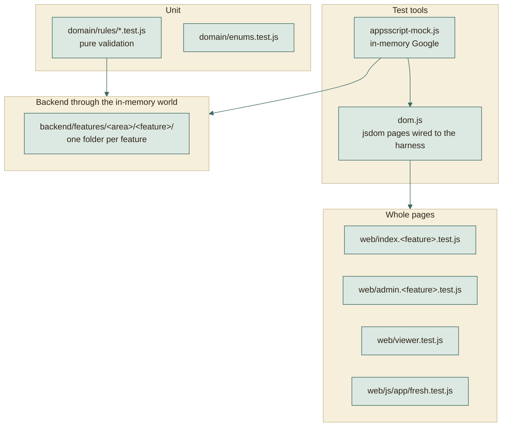
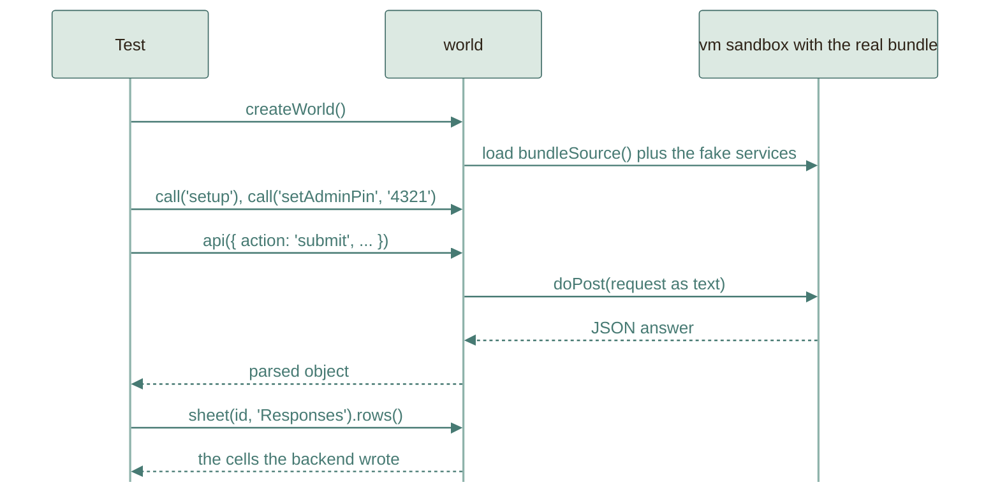

# Testing

397 automated tests run without a Google account, a browser, or a network.
They run the **real** backend and the **real** pages. This page explains how
that works and what it can and cannot prove.

```
npm test    # 397 tests
```

## The layers



Higher layers reuse lower ones: a page test types into the real page, the page
calls `fetch`, and `fetch` lands in the same in-memory backend the backend tests
use. A bug anywhere between the keyboard and the sheet is caught in one test.

## The in-memory Google

`tests/harness/appsscript-mock.js` implements just enough of Google's services
for the code to run unchanged:

| Fake | Behaves like |
|---|---|
| `SpreadsheetApp` | Spreadsheets, tabs, ranges, values, merges, backgrounds, borders |
| `DriveApp` | Files and folders with sharing access, configurable per test |
| `LockService`, `CacheService`, `PropertiesService` | Locks, expiring counters, stored properties |
| `MailApp` | Collects sent messages so tests can read them |
| `UrlFetchApp` | Configurable network answers, used for the PDF export |
| `Utilities`, `ContentService`, `ScriptApp` | Hashing, UUIDs, dates, JSON output, triggers |
| The clock | `w.setNow(...)`, so key expiry and form dates are tested without waiting |

The harness exposes `world.api(request)` (the same call a browser makes),
`world.call('functionName')` (run any backend function by name, such as
`setup` or `setAdminPin`), `world.sheet(id, tab)` (read cells back), and
`world.runTriggers()` (fire the triggers that are booked, as Google would when
their time comes; a test calls it before it reads a tinted view).
`createWorld({ seed })` makes ids, UUIDs and `Math.random` repeat from run to
run, so a test can compare everything a run stored with a saved copy.



## Page tests with jsdom

`tests/harness/dom.js` opens `index.html`, `admin.html`, or `viewer.html` in
jsdom, evaluates the real script tags in order, and replaces `fetch` with a
function that calls `world.api`. Helpers `type`, `pick`, `click`,
`clickText`, `submitForm`, and `settle` drive the page like a person would.

## What is covered

The numbers on this page are checked: `scripts/checks/tree/check-docs.js` counts the
tests each file defines, in `tests/` and its sub-folders, and the git hook in
`.githooks/pre-commit` refuses a commit while the total above or a row below
says something else.

| Area | File | Tests | Examples |
|---|---|---:|---|
| Shared enums | `domain/enums.test.js` | 2 | Each enum frozen, with distinct values and CONSTANT_CASE members, and the same in the backend bundle as in Node |
| Rules loader | `domain/rules/index.test.js` | 2 | Rules holds every function of every part, and a page that loads the enums and the parts gets the same Rules |
| Rules: text | `domain/rules/text.test.js` | 4 | Arabic filtering and name parts, live cleaning while typing, English-only titles |
| Rules: phones | `domain/rules/phone.test.js` | 2 | Every Egyptian way of writing a mobile number, numbers found in pasted WhatsApp lines |
| Rules: codes | `domain/rules/codes.test.js` | 4 | Seven digits by default, or the length the question gives; a registration key of five digits; an access key of six |
| Rules: Drive links | `domain/rules/drive-link.test.js` | 2 | Files, folders and slides, other hosts refused; folder names |
| Rules: slots | `domain/rules/slots.test.js` | 2 | The generated times of a day, and the room left in a slot |
| Rules: forms | `domain/rules/form.test.js` | 2 | Members list, role lookup and form state; counting the people of a form with a code counted once |
| Rules: progress | `domain/rules/progress.test.js` | 7 | The milestones of a team registration copied from a list and cleaned, a mark whose time changes only with its state, a refused milestone, state or note, counts per team and per milestone, what a team and a link see, a copy compared with its list by id, and the marks a change of milestones would hide |
| Rules: team size | `domain/rules/team-size.test.js` | 4 | The two warnings about small teams: the levels and their order, starting numbers, the level of a team, a wrong number or order, the numbers a level can ask for |
| Form metadata: terms | `domain/form-metadata/read.test.js` | 2 | A season term read into its season and the academic year that starts in its year, a term in another shape kept as written, and the batch year of an older WhatsApp form read the same way |
| Rules: submission | `domain/rules/submission.test.js` | 5 | Cleaned data, field and member errors, the same code twice, too many members, slot choices, disabled fields |
| Team size and audience | `backend/features/intake/teams/team-size.test.js` | 18 | Required question, range, exact member count, admin range, the warnings about small teams saved cleaned and refused when wrong, the sizes of the saved teams sent with the form, size notes, specialization limits, section limits |
| Forms | `backend/features/catalog/forms/forms.test.js` | 8 | Every template created with its own spreadsheet, type and title checked, the public form of a draft and of an open form, open and close dates, unique link names, duplicate, delete, WhatsApp metadata kept on a copy |
| Submissions | `backend/features/intake/submissions/submissions.test.js` | 13 | Submit, closed and draft forms, duplicates, a student in another team, capacity, Drive checks, folder names, the confirmation email on and off and without a key, WhatsApp registrations, the admin list, status, review, reset key and delete |
| Reservations | `backend/features/intake/reservations/reservations.test.js` | 12 | Slots, capacity, one booking per leader, a key that moves a booking and changes nothing else, a booking on a removed slot still counted |
| Sheet views | `backend/features/outputs/sheet-views/sheet-views.test.js` | 11 | Tinted blocks, leader star, merged task cell, bookings by day, one booked repaint for many changes that removes its trigger, a change during the repaint booking another, a failed repaint keeping its mark, the rebuild the admin asks for |
| Print | `backend/features/outputs/print/print.test.js` | 6 | Print tabs, signature column, PDF success and fallback |
| Key booking | `backend/features/intake/reservations/key-booking.test.js` | 12 | Setting and its source form, team preview without contact details, copied answers, forged answers ignored, one booking per team, the same key cancels and moves the booking to another slot with nothing else changed, a booking that may be cancelled may move, expired keys still book, the switch, the next booking one week later |
| Download all | `backend/features/outputs/downloads/downloads.test.js` | 5 | Task files saved under their team number and linked from `Teams.xlsx`, Google Slides and Docs exported, a project folder with subfolders over several requests, files too big or of a kind that cannot be saved listed with the reason, zip parts and pieces that add up, only zips left in Drive, admin only, a download that expired; the deadline lock of task forms |
| Key expiry | `backend/features/intake/keys/key-expiry.test.js` | 6 | Which keys are given and expired, extending the expired ones from today, all of them from their own end, one date for all, chosen teams only, bad requests change nothing, cancelled registrations left out |
| Member transfers | `backend/features/intake/transfers/transfers.test.js` | 12 | Refusal that lists who can be asked for, the request and the team saved without the member, approval by the leader and by the admin, rejection, cancelling, a full team, two requests for one student, a removed team, a team deleted by the admin; a leader asked for and the team handed to the member named, by the leader and by the admin, an approval without a new leader or with a refused email, a leader alone in a team; the phone of the other leader on a waiting request and its two switches |
| Matching | `backend/features/intake/matching/matching.test.js` | 6 | Paste, normalise, matched, none, duplicate, sequential review |
| Viewer API | `backend/features/access/viewer/viewer.test.js` | 13 | Tokens, hidden columns, the level of a small team sent only to a link that shows the warnings, today and by day, review rights, revoked links, access keys with the lock after wrong tries, reading a lost key again, links that end on a date and open again when it moves |
| Student page | `web/index.form.test.js` | 20 | Steps, the title and its tags, the Arabic name and code fields, errors on an empty step, a draft kept over a reload, a duplicate code that offers the key flow, a full registration ending on a ticket with its email notice, a closed form and an unknown link, Arabic and a locked language, themes, descriptions, the subject tag, the batch year of a WhatsApp form, who can register, the folder rule example, and the ship over the current step |
| Student page: edit | `web/index.edit.test.js` | 3 | Editing by key and registering again, a task locked after its deadline, Close out of a registration opened with a key |
| Form page: progress | `web/index.progress.test.js` | 3 | A key that opens the summary shows the team's progress with its note but never the private one, no block when teams do not see it, and an ended key that still shows the progress read only |
| Student page: booking | `web/index.reservation.test.js` | 3 | Teammates added to a booking and checked, taken slots, and the note for a number of teammates |
| Student page: team size | `web/index.team-size.test.js` | 8 | The size picker and the member forms it shows, the range and a fixed size, sizes kept when changed, remove and add a member with Undo, a team of three saved, and the note of a size |
| Student page: transfers | `web/index.transfer.test.js` | 6 | Asking for a member of another team, the leader who is asked approving or rejecting, a leader who is asked for naming the new leader and passing the key on, the phone of the other leader with Copy and as a WhatsApp link, a leader alone in a team not offered |
| Admin page: shell | `web/admin.shell.test.js` | 14 | Login, a refused PIN kept in its field, a lock that leaves an open window signed in, the forms list grouped by status, create with its preview and title reason, switching types and the batch year, the term chips, delete, form tabs that keep edits, and the same header on every tab with a status saved at once |
| Admin page: settings | `web/admin.settings.test.js` | 15 | Team size and its notes, the count of teams outside a new size range, a save over a newer change refused, status, dates and labels, locked fields, the two warnings about small teams with a wrong order kept with its reason, teammates of a booking, who can register by section or year group, section summaries, the save bar only while there is a change, and Extend keys |
| Admin page: timetable | `web/admin.timetable.test.js` | 5 | The calendar, the general hours, a day with its own hours and name, booked slots, and times saved by hand |
| Admin page: questions | `web/admin.questions.test.js` | 3 | Descriptions, added questions moved between pages, and pages added, renamed and reordered |
| Admin page: responses | `web/admin.responses.test.js` | 12 | Team cards with their stored numbers, small teams listed by level, the people count, search and status, details with a key reset or shown, matching, column names on list rows for the phone layout, the day sheet group, one registration's key extended, Download all with what was not downloaded and the saved zip |
| Admin page: clients | `web/admin.people.test.js` | 3 | A link shown once with the key apart, a lost key shown again, and a link end picked and moved |
| Admin page: lists | `web/admin.lists.test.js` | 9 | Lists as chips or rows, the reason for a refused save, a year group added from its own card, a section kind added or removed, number runs with steppers, a new list picked for a question, lists the server refuses, a new department letter kept as a chip, and milestones as named rows whose hidden ids survive a rename or a move |
| Admin page: progress | `web/admin.progress.test.js` | 3 | A team registration that copies a milestones list and keeps its copy until Update from list, no student switch while keys are off, and a team marked on the board with its note and the count on its card |
| Instructor page | `web/viewer.test.js` | 13 | Small teams listed by level and marked on their card, team numbers with a gap where a team cancelled, today, by day, hidden columns, review rights, invalid links, member values named for the phone layout, phone as a call link, the key screen and its theme switch |
| Instructor page: progress | `web/viewer.progress.test.js` | 3 | A link that may mark sets a state on the board and the mark names the link, a link that may see reads notes with no states to pick, and a hidden link sees no progress until its dialog sets Can mark |
| Registry writes | `backend/features/catalog/registry/registry-writes.test.js` | 6 | Every change to forms, lists and links written inside the lock, a save that keeps its row while another form is deleted, a save over a newer copy refused, a busy lock, a link that keeps a renamed form, list names that stay unique |
| Flag cells | `backend/platform/sheets/cell.test.js` | 2 | A stored flag read as yes, no or its column's default (empty, missing and legacy text), and written as `1` or the column's own cell for no |
| Golden copies | `golden.test.js` | 5 | What the live system depends on, compared with saved copies in `tests/fixtures/golden/`: every function Apps Script calls by name, the salted hashes and seals for a fixed pepper, the error code of every action for five kinds of request, legacy flag cells read and written back, and every sheet, property, cache entry, mail and trigger after one scripted run. `GOLDEN_UPDATE=1` writes the copies again, only for a change meant to alter them |
| Site map | `scripts/build/site-map.test.js` | 2 | Each published path, with or without a slash, query or fragment, finds its source under `web/` or `domain/`, and every page exists; a path outside the site or one that climbs out of it with `..` has none |
| Check exceptions | `scripts/checks/lib/exceptions.test.js` | 1 | An exception removes the findings of its path and rule, needs a reason, and fails once it matches nothing |
| Biome check | `scripts/checks/code/biome.test.js` | 2 | A formatted, clean file has no findings; a layout problem and a lint rule become findings with their rule and line, and files outside the configured folders are left out |
| Line check | `scripts/checks/code/lines.test.js` | 3 | A line over the limit is found with its width and one at the limit passes, an extension with its own width uses it, a hook file without an extension is checked, Arabic counts by character, a URL does not count, and other folders are left out |
| JSDoc check | `scripts/checks/code/jsdoc.test.js` | 4 | A full Google-style doc passes on a declaration, an arrow in a constant and an object property; a missing doc, a wrong or untyped `@param`, a missing or needless `@return`, `@returns` and `@author` are each found; a file header above a blank line does not count as the doc of the function below it, and callbacks, wrappers and handlers passed to a call need no doc |
| Comment check | `scripts/checks/code/comments.test.js` | 2 | A hook, a shell script and a workflow with their header and a comment above each job pass; a hook or script without a header, a workflow without one and a job without a comment are each found at their line |
| Number check | `scripts/checks/code/numbers.test.js` | 3 | A number held by a constant variable, property, member or object passes, so do 0, 1, -1 and an ignored line; an unnamed variable, property, nested property or default parameter is found; arguments, operands and array elements are left to Biome |
| Colour check | `scripts/checks/code/colours.test.js` | 4 | The palette names colours in custom properties; a hex value, a colour function, a colour keyword and a local custom property outside it are found at their line, and so is a colour in the palette outside a custom property; names, `transparent`, `currentColor`, `color-mix()` over names, property names, selectors, comments, strings and `url()` addresses pass |
| Enum check | `scripts/checks/code/enums.test.js` | 2 | A value of a mapped enum compared with its property, either way round, through a computed read or as a `case`, is found; members, other words of the same property, unmapped properties and local variables pass |
| Layer check | `scripts/checks/code/layers.test.js` | 2 | A controller reading a repository and platform code reading a feature are found, with the file of the namespace; a controller reading a service or the platform, a service reading its repository, and the platform reading itself pass |
| Flag check | `scripts/checks/code/flags.test.js` | 2 | A field compared with `'1'` or `'0'` either way round, and a choice that writes them, are found; a menu choice in a variable, a digit test, zero padding, other labels and a boolean compare pass |
| Structure check | `scripts/checks/tree/structure.test.js` | 2 | A tree that keeps every rule passes; an entry outside the root allow-list, catch-all names for a file and a folder, a missing page script, scripts no page loads, a file the structure page does not name and a test folder that mirrors no source folder are each found at their place; tests at the root and in the harness pass |
| Document check | `scripts/checks/tree/docs.test.js` | 3 | API.md, TESTING.md (sub-folders counted) and Markdown links that match pass; a missing action, an action in the section of another access, a wrong count and a broken link are each found |
| Harness | `harness/appsscript-mock.test.js` | 5 | The fake itself, and a seeded world that repeats its ids |
| Colour contrast | `web/css/theme.test.js` | 4 | Every text and outline pair meets WCAG AA in light, dark, and device-dark themes |
| A page older than the site | `web/js/app/fresh.test.js` | 4 | An untouched page reloads once for a newer site and never in a loop, a page with typed text or an open dialog offers Reload instead, the bar in the language of the form, nothing in a preview or when the version cannot be read |
| Router | `backend/platform/http/router.test.js` | 3 | Unknown actions and bad JSON answered with clean errors, a route table that could open an action refused at load, and the link and admin checks run before the handler |
| Admin PIN | `backend/features/access/auth/auth.test.js` | 3 | A wrong PIN refused and repeated guesses locked out, unlocking from the sheet menu keeps the PIN, actions need the PIN and a PIN must be long enough |
| Registry setup | `backend/features/catalog/registry/registry.setup.test.js` | 1 | Setup creates the registry tabs and default lists and is safe to repeat |
| Lists | `backend/features/catalog/lists/lists.test.js` | 1 | The admin replaces a list and the options of its questions follow |
| Private links | `backend/features/access/clients/clients.test.js` | 1 | A link is created once and the token itself is never stored |
| Team progress | `backend/features/intake/progress/progress.test.js` | 5 | Milestones kept and cleaned on team forms only and copied with the form, a mark in its own cell that whole-row saves keep and that leaves `updated` alone, a stale state and bad input refused, a link that sees, marks or hides progress, and a team that sees its own with an expired key |
| Edit keys | `backend/features/intake/keys/keys.test.js` | 9 | Lookup and throttling, expiry, editing and deleting by key, a key that cannot take another team code, per-form switches, unique keys, a key the admin reads back from its sealed copy, registrations from before sealing |
| Team numbers | `backend/features/intake/teams/team-numbers.test.js` | 3 | A team keeps its number when another cancels, older rows keep the numbers they showed, a booking or a WhatsApp registration gets none |
| Sheet rows | `backend/platform/sheets/table.test.js` | 1 | A new row is written as plain text, also past the rows the sheet was made with |
| Data tab look | `backend/platform/sheets/sheet-style.test.js` | 3 | The registry and a new form get the header, widths and row tints, an older sheet gets them on the next repaint with no value changed, a tab that refuses the look is still repainted |
| Sheet menu | `backend/features/outputs/menu/menu.test.js` | 2 | Print dialogs list the right forms and days with escaped titles, and the menu call creates the tab |
| Site build | `scripts/build/build-site.test.js` | 5 | `API_URL` validation, the URL and the deployment ID agree, built pages use the variable URL, the built site carries its version and names every script and stylesheet by its content, the command line fails without `API_URL` |
| Clasp configuration | `scripts/deploy/prepare-clasp.test.js` | 2 | Missing IDs or credentials fail without showing a token, and clasp targets `dist/` with the credentials written apart |
| First deployment | `scripts/deploy/setup-deployment.test.js` | 8 | A first run creates the web app and stores its address, the credential reaches GitHub on standard input only, a stored deployment updated in place, a branch-built Pages site switched to Actions, a failed step stops early, a bound sheet created once, the choice on a terminal, the same clasp version as the workflow |
| Backend change | `scripts/deploy/backend-changed.test.js` | 1 | A push without a backend change skips the Apps Script job, and one that cannot be compared deploys |
| Key booking on the student page | `web/index.key-booking.test.js` | 4 | The key, the team to confirm, the slot, then a ticket with the time; a booked team told its time and moving it; another key after a booked team; one key box |
| Key booking on the dashboard | `web/admin.key-booking.test.js` | 2 | The setting offered only with a form that issues keys and saved with its form; bookings listed under their form with the next one made in one click |
| Transfers on the dashboard | `web/admin.transfers.test.js` | 2 | The rule is a switch under one team per student and Responses lists what waits; moving a leader asks who leads next, and a leader alone can only be kept |

## What is not covered, and how to cover it

| Gap | Why | How to cover it |
|---|---|---|
| Real Drive sharing check | Needs real Drive files | First-run checklist in [DEPLOY.md](../operations/DEPLOY.md) |
| Real PDF export | Needs Google's export endpoint | Same checklist |
| Real email delivery and quotas | Needs real mail | Submit once with your own email |
| The booked repaint firing | Tests confirm a change books one run and fire it themselves, but cannot make Google fire it | Submit once, wait a minute, and look at the tinted tab |
| Row tints reaching a new row | The tests record the band that was asked for; whether Google stretches it over a row added below the last one is Google's | Register once and look at the last row of Responses. A band that fell short is laid again by the next repaint |
| Google's cross-site redirect behaviour | Needs a real web app | A real submission from the live site |
| Fonts and exact visuals | jsdom does not render | Look at the page, or use the screenshot scripts below |
| Excel rendering | Cell properties are asserted, not drawn | Open `Teams.xlsx` from a download in desktop Excel |

The first-run checklist exists because these gaps are real. Everything else is
exercised on every run.

## Looking at the pages in a real browser

jsdom does not draw anything, so `npm run dev` starts a local preview
(`scripts/dev/dev-server.js`). It serves the real pages and routes their API calls
into the same in-memory Google the tests use, seeded with a team form, a
reservation form, a WhatsApp form, three teams, and a viewer link. The admin PIN
is `4321`. Nothing is saved: stopping the server forgets everything.

## Adding a test

1. Pick the lowest layer that can see the behaviour: a rule goes in
   the test of its part under `domain/rules/`, a backend behaviour in the test folder of its
   feature, a screen behaviour in the test of its page. A test sits at the
   path of the code it checks under `tests/`, and a test of the whole system
   at the root of `tests/`.
2. Start a world: `const w = createWorld(); w.call('setup'); w.call('setAdminPin', '4321');`
3. Make a form with the admin API, submit through `w.api(...)`, assert on the
   JSON answer and on `w.sheet(...)`.
4. For a page, `openPage('index.html', w, { query: '?f=slug' })`, then drive it
   with the helpers and `await settle()`.

A good test states one behaviour in its name, for example
`Team size: the chosen size decides exactly how many member forms are needed`.

## Why this design

- **Fast.** The suite finishes in a few seconds, so it can run on every change.
- **Honest.** It runs the exact text that is deployed, via the same `bundleSource()`
  the build uses.
- **Cheap to extend.** The fake is small, and tests read like user stories.
- **Safe.** No test touches a real account, so nothing can send a real email or
  modify real data.
