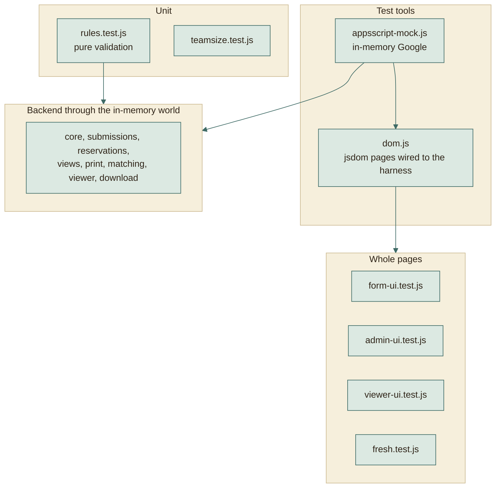
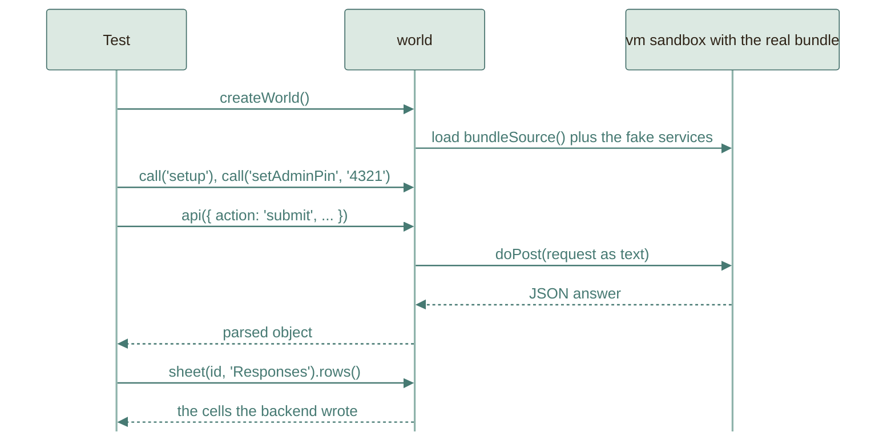

# Testing

345 automated tests run without a Google account, a browser, or a network.
They run the **real** backend and the **real** pages. This page explains how
that works and what it can and cannot prove.

```
npm test    # 345 tests
```

## The layers



Higher layers reuse lower ones: a page test types into the real page, the page
calls `fetch`, and `fetch` lands in the same in-memory backend the backend tests
use. A bug anywhere between the keyboard and the sheet is caught in one test.

## The in-memory Google

`tests/harness/appsscript-mock.js` implements just enough of Google's services
for the code to run unchanged:

| Fake | Behaves like |
|---|---|
| `SpreadsheetApp` | Spreadsheets, tabs, ranges, values, merges, backgrounds, borders |
| `DriveApp` | Files and folders with sharing access, configurable per test |
| `LockService`, `CacheService`, `PropertiesService` | Locks, expiring counters, stored properties |
| `MailApp` | Collects sent messages so tests can read them |
| `UrlFetchApp` | Configurable network answers, used for the PDF export |
| `Utilities`, `ContentService`, `ScriptApp` | Hashing, UUIDs, dates, JSON output, triggers |
| The clock | `w.setNow(...)`, so key expiry and form dates are tested without waiting |

The harness exposes `world.api(request)` (the same call a browser makes),
`world.call('functionName')` (run any backend function by name, such as
`setup` or `setAdminPin`), `world.sheet(id, tab)` (read cells back), and
`world.runTriggers()` (fire the triggers that are booked, as Google would when
their time comes; a test calls it before it reads a tinted view).
`createWorld({ seed })` makes ids, UUIDs and `Math.random` repeat from run to
run, so a test can compare everything a run stored with a saved copy.



## Page tests with jsdom

`tests/harness/dom.js` opens `index.html`, `admin.html`, or `viewer.html` in
jsdom, evaluates the real script tags in order, and replaces `fetch` with a
function that calls `world.api`. Helpers `type`, `pick`, `click`,
`clickText`, `submitForm`, and `settle` drive the page like a person would.

## What is covered

The numbers on this page are checked: `scripts/checks/check-docs.js` counts the
tests each file defines, in `tests/` and its sub-folders, and the git hook in
`.githooks/pre-commit` refuses a commit while the total above or a row below
says something else.

| Area | File | Tests | Examples |
|---|---|---:|---|
| Shared rules | `rules.test.js` | 20 | The two warnings about small teams (starting numbers, the level of a team, a wrong number or order), counting the people of a form with a code counted once, Arabic filtering, name parts, phones, codes, Drive links, folder names, slots and the room left in one, form state |
| Team size and audience | `teamsize.test.js` | 18 | Required question, range, exact member count, admin range, the warnings about small teams saved cleaned and refused when wrong, the sizes of the saved teams sent with the form, size notes, specialization limits, section limits |
| Core and forms | `core.test.js` | 14 | Setup, PIN lockout and unlocking it from the sheet menu, forms CRUD, duplicate, delete, templates |
| Submissions | `submissions.test.js` | 26 | Submit, edit keys, sealed keys, expiry, throttling, duplicates, Drive checks, folder names, limits, emails on and off and without a key, rows written as text past the rows a sheet starts with, team numbers that stay when a team cancels and that older rows keep |
| Reservations | `reservations.test.js` | 12 | Slots, capacity, one booking per leader, a key that moves a booking and changes nothing else, a booking on a removed slot still counted |
| Sheet views | `views.test.js` | 14 | Tinted blocks, leader star, merged task cell, bookings by day, one booked repaint for many changes that removes its trigger, a change during the repaint booking another, a failed repaint keeping its mark, the header, widths and row tints of every data tab with no value changed, a tab that refuses the look still repainted |
| Print | `print.test.js` | 8 | Print tabs, signature column, PDF success and fallback |
| Key booking | `keybooking.test.js` | 18 | Setting and its source form, team preview without contact details, copied answers, forged answers ignored, one booking per team, the same key cancels and moves the booking to another slot with nothing else changed, a booking that may be cancelled may move, expired keys still book, the student page with one key box, a booked team told its time and moving it in one step, a ticket that draws the time instead of the key, the admin switch, the next booking one week later, bookings listed under their form |
| Download all | `download.test.js` | 5 | Task files saved under their team number and linked from `Teams.xlsx`, Google Slides and Docs exported, a project folder with subfolders over several requests, files too big or of a kind that cannot be saved listed with the reason, zip parts and pieces that add up, only zips left in Drive, admin only, a download that expired; the deadline lock of task forms |
| Key expiry | `key-expiry.test.js` | 6 | Which keys are given and expired, extending the expired ones from today, all of them from their own end, one date for all, chosen teams only, bad requests change nothing, cancelled registrations left out |
| Member transfers | `transfers.test.js` | 14 | Refusal that lists who can be asked for, the request and the team saved without the member, approval by the leader and by the admin, rejection, cancelling, a full team, two requests for one student, a removed team, a team deleted by the admin, the switch and the list under Responses; a leader asked for and the team handed to the member named, by the leader and by the admin, an approval without a new leader or with a refused email, a leader alone in a team, the dashboard dialog that asks who leads next; the phone of the other leader on a waiting request and its two switches |
| Matching | `matching.test.js` | 6 | Paste, normalise, matched, none, duplicate, sequential review |
| Viewer API | `viewer.test.js` | 14 | Tokens, hidden columns, the level of a small team sent only to a link that shows the warnings, today and by day, review rights, revoked links, access keys with the lock after wrong tries, reading a lost key again, links that end on a date and open again when it moves |
| Student page | `form-ui.test.js` | 40 | Steps, filters, descriptions, team size picker and notes, the note for a number of teammates on a booking, remove and add a member with Undo, the summary a key opens, the ship over the current step, audience line, subject tag, slots, review, ticket and email notice, edit by key, themes, Arabic, asking for a member of another team, a leader who is asked for naming the new leader and passing the key on, a leader alone in a team not offered, the phone of the other leader with Copy and as a WhatsApp link, answering a request with Approve, Reject or Later, a task locked after its deadline, Close out of a registration opened with a key, the key read digit by digit |
| Admin page | `admin-ui.test.js` | 60 | The two warnings about small teams switched on in Setup with their numbers and a wrong order kept with its reason, small teams listed by level and marked on their card, login, a refused PIN kept in its field, a lock that leaves an open window signed in, create with term chips, team size and notes, descriptions, who can register, locked fields, team cards with their stored numbers, the people count, show key, teammates of a booking (how many, title, details asked), timetable calendar, hours, a day with its own hours and booked slots, delete, matching, clients with the link shown once and the key apart and whether the link shows small teams, a lost key shown again, a link end picked and moved, Extend keys for expired keys and chosen teams, one registration's key extended from its details, Download all with what was not downloaded and the saved zip, lists as chips or rows with the reason for a refused save, sections built from groups and counts, number runs with steppers, new lists picked for a question, column names on list rows for the phone layout, the day sheet group, form tabs that keep edits, section summaries, save bar only while there is a change, sections by one or by year group, a year group added from its own card with the counts set there, a section kind added by name or removed with its own button, added questions and pages, new form preview and title reason, the same header on every tab with a status saved at once, the forms list grouped by status, the count of teams outside a new size range, a new department letter kept as a chip |
| Instructor page | `viewer-ui.test.js` | 13 | Small teams listed by level and marked on their card, team numbers with a gap where a team cancelled, today, by day, hidden columns, review rights, invalid links, member values named for the phone layout, phone as a call link, the key screen and its theme switch |
| Registry writes | `registry-writes.test.js` | 6 | Every change to forms, lists and links written inside the lock, a save that keeps its row while another form is deleted, a save over a newer copy refused, a busy lock, a link that keeps a renamed form, list names that stay unique |
| Golden copies | `golden.test.js` | 5 | What the live system depends on, compared with saved copies in `tests/fixtures/golden/`: every function Apps Script calls by name, the salted hashes and seals for a fixed pepper, the error code of every action for five kinds of request, legacy flag cells read and written back, and every sheet, property, cache entry, mail and trigger after one scripted run. `GOLDEN_UPDATE=1` writes the copies again, only for a change meant to alter them |
| Check baseline | `scripts/checks/lib/baseline.test.js` | 2 | A legacy file keeps its count and never goes over it, a new file has no allowance, a lowered count must be written down and lowering never raises one |
| Check exceptions | `scripts/checks/lib/exceptions.test.js` | 1 | An exception removes the findings of its path and rule, needs a reason, and fails once it matches nothing |
| Biome check | `scripts/checks/biome.test.js` | 2 | A formatted, clean file has no findings; a layout problem and a lint rule become findings with their rule and line, and files outside the configured folders are left out |
| Line check | `scripts/checks/lines.test.js` | 2 | A line over the limit is found with its width and one at the limit passes, a hook file without an extension is checked, Arabic counts by character, a URL does not count, and other folders are left out |
| JSDoc check | `scripts/checks/jsdoc.test.js` | 3 | A full Google-style doc passes on a declaration, an arrow in a constant and an object property; a missing doc, a wrong or untyped `@param`, a missing or needless `@return`, `@returns` and `@author` are each found; callbacks, wrappers and handlers passed to a call need no doc |
| Number check | `scripts/checks/numbers.test.js` | 3 | A number held by a constant variable, property, member or object passes, so do 0, 1, -1 and an ignored line; an unnamed variable, property, nested property or default parameter is found; arguments, operands and array elements are left to Biome |
| Flag check | `scripts/checks/flags.test.js` | 2 | A field compared with `'1'` or `'0'` either way round, and a choice that writes them, are found; a menu choice in a variable, a digit test, zero padding, other labels and a boolean compare pass |
| Document check | `scripts/checks/docs.test.js` | 2 | API.md, TESTING.md (sub-folders counted) and Markdown links that match pass; a missing action, a wrong count and a broken link are each found |
| Harness | `harness.test.js` | 5 | The fake itself, and a seeded world that repeats its ids |
| Colour contrast | `contrast.test.js` | 4 | Every text and outline pair meets WCAG AA in light, dark, and device-dark themes |
| A page older than the site | `fresh.test.js` | 4 | An untouched page reloads once for a newer site and never in a loop, a page with typed text or an open dialog offers Reload instead, the bar in the language of the form, nothing in a preview or when the version cannot be read |
| Deployment | `deployment.test.js` | 16 | The built site carries its version and names every script and stylesheet by its content, a push without a backend change skips the Apps Script job and one that cannot be compared deploys, `API_URL` validation, URL and deployment ID agree, built pages use the variable URL, clasp configuration, missing credentials, first-deployment setup with a fake `gh` and clasp |

## What is not covered, and how to cover it

| Gap | Why | How to cover it |
|---|---|---|
| Real Drive sharing check | Needs real Drive files | First-run checklist in [DEPLOY.md](../operations/DEPLOY.md) |
| Real PDF export | Needs Google's export endpoint | Same checklist |
| Real email delivery and quotas | Needs real mail | Submit once with your own email |
| The booked repaint firing | Tests confirm a change books one run and fire it themselves, but cannot make Google fire it | Submit once, wait a minute, and look at the tinted tab |
| Row tints reaching a new row | The tests record the band that was asked for; whether Google stretches it over a row added below the last one is Google's | Register once and look at the last row of Responses. A band that fell short is laid again by the next repaint |
| Google's cross-site redirect behaviour | Needs a real web app | A real submission from the live site |
| Fonts and exact visuals | jsdom does not render | Look at the page, or use the screenshot scripts below |
| Excel rendering | Cell properties are asserted, not drawn | Open `Teams.xlsx` from a download in desktop Excel |

The first-run checklist exists because these gaps are real. Everything else is
exercised on every run.

## Looking at the pages in a real browser

jsdom does not draw anything, so `npm run dev` starts a local preview
(`scripts/dev-server.js`). It serves the real pages and routes their API calls
into the same in-memory Google the tests use, seeded with a team form, a
reservation form, a WhatsApp form, three teams, and a viewer link. The admin PIN
is `4321`. Nothing is saved: stopping the server forgets everything.

## Adding a test

1. Pick the lowest layer that can see the behaviour: a rule goes in
   `rules.test.js`, a backend behaviour in a backend test, a screen behaviour in
   a page test.
2. Start a world: `const w = createWorld(); w.call('setup'); w.call('setAdminPin', '4321');`
3. Make a form with the admin API, submit through `w.api(...)`, assert on the
   JSON answer and on `w.sheet(...)`.
4. For a page, `openPage('index.html', w, { query: '?f=slug' })`, then drive it
   with the helpers and `await settle()`.

A good test states one behaviour in its name, for example
`Team size: the chosen size decides exactly how many member forms are needed`.

## Why this design

- **Fast.** The suite finishes in a few seconds, so it can run on every change.
- **Honest.** It runs the exact text that is deployed, via the same `bundleSource()`
  the build uses.
- **Cheap to extend.** The fake is small, and tests read like user stories.
- **Safe.** No test touches a real account, so nothing can send a real email or
  modify real data.
