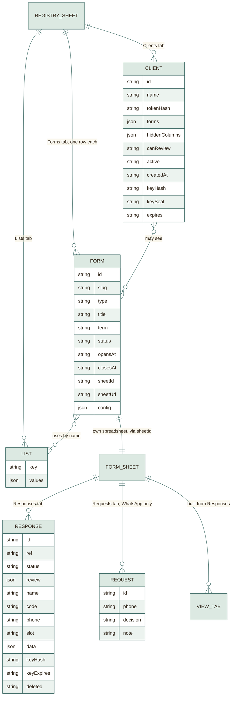

# Data model

Everything is stored in Google Sheets and Apps Script properties. This page
lists every sheet, column, and stored value, and how they relate.

## Overview



## The registry spreadsheet ("Forms Registry")

Created by you, then prepared by **First-time setup**. It is also the
spreadsheet the Apps Script is attached to, which is why the sheet menu exists.

### Forms tab (one row per form)

| Column | Meaning |
|---|---|
| `id` | Internal id, never changes |
| `slug` | The link name used in `?f=` |
| `type` | `team_registration`, `task_submission`, `reservation`, or `whatsapp_registration` |
| `title`, `term` | Heading and the small tag beside it. The dashboard writes the term as a season and a year, for example `Fall 2027` |
| `status` | `draft`, `open`, `closed`, `archived` |
| `opensAt`, `closesAt` | Optional ISO dates |
| `sheetId`, `sheetUrl` | The form's own spreadsheet |
| `config` | **Everything else about the form, as JSON** (see below) |
| `createdAt`, `updatedAt` | ISO timestamps |

The `config` cell is the reason new forms need no code:

| Key | Holds |
|---|---|
| `batchYear` | WhatsApp forms only: the academic year of the batch, such as `2027/2028`. These forms keep `term` empty |
| `subject` | Subject code shown beside the title, such as `CMPn323` (letters, digits, dashes, no spaces) |
| `lang` | Default language and whether students see the switch |
| `icon` | `team`, `calendar`, `task`, `chat`, or `none` |
| `fields` | The questions: id, type, role, labels and an optional description (`help`) in English and Arabic, required, enabled, list name, name parts. A question added by the admin has `custom: true`, an id that starts with `q_`, the type `text`, `textarea` or `select`, and for `select` its own `options` |
| `steps` | The pages of the form in order: id, `title` in English and Arabic, and the ids of its questions in order. The admin can add, rename and reorder pages |
| `rules` | `uniqueBy`, `uniqueAcrossForm`, `driveCheck`, `maxSubmissions`, `majors` (specializations allowed to register; empty means all), `sections` (sections offered and accepted; empty means all), `folderName { enabled, subject }` (Drive folder names must be `Team_Leader_Name_Project_Name_Subject_Name`; the subject name, for example `Software_Engineering`; empty accepts any subject name), **`teamSize { min, max, notice }`**. `notice` is optional: `{ sizes: [3, 4], text: { en, ar } }`, a note shown to students who pick one of those sizes; `{n}` and `{max}` are filled in |
| `editKey` | `enabled`, `days`, `allowEdit`, `allowDelete` |
| `slots` | Reservation days (id, label, date, times), `capacity`, and `pattern { start, end, length, gap }`: the session hours new days start with |
| `keyBooking` | Reservations only: `enabled` and `source` (the id of the registration form whose keys book this one) |
| `review` | Review steps and whether they are sequential |
| `matching` | WhatsApp matching switch |
| `notifications` | `confirmEmail`, `alertEmail` |
| `messages` | Custom text for closed, not-yet, and draft states |

### Lists tab

| Column | Meaning |
|---|---|
| `key` | List key: the built-in `levels`, `curricula`, `majors`, `sections`, `groups`, `wa_sections`, or the key of a list an admin made (from its name, such as `third_year`) |
| `values` | JSON array of `{ value, label: { en, ar } }` |

The row with the key `_info` is not a list. Its `values` is a JSON object with
the name and the kind of each list an admin made:
`{ "third_year": { "name": "Third year", "kind": "sections" } }`. The kinds are
`sections`, `numbers`, `named` and `plain`; a built-in list has its kind by key.

A form's dropdown stores only the list **key** (`field.list`), and the admin
picks it in the Questions tab. The options are filled in when the form is read,
so editing a list updates every form that uses it. `rules.sections` limits
whichever list of the kind `sections` a question reads.

### Clients tab (instructor and client links)

| Column | Meaning |
|---|---|
| `id`, `name` | Internal id and the admin's label |
| `tokenHash` | `sha256(pepper + ':client:' + token)`. The token itself is never stored. |
| `forms` | JSON array of form ids, or `["*"]` for all forms. A row saved before ids were stored holds link names; it is read as ids and rewritten as ids on its next save, and before any form's link name changes. |
| `hiddenColumns` | JSON array, for example `["phone","email"]` |
| `canReview` | `1` if the link may mark review steps |
| `active` | `0` when the link is turned off |
| `createdAt` | ISO timestamp |
| `keyHash` | `sha256(pepper + ':clientkey:' + id + ':' + key)` for the six-digit access key, or empty when the link asks for none |
| `keySeal` | The access key sealed for the admin: `S` plus six digits, each shifted by a pad from `sha256(pepper + ':clientseal:' + id)`. Empty for a link without a key, and for keys made before this column existed. |
| `expires` | ISO time the link stops working, or empty for no end |

`keyHash`, `keySeal` and `expires` were added after the first release. A Clients
tab without them gets the headers the next time a link is saved; until then the
empty cells mean no key and no end.

## A form's own spreadsheet

Created automatically in the **Forms Platform** Drive folder when a form is
created. Deleting the form from the dashboard moves this spreadsheet to the Drive
trash, where it can be restored for 30 days; the registry row is removed. Named like `Database Team Project Registration Form - Fall 2027`.

### Responses tab (the raw data; do not edit by hand)

| Column | Meaning |
|---|---|
| `id` | Internal id |
| `ref` | Reference shown to the student, such as `TR-2027-0001`. Prefix by type: `TR`, `TK`, `RS`, `WA`. Numbered by row count, so a reference is never reused. |
| `created`, `updated` | ISO timestamps |
| `status` | `new`, `in_review`, `approved`, `rejected`, `done` |
| `review` | JSON: each review step to `pending`, `approved`, or `rejected` |
| `email`, `name`, `code`, `phone`, `title`, `link` | Copies of the answers found by **role**, so the sheet is readable and filterable |
| `slot` | `day-id|time` for reservations |
| `members` | Readable text: `name (code); name (code)` for team forms |
| `data` | **The full validated answers as JSON**: the source of truth |
| `keyHash` | `sha256(pepper + ':key:' + form id + ':' + key)`. Empty after deletion. |
| `keyExpires` | ISO expiry of the key |
| `deleted` | `1` for a cancelled registration; the row stays |
| `keySeal` | The key sealed for the admin: `S` plus five digits, each shifted by a pad from `sha256(pepper + ':seal:' + form id + ':' + row id)`. Empty after deletion, and on rows saved before this column existed (the header is added on the next save). |
| `number` | Team and task forms only: the team's number, given once when it registers and kept after it is cancelled, so the teams after it do not move up. Rows saved before this column existed get the numbers they showed, in the order they registered, the first time a team is added or cancelled. Empty for bookings and WhatsApp registrations. |

The readable columns are derived from `data` every time a row is saved
(`applyDerived_`). If they ever disagree, `data` wins.

Every row is written as **plain text**: a tab is made with plain-text cells, and
each new row sets the format again (`appendPlain_`), because a row past the ones
the sheet started with has none. That keeps phone numbers such as `01012345678`
and codes from losing their leading zeros or turning into numbers. The Transfers
and Requests tabs and the registry tabs are written the same way.

### Transfers tab (made with the first request)

One row for each member that a team asked for from another team of the same
form (`rules.transfers`). A form that never has a request has no such tab.

| Column | Meaning |
|---|---|
| `id` | Unique id of the request |
| `created`, `updated` | ISO timestamps |
| `status` | `pending`, `approved`, `rejected`, `cancelled` (by the team that asked) or `closed` (the student moved elsewhere, or one of the two teams was cancelled by its leader or deleted by the admin) |
| `code` | Code of the student |
| `member` | The member as the asking team typed it (JSON); this is what joins the team on approval |
| `fromId`, `fromRef` | The team that holds the student |
| `toId`, `toRef` | The team that asked |
| `decidedBy` | `leader` or `admin` |

### Requests tab (WhatsApp forms only)

| Column | Meaning |
|---|---|
| `id` | Internal id |
| `raw` | The original pasted line |
| `phone` | Normalised phone found in it |
| `label` | The rest of the line, usually the name |
| `added` | ISO timestamp |
| `decision` | `pending`, `approved`, `rejected` |
| `note` | Reviewer's note |

### View tabs (generated; safe to delete, they are rebuilt)

| Tab | For | Layout |
|---|---|---|
| `Team Members List` | Team and task forms | One block per team: heavy border, alternating tint family, member name, section, code, star on the leader, one merged project or task cell with its link |
| `Bookings` | Reservations | One block per day in timetable order |
| `Registrations` | WhatsApp forms | Sorted by group and section with review status and a timetable link |
| `Print - ...` | Printing | A tab per printed day or the team list, with a signature column where relevant |

## Script properties (private settings)

Stored by Apps Script itself, not in any sheet:

| Property | Holds |
|---|---|
| `PEPPER` | A long random value created once. It salts every stored hash. |
| `ADMIN_PIN_HASH` | `sha256(pepper + ':admin:' + pin)` |
| `REGISTRY_ID` | The registry spreadsheet's id |
| `ROOT_FOLDER_ID` | The `Forms Platform` Drive folder |
| `SITE_URL` | Your website address, used in emails |
| `dirty:<form id>` | The time of the last change whose sheet views are not repainted yet. The booked run of `processDirtyViews` clears it |

## Short-lived counters (CacheService)

| Key | Purpose | Limit |
|---|---|---|
| `admin_fails` | Wrong admin PINs | 8 then locked 10 minutes |
| `badkey:<form id>` | Wrong edit keys on a form | 10 per minute |
| `bad_tokens` | Wrong viewer tokens | 30 per minute |
| `client_key:<client id>` | Wrong access keys on one private link | 5 then locked 10 minutes |
| `views_booked` | A note that a repaint of the sheet views is booked, so a change does not look at the triggers again | 5 minutes |
| `dl_job:<folder id>` | A Download all in progress: its form, its work folder, what could not be saved, its zip parts | 6 hours |

Download all works in the owner's Drive, in `Forms Platform / Exports / Downloads`,
one folder per download named after the form. Starting a new download of the
same form moves the older folder to the trash; only the zips stay in a folder.

Counters live in the cache and expire on their own, so they cost no sheet
writes and cannot be reset from the browser.

## Browser storage

| Where | Key | Holds | Lasts |
|---|---|---|---|
| `sessionStorage` | `fp_draft_<slug>` | The student's unsent answers | Until the tab closes |
| `sessionStorage` | `fp_admin_pin` | The admin PIN for this tab | Until the tab closes |
| `localStorage` | `fp_theme` | Light, dark, or follow the device | Until cleared |
| `localStorage` | `fp_lang` | English or Arabic | Until cleared |

## How a registration is shaped

Example for a team of three (`team_size` is the total, including the leader):

```json
{
  "email": "sara@example.com",
  "leader_name": "أحمد محمد محمود أحمد",
  "leader_code": "4230999",
  "phone": "01012345678",
  "major": "حاسبات",
  "level": "صفر / الأولى",
  "section": "4C-TH1",
  "curriculum": "2020",
  "team_size": "3",
  "members": [
    { "name": "سارة خالد حسن علي", "phone": "01112345678", "code": "4230998", "level": "صفر / الأولى", "curriculum": "2020", "section": "4C-TH1" },
    { "name": "منى أشرف كمال فؤاد", "phone": "01212345678", "code": "4230997", "level": "صفر / الأولى", "curriculum": "2020", "section": "4C-TH1" }
  ],
  "title": "Library System"
}
```

The rule `members.length == team_size - 1` is enforced by `Rules.validateSubmission`
in the browser, on the server for students, and on the server for admin edits.
