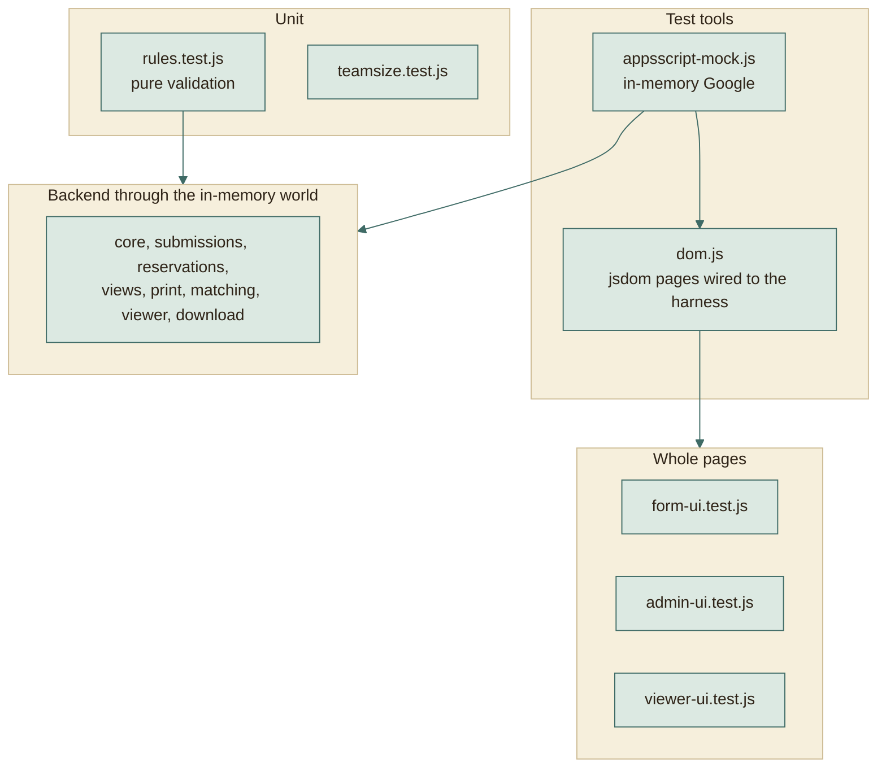
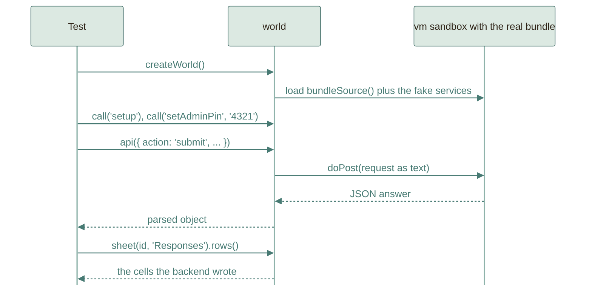

# Testing

265 automated tests run without a Google account, a browser, or a network.
They run the **real** backend and the **real** pages. This page explains how
that works and what it can and cannot prove.

```
npm test    # 265 tests
```

## The layers



Higher layers reuse lower ones: a page test types into the real page, the page
calls `fetch`, and `fetch` lands in the same in-memory backend the backend tests
use. A bug anywhere between the keyboard and the sheet is caught in one test.

## The in-memory Google

`tests/harness/appsscript-mock.js` implements just enough of Google's services
for the code to run unchanged:

| Fake | Behaves like |
|---|---|
| `SpreadsheetApp` | Spreadsheets, tabs, ranges, values, merges, backgrounds, borders |
| `DriveApp` | Files and folders with sharing access, configurable per test |
| `LockService`, `CacheService`, `PropertiesService` | Locks, expiring counters, stored properties |
| `MailApp` | Collects sent messages so tests can read them |
| `UrlFetchApp` | Configurable network answers, used for the PDF export |
| `Utilities`, `ContentService`, `ScriptApp` | Hashing, UUIDs, dates, JSON output, triggers |
| The clock | `w.setNow(...)`, so key expiry and form dates are tested without waiting |

The harness exposes `world.api(request)` (the same call a browser makes),
`world.call('functionName')` (run any backend function by name, such as
`setup` or `setAdminPin`), and `world.sheet(id, tab)` (read cells back).



## Page tests with jsdom

`tests/harness/dom.js` opens `index.html`, `admin.html`, or `viewer.html` in
jsdom, evaluates the real script tags in order, and replaces `fetch` with a
function that calls `world.api`. Helpers `type`, `pick`, `click`,
`clickText`, `submitForm`, and `settle` drive the page like a person would.

## What is covered

| Area | Tests | Examples |
|---|---:|---|
| Shared rules | 16 | Arabic filtering, name parts, phones, codes, Drive links, folder names, slots, form state |
| Team size and audience | 17 | Required question, range, exact member count, admin range, conflicts warning, size notes, specialization limits, section limits |
| Core and forms | 13 | Setup, PIN lockout, forms CRUD, duplicate, delete, templates |
| Submissions | 21 | Submit, edit keys, sealed keys, expiry, throttling, duplicates, Drive checks, folder names, limits, emails on and off |
| Reservations | 11 | Slots, capacity, one booking per leader, orphan warning |
| Sheet views | 9 | Tinted blocks, leader star, merged task cell, bookings by day |
| Print | 8 | Print tabs, signature column, PDF success and fallback |
| Key booking | 15 | Setting and its source form, team preview without contact details, copied answers, forged answers ignored, one booking per team, the same key cancels, expired keys still book, the student page and the admin switch, the next booking one week later, bookings listed under their form |
| Download all | 5 | Task files saved under their team number and linked from `Teams.xlsx`, Google Slides and Docs exported, a project folder with subfolders over several requests, files too big or of a kind that cannot be saved listed with the reason, zip parts and pieces that add up, only zips left in Drive, admin only, a download that expired; the deadline lock of task forms |
| Key expiry | 6 | Which keys are given and expired, extending the expired ones from today, all of them from their own end, one date for all, chosen teams only, bad requests change nothing, cancelled registrations left out |
| Member transfers | 8 | Refusal that lists who can be asked for, the request and the team saved without the member, approval by the leader and by the admin, rejection, cancelling, a full team, a leader, two requests for one student, a removed team, the switch and the list under Responses |
| Matching | 6 | Paste, normalise, matched, none, duplicate, sequential review |
| Viewer API | 13 | Tokens, hidden columns, today and by day, review rights, revoked links, access keys with the lock after wrong tries, reading a lost key again, links that end on a date and open again when it moves |
| Student page | 35 | Steps, filters, descriptions, team size picker and notes, remove and add a member with Undo, the summary a key opens, the ship over the current step, audience line, subject tag, slots, review, ticket and email notice, edit by key, themes, Arabic, asking for a member of another team, answering a request with Approve, Reject or Later, a task locked after its deadline |
| Admin page | 50 | Login, create with term chips, team size and notes, descriptions, who can register, locked fields, team cards, show key, teammates of a booking (how many, title, details asked), timetable calendar, hours, a day with its own hours and booked slots, delete, matching, clients with the link shown once and the key apart, a lost key shown again, a link end picked and moved, Extend keys for expired keys and chosen teams, one registration's key extended from its details, Download all with what was not downloaded and the saved zip, lists as chips or rows with the reason for a refused save, sections built from groups and counts, number runs with steppers, new lists picked for a question, column names on list rows for the phone layout, the day sheet group, form tabs that keep edits, section summaries, save bar only while there is a change, sections by one or by year group, added questions and pages, new form preview and title reason |
| Instructor page | 10 | Today, by day, hidden columns, review rights, invalid links, member values named for the phone layout, phone as a call link |
| Harness | 4 | The fake itself |
| Colour contrast | 4 | Every text and outline pair meets WCAG AA in light, dark, and device-dark themes |
| Deployment | 14 | `API_URL` validation, URL and deployment ID agree, built pages use the variable URL, clasp configuration, missing credentials, first-deployment setup with a fake `gh` and clasp |

## What is not covered, and how to cover it

| Gap | Why | How to cover it |
|---|---|---|
| Real Drive sharing check | Needs real Drive files | First-run checklist in [DEPLOY.md](../DEPLOY.md) |
| Real PDF export | Needs Google's export endpoint | Same checklist |
| Real email delivery and quotas | Needs real mail | Submit once with your own email |
| The 5-minute timer firing | Tests confirm setup installs the trigger once and call `processDirtyViews` directly, but cannot make Google fire it | Check **Triggers** in Apps Script after setup |
| Google's cross-site redirect behaviour | Needs a real web app | A real submission from the live site |
| Fonts and exact visuals | jsdom does not render | Look at the page, or use the screenshot scripts below |
| Excel rendering | Cell properties are asserted, not drawn | Open `Teams.xlsx` from a download in desktop Excel |

The first-run checklist exists because these gaps are real. Everything else is
exercised on every run.

## Looking at the pages in a real browser

jsdom does not draw anything, so `npm run dev` starts a local preview
(`scripts/dev-server.js`). It serves the real pages and routes their API calls
into the same in-memory Google the tests use, seeded with a team form, a
reservation form, a WhatsApp form, three teams, and a viewer link. The admin PIN
is `4321`. Nothing is saved: stopping the server forgets everything.

## Adding a test

1. Pick the lowest layer that can see the behaviour: a rule goes in
   `rules.test.js`, a backend behaviour in a backend test, a screen behaviour in
   a page test.
2. Start a world: `const w = createWorld(); w.call('setup'); w.call('setAdminPin', '4321');`
3. Make a form with the admin API, submit through `w.api(...)`, assert on the
   JSON answer and on `w.sheet(...)`.
4. For a page, `openPage('index.html', w, { query: '?f=slug' })`, then drive it
   with the helpers and `await settle()`.

A good test states one behaviour in its name, for example
`Team size: the chosen size decides exactly how many member forms are needed`.

## Why this design

- **Fast.** The suite finishes in a few seconds, so it can run on every change.
- **Honest.** It runs the exact text that is deployed, via the same `bundleSource()`
  the build uses.
- **Cheap to extend.** The fake is small, and tests read like user stories.
- **Safe.** No test touches a real account, so nothing can send a real email or
  modify real data.
